# `@git-stunts/git-warp` v21.0.0 Roadmap and Execution DAG

## 1. Executive Summary (ASD-STE100)

This roadmap defines the remaining engineering tasks required to ship `@git-stunts/git-warp` `v21.0.0` (substrate version `21`).

### Why `v21.0.0` Exists

In `v20.0.0` and earlier versions, `@git-stunts/git-warp` answered graph queries and resumed checkpoints through whole-state materialization (`_materializeGraph`, `WarpFullStateV5`, and legacy `Runtime` / `Lane` surfaces). Whole-state materialization scales with total repository history and total node count instead of the causal cone of the entities that a caller reads or writes.

`v21.0.0` replaces whole-state materialization with a cone-bounded runtime and an observer-bound public API:

1. **Public Entry and Cone Writes (`#1048`, `#1051` — Merged on `main`):** Callers open a repository with `Warp.open({ storage, crypto, codecs, access })` and execute writes with `warp.as(writer).execute(intent)`. The private cone engine (`#1062`) and observation custody service (`#1066`, `#1067`) fold per-entity causal cones without loading the full graph.
2. **Observer-Bound Optic Reads (`#1052`):** Callers bind an observer with `warp.forObserver(observer)` and evaluate bounded read projections (`nodeExists`, `nodeProperty`, `edgeProperty`, `edgesAround`, `traverse`, `content`, and paged entity inventory) through `Optic(observedView).read(purpose, budget)`.
3. **Receipt-Derived Coordinates and Strands (`#1053`):** Write and read receipts expose an opaque `Coordinate`. Callers use `Optic(view).replay(coord)` to verify historical receipts without re-execution, `Optic(view).at(coord)` to ask new questions at a retained basis, and strand forks (`#968`–`#970`) to stage and settle speculative overlays.
4. **Write-Path Hardening and Custody Scaling (`#1072`–`#1080`, `#1041`):** The write and custody layers eliminate loose-object amplification (`#1080`), recover interrupted write attempts after a process crash (`#1074`), bound publication probes (`#1075`), enforce unforgeable receipts (`#1076`), and prove multi-process durability (`#1077`).
5. **Retained Readings and Streaming Indexed WARP (`#1044`, `#824`, `#905`, `#917`):** Retained readings (`#1044`) replace the 29,409-line whole-state checkpoint subsystem with Merkle directory pages, support memos, wormholes, and compaction. Retained graph manifests (`#815`), Roaring bitmap selection planes (`#816`), streaming causal reduction (`#817`), recursive graph references (`#819`–`#821`), and bounded bulk ingestion (`#917`) remove all remaining `_materializeGraph` and full-state codec dependencies (`#248`, `#814`).
6. **Direct Breaking Cutover (`#1055`, `#1057`, `#1054`):** Once the newcomer path (`#1055`) and CLI `doctor`/`repair` commands (`#1057`) run exclusively on `Warp` and `Optic`, `#1054` and `#814` delete legacy `Runtime`, `Lane`, `captureCoordinate`, and `WarpFullState` contracts and empty `policy/public-surface-ratchet.txt` to zero.

---

## 2. DAG Structural Health Metrics & Already Merged Foundations

### Compiled DAG Metrics (`issue_dag_snapshot.py --from-tasks-dir`)

- **Acyclicity & House-Format Validation:** `ok = true` across all `35` task documents (`0` cycles, `0` transitive-redundant edges).
- **Reduced Open Edges & Density:** `42` hard structural edges across `35` open nodes (`edge_density = 0.0706`, within target `[0.01, 0.50]` band).
- **Maximum Parallel Width:** `16` concurrent tasks (`Wave 0` Open Frontier).
- **Critical Path (`7` hops):** `PR #1082` -> `#1052-3b` -> `#1053` -> `#1055` -> `#1054` -> `#814` -> `#823`

### Already Merged Foundations on `main`

- [x] **[#1049](https://github.com/git-stunts/git-warp/issues/1049)** (PR [#1059](https://github.com/git-stunts/git-warp/pull/1059)): Accepted Optic-Only Public API Design Record (`docs/plans/optic-only-public-api.md`).
- [x] **[#1050](https://github.com/git-stunts/git-warp/issues/1050)** (PR [#1060](https://github.com/git-stunts/git-warp/pull/1060)): Public Surface Guard with Opaque `Coordinate` Exception (`policy/public-surface-ratchet.txt`).
- [x] **[#1062](https://github.com/git-stunts/git-warp/issues/1062)** (PR [#1064](https://github.com/git-stunts/git-warp/pull/1064)): Private Cone Engine Foundation (`src/domain/services/cone/*`, `GitConeRecordStoreAdapter`, `GitConeRecordTrie`, `GitFastImportTreeWriter`).
- [x] **[#1066](https://github.com/git-stunts/git-warp/issues/1066) & [#1067](https://github.com/git-stunts/git-warp/issues/1067)** (PRs [#1068](https://github.com/git-stunts/git-warp/pull/1068), [#1069](https://github.com/git-stunts/git-warp/pull/1069), [#1083](https://github.com/git-stunts/git-warp/pull/1083)): Shared Durable Observation Identity, Opaque `Coordinate` Codec, and `ObservationCustodyService` on `git-cas 7.2.0`.
- [x] **[#1051](https://github.com/git-stunts/git-warp/issues/1051)** (PR [#1071](https://github.com/git-stunts/git-warp/pull/1071)): `Warp.open`, Injected `WarpAccessPort`, and `warp.as(writer).execute(intent)` Cone Writes.

---

## 3. Ranked Open Frontier (`Wave 0` — Zero Incomplete Parent Tasks)

Every task in the table below has **zero incomplete parent tasks** (all prerequisites are already merged on `main`). Tasks are ranked deterministically by `PriorityScore = 1000*InFlight + 100*TransitiveUnblocks + 10*CriticalPathDepth + DirectOutDegree`. Resource locks (`git-locks`) are modeled adjacent to the precedence graph.

| Rank | Score | Task & Issue | Task Plan Document | Workstream | Transitive Unblocks | Crit-Path Depth | Canonical `git-locks` | Directly Unlocks |
| --- | --- | --- | --- | --- | --- | --- | --- | --- |
| 1 | `2072` | **[PR #1082](docs/plans/v21.0.0/tasks/1052a-optic-node-property-reads.md)** ([#1052](https://github.com/git-stunts/git-warp/issues/1052)) | [Observer-bound Optic reads Slice 3a: core nodes and properties](docs/plans/v21.0.0/tasks/1052a-optic-node-property-reads.md) | `W1` | `10` | `7` | `host/heavy-work` | `#1052-3b`, `#1073` |
| 2 | `1072` | **[#1078](docs/plans/v21.0.0/tasks/1078-warp-open-pre-access-and-write-ref-guard.md)** ([#1078](https://github.com/git-stunts/git-warp/issues/1078)) | [Settle Warp.open pre-access behavior and guard clone-local write-attempts refs](docs/plans/v21.0.0/tasks/1078-warp-open-pre-access-and-write-ref-guard.md) | `W2` | `10` | `7` | `host/heavy-work` | `#1052-3b`, `#1077` |
| 3 | `1072` | **[#1080](docs/plans/v21.0.0/tasks/1080-retained-observation-loose-object-cost.md)** ([#1080](https://github.com/git-stunts/git-warp/issues/1080)) | [Attribute and cut loose-object cost per retained observation and settle read retention](docs/plans/v21.0.0/tasks/1080-retained-observation-loose-object-cost.md) | `W2` | `10` | `7` | `repo/docs-and-policy` | `#1052-3b`, `#1077` |
| 4 | `1062` | **[#815](docs/plans/v21.0.0/tasks/815-retained-graph-manifests-and-address-pages.md)** ([#815](https://github.com/git-stunts/git-warp/issues/815)) | [Define retained graph manifests and bounded ordinal address pages](docs/plans/v21.0.0/tasks/815-retained-graph-manifests-and-address-pages.md) | `W3` | `10` | `6` | `host/heavy-work` | `#816`, `#819` |
| 5 | `971` | **[#1079](docs/plans/v21.0.0/tasks/1079-payload-headroom-and-contract-reconciliation.md)** ([#1079](https://github.com/git-stunts/git-warp/issues/1079)) | [Reconcile unpacked payload headroom, pre-permission I/O failures, and v20 trailer compatibility](docs/plans/v21.0.0/tasks/1079-payload-headroom-and-contract-reconciliation.md) | `W5` | `9` | `7` | `repo/docs-and-policy` | `#1052-3b` |
| 6 | `962` | **[#192](docs/plans/v21.0.0/tasks/192-incremental-index-updater-typed-boundary.md)** ([#192](https://github.com/git-stunts/git-warp/issues/192)) | [Replace Record<string, unknown> and WarpStateLike in IncrementalIndexUpdater](docs/plans/v21.0.0/tasks/192-incremental-index-updater-typed-boundary.md) | `W3` | `9` | `6` | `host/heavy-work` | `#228`, `#816` |
| 7 | `561` | **[#1072](docs/plans/v21.0.0/tasks/1072-retain-write-races-in-receipt-core.md)** ([#1072](https://github.com/git-stunts/git-warp/issues/1072)) | [Retain concurrent write races in WriteAttemptRecord and writeReceiptCore](docs/plans/v21.0.0/tasks/1072-retain-write-races-in-receipt-core.md) | `W2` | `5` | `6` | `host/heavy-work` | `#1053` |
| 8 | `451` | **[#1041](docs/plans/v21.0.0/tasks/1041-bound-repository-pack-count.md)** ([#1041](https://github.com/git-stunts/git-warp/issues/1041)) | [Bound Git pack count for WARP repositories so save cost stays flat at 20k threads](docs/plans/v21.0.0/tasks/1041-bound-repository-pack-count.md) | `W2` | `4` | `5` | `host/heavy-work` | `#1055` |
| 9 | `341` | **[#1044-S1](docs/plans/v21.0.0/tasks/1044a-retained-readings-design-and-record-digests.md)** ([#1044](https://github.com/git-stunts/git-warp/issues/1044)) | [Retained readings Slice 1: canonical record digests, Merkle directory pages, and join laws](docs/plans/v21.0.0/tasks/1044a-retained-readings-design-and-record-digests.md) | `W3` | `3` | `4` | `host/heavy-work` | `#1044-S2..S6` |
| 10 | `341` | **[#1076](docs/plans/v21.0.0/tasks/1076-typed-write-causes-and-unforgeable-receipts.md)** ([#1076](https://github.com/git-stunts/git-warp/issues/1076)) | [Replace string write causes with typed nouns and make write receipts unforgeable](docs/plans/v21.0.0/tasks/1076-typed-write-causes-and-unforgeable-receipts.md) | `W2` | `3` | `4` | `host/heavy-work` | `#1054` |
| 11 | `341` | **[#811](docs/plans/v21.0.0/tasks/811-canonical-migration-guidance-contract.md)** ([#811](https://github.com/git-stunts/git-warp/issues/811)) | [Generate migration CLI help and documentation from one canonical contract](docs/plans/v21.0.0/tasks/811-canonical-migration-guidance-contract.md) | `W3` | `3` | `4` | `host/heavy-work` | `#822` |
| 12 | `231` | **[#1074](docs/plans/v21.0.0/tasks/1074-recover-write-attempts-after-crash.md)** ([#1074](https://github.com/git-stunts/git-warp/issues/1074)) | [Recover unresolved write attempts after a process crash and allow re-asking](docs/plans/v21.0.0/tasks/1074-recover-write-attempts-after-crash.md) | `W2` | `2` | `3` | `host/heavy-work` | `#1077` |
| 13 | `231` | **[#1075](docs/plans/v21.0.0/tasks/1075-bound-publication-probe-and-writer-limit.md)** ([#1075](https://github.com/git-stunts/git-warp/issues/1075)) | [Bound WritePublicationProbe ancestry walk and settle the 4,096 writer limit](docs/plans/v21.0.0/tasks/1075-bound-publication-probe-and-writer-limit.md) | `W2` | `2` | `3` | `host/heavy-work` | `#1077` |
| 14 | `121` | **[#1032](docs/plans/v21.0.0/tasks/1032-re-review-expired-accepted-security-risks.md)** ([#1032](https://github.com/git-stunts/git-warp/issues/1032)) | [Re-review the four expired accepted security risks in .github/SECURITY.md](docs/plans/v21.0.0/tasks/1032-re-review-expired-accepted-security-risks.md) | `W5` | `1` | `2` | `repo/docs-and-policy` | `#823` |
| 15 | `10` | **[#1070](docs/plans/v21.0.0/tasks/1070-stable-unit-runner-benchmark-filter.md)** ([#1070](https://github.com/git-stunts/git-warp/issues/1070)) | [Prevent stable unit runner from selecting benchmark files that Vitest ignores](docs/plans/v21.0.0/tasks/1070-stable-unit-runner-benchmark-filter.md) | `W5` | `0` | `1` | `repo/scripts-and-ci` | none |
| 16 | `10` | **[#1081](docs/plans/v21.0.0/tasks/1081-public-surface-package-dist-race.md)** ([#1081](https://github.com/git-stunts/git-warp/issues/1081)) | [Fix public-surface-package test losing dist/ during group script runs](docs/plans/v21.0.0/tasks/1081-public-surface-package-dist-race.md) | `W5` | `0` | `1` | `repo/scripts-and-ci` | none |

### Conflict-Free Concurrent `git-locks` Dispatch Batch

The following top-ranked Open Frontier tasks have mutually disjoint `git-locks` resource keys and can execute **simultaneously** across separate agents/worktrees without lock contention:

| Slot | Task | Task Plan Document | Workstream | Priority Score | Canonical `git-locks` Keys |
| --- | --- | --- | --- | --- | --- |
| 1 | **[PR #1082](docs/plans/v21.0.0/tasks/1052a-optic-node-property-reads.md)** | [Observer-bound Optic reads Slice 3a: core nodes and properties](docs/plans/v21.0.0/tasks/1052a-optic-node-property-reads.md) | `W1` | `2072` | `host/heavy-work` |
| 2 | **[#1080](docs/plans/v21.0.0/tasks/1080-retained-observation-loose-object-cost.md)** | [Attribute and cut loose-object cost per retained observation and settle read retention](docs/plans/v21.0.0/tasks/1080-retained-observation-loose-object-cost.md) | `W2` | `1072` | `repo/docs-and-policy` |
| 3 | **[#1070](docs/plans/v21.0.0/tasks/1070-stable-unit-runner-benchmark-filter.md)** | [Prevent stable unit runner from selecting benchmark files that Vitest ignores](docs/plans/v21.0.0/tasks/1070-stable-unit-runner-benchmark-filter.md) | `W5` | `10` | `repo/scripts-and-ci` |

---

## 4. Sequenced Task Checklist by Topological Wave (`Waves 0–6`)

Each checklist item below links directly to its house-format task specification in `docs/plans/v21.0.0/tasks/*.md`. Each specification contains YAML frontmatter, a self-contained LLM Execution Prompt, and the nine-section ASD-STE100 house template.

### Wave 0 — Open Frontier (Zero Incomplete Parent Tasks)

- [ ] **[PR #1082: Observer-bound Optic reads Slice 3a: core nodes and properties](docs/plans/v21.0.0/tasks/1052a-optic-node-property-reads.md)** ([#1052](https://github.com/git-stunts/git-warp/issues/1052) | `Feature` | `W1` | Prereqs: `#1049 (merged)`, `#1050 (merged)`, `#1062 (merged)`, `#1067 (merged)`, `#1051 (merged)` | Unlocks: `#1052-3b`, `#1073`)
- [ ] **[#1081: Fix public-surface-package test losing dist/ during group script runs](docs/plans/v21.0.0/tasks/1081-public-surface-package-dist-race.md)** ([#1081](https://github.com/git-stunts/git-warp/issues/1081) | `Bug` | `W5` | Prereqs: `#1050 (merged)` | Unlocks: none)
- [ ] **[#1070: Prevent stable unit runner from selecting benchmark files that Vitest ignores](docs/plans/v21.0.0/tasks/1070-stable-unit-runner-benchmark-filter.md)** ([#1070](https://github.com/git-stunts/git-warp/issues/1070) | `Bug` | `W5` | Prereqs: `#1063 (merged)` | Unlocks: none)
- [ ] **[#1080: Attribute and cut loose-object cost per retained observation and settle read retention](docs/plans/v21.0.0/tasks/1080-retained-observation-loose-object-cost.md)** ([#1080](https://github.com/git-stunts/git-warp/issues/1080) | `Decision` | `W2` | Prereqs: `#1051 (merged)`, `#1067 (merged)`, `PR #1083 (merged)` | Unlocks: `#1052-3b`, `#1077`)
- [ ] **[#1078: Settle Warp.open pre-access behavior and guard clone-local write-attempts refs](docs/plans/v21.0.0/tasks/1078-warp-open-pre-access-and-write-ref-guard.md)** ([#1078](https://github.com/git-stunts/git-warp/issues/1078) | `Bug` | `W2` | Prereqs: `#1051 (merged)` | Unlocks: `#1052-3b`, `#1077`)
- [ ] **[#1079: Reconcile unpacked payload headroom, pre-permission I/O failures, and v20 trailer compatibility](docs/plans/v21.0.0/tasks/1079-payload-headroom-and-contract-reconciliation.md)** ([#1079](https://github.com/git-stunts/git-warp/issues/1079) | `Decision` | `W5` | Prereqs: `#1051 (merged)` | Unlocks: `#1052-3b`)
- [ ] **[#1072: Retain concurrent write races in WriteAttemptRecord and writeReceiptCore](docs/plans/v21.0.0/tasks/1072-retain-write-races-in-receipt-core.md)** ([#1072](https://github.com/git-stunts/git-warp/issues/1072) | `Feature` | `W2` | Prereqs: `#1051 (merged)`, `#1067 (merged)` | Unlocks: `#1053`)
- [ ] **[#1074: Recover unresolved write attempts after a process crash and allow re-asking](docs/plans/v21.0.0/tasks/1074-recover-write-attempts-after-crash.md)** ([#1074](https://github.com/git-stunts/git-warp/issues/1074) | `Feature` | `W2` | Prereqs: `#1051 (merged)`, `#1067 (merged)` | Unlocks: `#1077`)
- [ ] **[#1075: Bound WritePublicationProbe ancestry walk and settle the 4,096 writer limit](docs/plans/v21.0.0/tasks/1075-bound-publication-probe-and-writer-limit.md)** ([#1075](https://github.com/git-stunts/git-warp/issues/1075) | `Bug` | `W2` | Prereqs: `#1051 (merged)` | Unlocks: `#1077`)
- [ ] **[#1076: Replace string write causes with typed nouns and make write receipts unforgeable](docs/plans/v21.0.0/tasks/1076-typed-write-causes-and-unforgeable-receipts.md)** ([#1076](https://github.com/git-stunts/git-warp/issues/1076) | `Feature` | `W2` | Prereqs: `#1051 (merged)` | Unlocks: `#1054`)
- [ ] **[#1041: Bound Git pack count for WARP repositories so save cost stays flat at 20k threads](docs/plans/v21.0.0/tasks/1041-bound-repository-pack-count.md)** ([#1041](https://github.com/git-stunts/git-warp/issues/1041) | `Feature` | `W2` | Prereqs: `#1062 (merged)` | Unlocks: `#1055`)
- [ ] **[#1032: Re-review the four expired accepted security risks in .github/SECURITY.md](docs/plans/v21.0.0/tasks/1032-re-review-expired-accepted-security-risks.md)** ([#1032](https://github.com/git-stunts/git-warp/issues/1032) | `Decision` | `W5` | Prereqs: `#892 (merged)` | Unlocks: `#823`)
- [ ] **[#815: Define retained graph manifests and bounded ordinal address pages](docs/plans/v21.0.0/tasks/815-retained-graph-manifests-and-address-pages.md)** ([#815](https://github.com/git-stunts/git-warp/issues/815) | `Feature` | `W3` | Prereqs: none (merged on `main`) | Unlocks: `#816`, `#819`)
- [ ] **[#192: Replace Record<string, unknown> and WarpStateLike in IncrementalIndexUpdater](docs/plans/v21.0.0/tasks/192-incremental-index-updater-typed-boundary.md)** ([#192](https://github.com/git-stunts/git-warp/issues/192) | `Feature` | `W3` | Prereqs: none (merged on `main`) | Unlocks: `#228`, `#816`)
- [ ] **[#811: Generate migration CLI help and documentation from one canonical contract](docs/plans/v21.0.0/tasks/811-canonical-migration-guidance-contract.md)** ([#811](https://github.com/git-stunts/git-warp/issues/811) | `Feature` | `W3` | Prereqs: none (merged on `main`) | Unlocks: `#822`)
- [ ] **[#1044-S1: Retained readings Slice 1: canonical record digests, Merkle directory pages, and join laws](docs/plans/v21.0.0/tasks/1044a-retained-readings-design-and-record-digests.md)** ([#1044](https://github.com/git-stunts/git-warp/issues/1044) | `Feature` | `W3` | Prereqs: `#1062 (merged)`, `#1067 (merged)` | Unlocks: `#1044-S2..S6`)
### Wave 1 — Complete Optic Read Surface, Crash Witnesses & Selection Plane

- [ ] **[#1052-3b: Observer-bound Optic reads Slice 3b: edges, neighborhood, traversal, content, inventory, strands, and plurality](docs/plans/v21.0.0/tasks/1052b-optic-edges-inventory-strands-plurality.md)** ([#1052](https://github.com/git-stunts/git-warp/issues/1052) | `Feature` | `W1` | Prereqs: `PR #1082`, `#1080`, `#1078`, `#1079` | Unlocks: `#1044-S2..S6`, `#1053`, `#1057`, `#248`)
- [ ] **[#1073: Make write derived outcome honest across processes](docs/plans/v21.0.0/tasks/1073-honest-cross-process-derived-outcome.md)** ([#1073](https://github.com/git-stunts/git-warp/issues/1073) | `Bug` | `W2` | Prereqs: `PR #1082` | Unlocks: none)
- [ ] **[#1077: Add real multi-process crash, concurrency, and durability witnesses for Warp writes](docs/plans/v21.0.0/tasks/1077-write-crash-concurrency-durability-witnesses.md)** ([#1077](https://github.com/git-stunts/git-warp/issues/1077) | `Feature` | `W2` | Prereqs: `#1074`, `#1075`, `#1078`, `#1080` | Unlocks: `#823`)
- [ ] **[#816: Remix Roaring bitmap indexes as the retained-state selection plane](docs/plans/v21.0.0/tasks/816-roaring-retained-selection-plane.md)** ([#816](https://github.com/git-stunts/git-warp/issues/816) | `Feature` | `W3` | Prereqs: `#815`, `#192` | Unlocks: `#817`, `#820`)
- [ ] **[#228: Remove P5-LEGACY index verification and byte-shard bridge from MaterializedViewService](docs/plans/v21.0.0/tasks/228-materialized-view-service-index-decoupling.md)** ([#228](https://github.com/git-stunts/git-warp/issues/228) | `Feature` | `W3` | Prereqs: `#192` | Unlocks: `#248`)
- [ ] **[#819: Add typed recursive WARP graph attachment references](docs/plans/v21.0.0/tasks/819-typed-recursive-warp-graph-references.md)** ([#819](https://github.com/git-stunts/git-warp/issues/819) | `Feature` | `W4` | Prereqs: `#815`, `#903 (merged)` | Unlocks: `#820`, `#821`)
### Wave 2 — Receipt Coordinates, Strands, Operator CLI & Root Commitments

- [ ] **[#1053: Receipt-derived observation Coordinate for replay, re-ask, fork, and strand settlement](docs/plans/v21.0.0/tasks/1053-receipt-derived-observation-coordinates.md)** ([#1053](https://github.com/git-stunts/git-warp/issues/1053) | `Feature` | `W1` | Prereqs: `#1052-3b`, `#1072`, `#1049 (merged)`, `#1067 (merged)` | Unlocks: `#1055`)
- [ ] **[#1057: Rewrite git warp doctor and repair as operator tools for the cone, optic-only model](docs/plans/v21.0.0/tasks/1057-cli-doctor-and-repair-cone-rewrite.md)** ([#1057](https://github.com/git-stunts/git-warp/issues/1057) | `Feature` | `W3` | Prereqs: `#1052-3b`, `#1049 (merged)`, `#1062 (merged)`, `#1067 (merged)` | Unlocks: none)
- [ ] **[#817: Stream causal reduction and replace full-state hashes with root commitments](docs/plans/v21.0.0/tasks/817-stream-causal-reduction-and-root-commitments.md)** ([#817](https://github.com/git-stunts/git-warp/issues/817) | `Feature` | `W3` | Prereqs: `#816` | Unlocks: `#248`, `#822`, `#917`)
- [ ] **[#820: Traverse recursive WARP graphs with cycle-safe bounded receipts](docs/plans/v21.0.0/tasks/820-cycle-safe-recursive-traversal-receipts.md)** ([#820](https://github.com/git-stunts/git-warp/issues/820) | `Feature` | `W4` | Prereqs: `#816`, `#819`, `#903 (merged)` | Unlocks: `#822`)
- [ ] **[#821: Retain and diagnose recursive graph references across CAS boundaries](docs/plans/v21.0.0/tasks/821-retain-and-diagnose-recursive-graph-references.md)** ([#821](https://github.com/git-stunts/git-warp/issues/821) | `Feature` | `W4` | Prereqs: `#819`, `#903 (merged)` | Unlocks: `#822`)
- [ ] **[#1044-S2..S6: Retained readings Slices 2-6: git-cas storage, support memos, wormholes, compaction, and shared-dot folds](docs/plans/v21.0.0/tasks/1044b-support-memos-wormholes-and-compaction.md)** ([#1044](https://github.com/git-stunts/git-warp/issues/1044) | `Feature` | `W3` | Prereqs: `#1044-S1`, `#1052-3b` | Unlocks: `#814`)
### Wave 3 — Newcomer Scaffold, Bulk Ingestion & Substrate Migration

- [ ] **[#1055: Optic-only newcomer path, Rust-free annotations scaffold, and cone cost witness migration](docs/plans/v21.0.0/tasks/1055-optic-only-newcomer-path-and-annotations-showcase.md)** ([#1055](https://github.com/git-stunts/git-warp/issues/1055) | `Feature` | `W1` | Prereqs: `#1051 (merged)`, `#1053`, `#1041` | Unlocks: `#1054`)
- [ ] **[#248: Migrate remaining runtime and controller consumers off _materializeGraph()](docs/plans/v21.0.0/tasks/248-remove-materialize-graph-runtime-consumers.md)** ([#248](https://github.com/git-stunts/git-warp/issues/248) | `Feature` | `W3` | Prereqs: `#817`, `#228`, `#1052-3b` | Unlocks: `#814`)
- [ ] **[#917: Stream public bulk intents through bounded atomic batches with backpressured receipts](docs/plans/v21.0.0/tasks/917-stream-public-bulk-intents-bounded-batches.md)** ([#917](https://github.com/git-stunts/git-warp/issues/917) | `Feature` | `W4` | Prereqs: `#817`, `#916 (merged)` | Unlocks: `#823`)
- [ ] **[#822: Migrate retained substrates directly into indexed graph roots with verified promotion](docs/plans/v21.0.0/tasks/822-migrate-substrates-into-indexed-graph-roots.md)** ([#822](https://github.com/git-stunts/git-warp/issues/822) | `Feature` | `W3` | Prereqs: `#811`, `#817`, `#818 (merged)`, `#820`, `#821` | Unlocks: `#814`)
### Wave 4 — Direct Breaking Cutover & Full-State Deletion

- [ ] **[#1054: Direct breaking cutover: remove legacy Runtime, Lane, captureCoordinate, and checkpoint surfaces](docs/plans/v21.0.0/tasks/1054-remove-legacy-runtime-lane-and-capture-surfaces.md)** ([#1054](https://github.com/git-stunts/git-warp/issues/1054) | `Feature` | `W1` | Prereqs: `#1050 (merged)`, `#1051 (merged)`, `#1055`, `#1076` | Unlocks: `#814`)
### Wave 5 — Aggregate Bounded-Memory Proof & v21.0.0 Release Closure

- [ ] **[#814: Delete production full-state materialization contracts and whole-state checkpoint system](docs/plans/v21.0.0/tasks/814-eliminate-production-full-state-contracts.md)** ([#814](https://github.com/git-stunts/git-warp/issues/814) | `Feature` | `W3` | Prereqs: `#248`, `#822`, `#1054`, `#1044-S2..S6` | Unlocks: `#823`)
### Wave 6 — Post-v21.0.0 Deferred Enhancements (Priority: Later)

- [ ] **[#823: Prove bounded process memory across global jobs, attachments, migration, and recursion, and run v21.0.0 release preflight](docs/plans/v21.0.0/tasks/823-prove-bounded-memory-across-global-jobs.md)** ([#823](https://github.com/git-stunts/git-warp/issues/823) | `Feature` | `W4` | Prereqs: `#814`, `#818 (merged)`, `#916 (merged)`, `#917`, `#1032`, `#1077` | Unlocks: none)

---

## 5. Task Checklist Partitioned by MECE Workstream (`W1–W5`)

### W1 — Core Optic Read, Coordinate & Strand Cutover (#1048 / #1039)

- [ ] **[PR #1082: Observer-bound Optic reads Slice 3a: core nodes and properties](docs/plans/v21.0.0/tasks/1052a-optic-node-property-reads.md)** ([#1052](https://github.com/git-stunts/git-warp/issues/1052) | `Feature` | `W1` | Prereqs: `#1049 (merged)`, `#1050 (merged)`, `#1062 (merged)`, `#1067 (merged)`, `#1051 (merged)` | Unlocks: `#1052-3b`, `#1073`)
- [ ] **[#1052-3b: Observer-bound Optic reads Slice 3b: edges, neighborhood, traversal, content, inventory, strands, and plurality](docs/plans/v21.0.0/tasks/1052b-optic-edges-inventory-strands-plurality.md)** ([#1052](https://github.com/git-stunts/git-warp/issues/1052) | `Feature` | `W1` | Prereqs: `PR #1082`, `#1080`, `#1078`, `#1079` | Unlocks: `#1044-S2..S6`, `#1053`, `#1057`, `#248`)
- [ ] **[#1053: Receipt-derived observation Coordinate for replay, re-ask, fork, and strand settlement](docs/plans/v21.0.0/tasks/1053-receipt-derived-observation-coordinates.md)** ([#1053](https://github.com/git-stunts/git-warp/issues/1053) | `Feature` | `W1` | Prereqs: `#1052-3b`, `#1072`, `#1049 (merged)`, `#1067 (merged)` | Unlocks: `#1055`)
- [ ] **[#1055: Optic-only newcomer path, Rust-free annotations scaffold, and cone cost witness migration](docs/plans/v21.0.0/tasks/1055-optic-only-newcomer-path-and-annotations-showcase.md)** ([#1055](https://github.com/git-stunts/git-warp/issues/1055) | `Feature` | `W1` | Prereqs: `#1051 (merged)`, `#1053`, `#1041` | Unlocks: `#1054`)
- [ ] **[#1054: Direct breaking cutover: remove legacy Runtime, Lane, captureCoordinate, and checkpoint surfaces](docs/plans/v21.0.0/tasks/1054-remove-legacy-runtime-lane-and-capture-surfaces.md)** ([#1054](https://github.com/git-stunts/git-warp/issues/1054) | `Feature` | `W1` | Prereqs: `#1050 (merged)`, `#1051 (merged)`, `#1055`, `#1076` | Unlocks: `#814`)
### W2 — Write-Path Hardening, Custody Scaling & Crash Recovery (#1051 / #1067)

- [ ] **[#1080: Attribute and cut loose-object cost per retained observation and settle read retention](docs/plans/v21.0.0/tasks/1080-retained-observation-loose-object-cost.md)** ([#1080](https://github.com/git-stunts/git-warp/issues/1080) | `Decision` | `W2` | Prereqs: `#1051 (merged)`, `#1067 (merged)`, `PR #1083 (merged)` | Unlocks: `#1052-3b`, `#1077`)
- [ ] **[#1078: Settle Warp.open pre-access behavior and guard clone-local write-attempts refs](docs/plans/v21.0.0/tasks/1078-warp-open-pre-access-and-write-ref-guard.md)** ([#1078](https://github.com/git-stunts/git-warp/issues/1078) | `Bug` | `W2` | Prereqs: `#1051 (merged)` | Unlocks: `#1052-3b`, `#1077`)
- [ ] **[#1072: Retain concurrent write races in WriteAttemptRecord and writeReceiptCore](docs/plans/v21.0.0/tasks/1072-retain-write-races-in-receipt-core.md)** ([#1072](https://github.com/git-stunts/git-warp/issues/1072) | `Feature` | `W2` | Prereqs: `#1051 (merged)`, `#1067 (merged)` | Unlocks: `#1053`)
- [ ] **[#1074: Recover unresolved write attempts after a process crash and allow re-asking](docs/plans/v21.0.0/tasks/1074-recover-write-attempts-after-crash.md)** ([#1074](https://github.com/git-stunts/git-warp/issues/1074) | `Feature` | `W2` | Prereqs: `#1051 (merged)`, `#1067 (merged)` | Unlocks: `#1077`)
- [ ] **[#1075: Bound WritePublicationProbe ancestry walk and settle the 4,096 writer limit](docs/plans/v21.0.0/tasks/1075-bound-publication-probe-and-writer-limit.md)** ([#1075](https://github.com/git-stunts/git-warp/issues/1075) | `Bug` | `W2` | Prereqs: `#1051 (merged)` | Unlocks: `#1077`)
- [ ] **[#1076: Replace string write causes with typed nouns and make write receipts unforgeable](docs/plans/v21.0.0/tasks/1076-typed-write-causes-and-unforgeable-receipts.md)** ([#1076](https://github.com/git-stunts/git-warp/issues/1076) | `Feature` | `W2` | Prereqs: `#1051 (merged)` | Unlocks: `#1054`)
- [ ] **[#1041: Bound Git pack count for WARP repositories so save cost stays flat at 20k threads](docs/plans/v21.0.0/tasks/1041-bound-repository-pack-count.md)** ([#1041](https://github.com/git-stunts/git-warp/issues/1041) | `Feature` | `W2` | Prereqs: `#1062 (merged)` | Unlocks: `#1055`)
- [ ] **[#1073: Make write derived outcome honest across processes](docs/plans/v21.0.0/tasks/1073-honest-cross-process-derived-outcome.md)** ([#1073](https://github.com/git-stunts/git-warp/issues/1073) | `Bug` | `W2` | Prereqs: `PR #1082` | Unlocks: none)
- [ ] **[#1077: Add real multi-process crash, concurrency, and durability witnesses for Warp writes](docs/plans/v21.0.0/tasks/1077-write-crash-concurrency-durability-witnesses.md)** ([#1077](https://github.com/git-stunts/git-warp/issues/1077) | `Feature` | `W2` | Prereqs: `#1074`, `#1075`, `#1078`, `#1080` | Unlocks: `#823`)
### W3 — Retained Readings, Operator CLI & Global Selection Plane (#1044 & #824)

- [ ] **[#815: Define retained graph manifests and bounded ordinal address pages](docs/plans/v21.0.0/tasks/815-retained-graph-manifests-and-address-pages.md)** ([#815](https://github.com/git-stunts/git-warp/issues/815) | `Feature` | `W3` | Prereqs: none (merged on `main`) | Unlocks: `#816`, `#819`)
- [ ] **[#192: Replace Record<string, unknown> and WarpStateLike in IncrementalIndexUpdater](docs/plans/v21.0.0/tasks/192-incremental-index-updater-typed-boundary.md)** ([#192](https://github.com/git-stunts/git-warp/issues/192) | `Feature` | `W3` | Prereqs: none (merged on `main`) | Unlocks: `#228`, `#816`)
- [ ] **[#811: Generate migration CLI help and documentation from one canonical contract](docs/plans/v21.0.0/tasks/811-canonical-migration-guidance-contract.md)** ([#811](https://github.com/git-stunts/git-warp/issues/811) | `Feature` | `W3` | Prereqs: none (merged on `main`) | Unlocks: `#822`)
- [ ] **[#1044-S1: Retained readings Slice 1: canonical record digests, Merkle directory pages, and join laws](docs/plans/v21.0.0/tasks/1044a-retained-readings-design-and-record-digests.md)** ([#1044](https://github.com/git-stunts/git-warp/issues/1044) | `Feature` | `W3` | Prereqs: `#1062 (merged)`, `#1067 (merged)` | Unlocks: `#1044-S2..S6`)
- [ ] **[#816: Remix Roaring bitmap indexes as the retained-state selection plane](docs/plans/v21.0.0/tasks/816-roaring-retained-selection-plane.md)** ([#816](https://github.com/git-stunts/git-warp/issues/816) | `Feature` | `W3` | Prereqs: `#815`, `#192` | Unlocks: `#817`, `#820`)
- [ ] **[#228: Remove P5-LEGACY index verification and byte-shard bridge from MaterializedViewService](docs/plans/v21.0.0/tasks/228-materialized-view-service-index-decoupling.md)** ([#228](https://github.com/git-stunts/git-warp/issues/228) | `Feature` | `W3` | Prereqs: `#192` | Unlocks: `#248`)
- [ ] **[#1057: Rewrite git warp doctor and repair as operator tools for the cone, optic-only model](docs/plans/v21.0.0/tasks/1057-cli-doctor-and-repair-cone-rewrite.md)** ([#1057](https://github.com/git-stunts/git-warp/issues/1057) | `Feature` | `W3` | Prereqs: `#1052-3b`, `#1049 (merged)`, `#1062 (merged)`, `#1067 (merged)` | Unlocks: none)
- [ ] **[#817: Stream causal reduction and replace full-state hashes with root commitments](docs/plans/v21.0.0/tasks/817-stream-causal-reduction-and-root-commitments.md)** ([#817](https://github.com/git-stunts/git-warp/issues/817) | `Feature` | `W3` | Prereqs: `#816` | Unlocks: `#248`, `#822`, `#917`)
- [ ] **[#1044-S2..S6: Retained readings Slices 2-6: git-cas storage, support memos, wormholes, compaction, and shared-dot folds](docs/plans/v21.0.0/tasks/1044b-support-memos-wormholes-and-compaction.md)** ([#1044](https://github.com/git-stunts/git-warp/issues/1044) | `Feature` | `W3` | Prereqs: `#1044-S1`, `#1052-3b` | Unlocks: `#814`)
- [ ] **[#248: Migrate remaining runtime and controller consumers off _materializeGraph()](docs/plans/v21.0.0/tasks/248-remove-materialize-graph-runtime-consumers.md)** ([#248](https://github.com/git-stunts/git-warp/issues/248) | `Feature` | `W3` | Prereqs: `#817`, `#228`, `#1052-3b` | Unlocks: `#814`)
- [ ] **[#822: Migrate retained substrates directly into indexed graph roots with verified promotion](docs/plans/v21.0.0/tasks/822-migrate-substrates-into-indexed-graph-roots.md)** ([#822](https://github.com/git-stunts/git-warp/issues/822) | `Feature` | `W3` | Prereqs: `#811`, `#817`, `#818 (merged)`, `#820`, `#821` | Unlocks: `#814`)
- [ ] **[#814: Delete production full-state materialization contracts and whole-state checkpoint system](docs/plans/v21.0.0/tasks/814-eliminate-production-full-state-contracts.md)** ([#814](https://github.com/git-stunts/git-warp/issues/814) | `Feature` | `W3` | Prereqs: `#248`, `#822`, `#1054`, `#1044-S2..S6` | Unlocks: `#823`)
### W4 — Recursive WARP & Bounded Bulk Ingestion (#905 & #917)

- [ ] **[#819: Add typed recursive WARP graph attachment references](docs/plans/v21.0.0/tasks/819-typed-recursive-warp-graph-references.md)** ([#819](https://github.com/git-stunts/git-warp/issues/819) | `Feature` | `W4` | Prereqs: `#815`, `#903 (merged)` | Unlocks: `#820`, `#821`)
- [ ] **[#820: Traverse recursive WARP graphs with cycle-safe bounded receipts](docs/plans/v21.0.0/tasks/820-cycle-safe-recursive-traversal-receipts.md)** ([#820](https://github.com/git-stunts/git-warp/issues/820) | `Feature` | `W4` | Prereqs: `#816`, `#819`, `#903 (merged)` | Unlocks: `#822`)
- [ ] **[#821: Retain and diagnose recursive graph references across CAS boundaries](docs/plans/v21.0.0/tasks/821-retain-and-diagnose-recursive-graph-references.md)** ([#821](https://github.com/git-stunts/git-warp/issues/821) | `Feature` | `W4` | Prereqs: `#819`, `#903 (merged)` | Unlocks: `#822`)
- [ ] **[#917: Stream public bulk intents through bounded atomic batches with backpressured receipts](docs/plans/v21.0.0/tasks/917-stream-public-bulk-intents-bounded-batches.md)** ([#917](https://github.com/git-stunts/git-warp/issues/917) | `Feature` | `W4` | Prereqs: `#817`, `#916 (merged)` | Unlocks: `#823`)
- [ ] **[#823: Prove bounded process memory across global jobs, attachments, migration, and recursion, and run v21.0.0 release preflight](docs/plans/v21.0.0/tasks/823-prove-bounded-memory-across-global-jobs.md)** ([#823](https://github.com/git-stunts/git-warp/issues/823) | `Feature` | `W4` | Prereqs: `#814`, `#818 (merged)`, `#916 (merged)`, `#917`, `#1032`, `#1077` | Unlocks: none)
### W5 — Test Infrastructure, Security & Release Closure

- [ ] **[#1081: Fix public-surface-package test losing dist/ during group script runs](docs/plans/v21.0.0/tasks/1081-public-surface-package-dist-race.md)** ([#1081](https://github.com/git-stunts/git-warp/issues/1081) | `Bug` | `W5` | Prereqs: `#1050 (merged)` | Unlocks: none)
- [ ] **[#1070: Prevent stable unit runner from selecting benchmark files that Vitest ignores](docs/plans/v21.0.0/tasks/1070-stable-unit-runner-benchmark-filter.md)** ([#1070](https://github.com/git-stunts/git-warp/issues/1070) | `Bug` | `W5` | Prereqs: `#1063 (merged)` | Unlocks: none)
- [ ] **[#1079: Reconcile unpacked payload headroom, pre-permission I/O failures, and v20 trailer compatibility](docs/plans/v21.0.0/tasks/1079-payload-headroom-and-contract-reconciliation.md)** ([#1079](https://github.com/git-stunts/git-warp/issues/1079) | `Decision` | `W5` | Prereqs: `#1051 (merged)` | Unlocks: `#1052-3b`)
- [ ] **[#1032: Re-review the four expired accepted security risks in .github/SECURITY.md](docs/plans/v21.0.0/tasks/1032-re-review-expired-accepted-security-risks.md)** ([#1032](https://github.com/git-stunts/git-warp/issues/1032) | `Decision` | `W5` | Prereqs: `#892 (merged)` | Unlocks: `#823`)

---

## 6. Audit of Local Worktrees and Unmerged Branches

| Worktree / Branch | Head Commit | Status vs `main` | Disposition in Roadmap |
| --- | --- | --- | --- |
| `~/git/git-warp` (`main`) | `HEAD` | Active primary checkout | Contains `ROADMAP.md`, `PLAN.md`, and `docs/plans/v21.0.0/tasks/*.md`. |
| `~/git/git-warp-w-1052` (`feat/1052-optic-reads`, PR [#1082](https://github.com/git-stunts/git-warp/pull/1082)) | `5ce1d2d12` | Pushed, +11 ahead of `origin/main` | **Active (`PR #1082`):** Pushed with all 9 pre-push gates green and `93.59%` coverage ratchet; ready to merge. |
| `~/git/git-warp-w-cone` (`feat/cone-bounded-runtime`, PR [#1040](https://github.com/git-stunts/git-warp/pull/1040)) | `906d24ea4` | +31 commits | **Source prototype:** Extracted across `#1052-3b`, `#1053`, `#1055`, `#1057`, and `#1054`; close PR #1040 at `#1054`. |
| `~/git/git-warp-w-1050` (`fix/1040-main-integration`) | `0facc4c3a` | `#1040` + main merge + 3 commits | **Extract in `#1054`:** Commits `2e43c1526`, `171ef5744`, `0facc4c3a` (`ImmutableBytes` / `ContentAttachment` iterator contracts). |
| `~/git/git-warp-w-ckpt` (`design/retained-readings` / `origin/design/retained-readings`) | `d1a02bd2b` | `#1040` + 1 commit | **Extract in `#1044-S1`:** Commit `d1a02bd2b` (`docs/plans/retained-readings.md` design record). |
| `~/git/git-warp-w-coneperf` (`feat/1039-cone-storage-perf`) | `b1cab2fdf` | Merged into `#1040` | Storage layout 2 code already landed on `main` via `#1062` (PR #1064). |
| `~/git/git-warp-w-showcase` (`feat/1039-cone-showcase`) | `300d8684d` | Merged into `#1040` | **Extract in `#1055`:** `examples/annotations/` and `benchmarks/cone-showcase/`. |
| `origin/agent/eliminate-full-state-contracts` | `c937c3c64` | +2 commits | **Extract in `#814`:** Commits `82ba46409` (`full-state-contract-ratchet.test.ts`) and `c937c3c64` (delete `loadReplayBasis`). |
| `origin/feature/optic-only-public-api` | `25c2945a3` | +9 commits | **Superseded** by `#1049` (PR #1059), `#1051` (PR #1071), and `#1052` (PR #1082). |
| `origin/policy/quarantine-evidence` | `1f83f7e08` | +2 commits | `5f031e8e9` landed via `#1030` (PR #1033); `1f83f7e08` remains optional tooling work. |
| `~/git/git-warp-w-1031` (`fix/1031-v16-gc-convergence`, `origin/maintenance/16.x`) | `65207ace7` | `v16.0.1` tag | Maintenance line for `#1031` (`v16.0.2`), independent of `v21.0.0`. |

---

## 7. Transitively-Reduced Correctness Dependency DAG (Mermaid)

```mermaid
flowchart TD
  subgraph Merged["Already Merged on main"]
    M1049["#1049 Optic Contract"]
    M1050["#1050 Surface Guard"]
    M1062["#1062 Cone Engine"]
    M1067["#1067 Custody & Coordinate Codec"]
    M1051["#1051 Warp Cone Writes"]
  end

  subgraph Wave0["Wave 0: Open Frontier (Zero Incomplete Parents)"]
    W0_1082["PR #1082 (#1052-3a): Core Node/Prop Optic Reads"]
    W0_Test["#1081 & #1070: Script/Runner Test Fixes"]
    W0_1080["#1080: Loose-Object Attribution & Read Retention"]
    W0_1078["#1078: Warp.open Pre-Access & Attempt Ref Guard"]
    W0_1072["#1072: Retain Write Races in Receipt Core"]
    W0_1074["#1074: Write Crash Attempt Recovery"]
    W0_1075["#1075: Bound Publication Probe & Writer Limit"]
    W0_1076["#1076: Typed Write Causes & Unforgeable Receipts"]
    W0_1079["#1079: Payload Headroom & Contract Reconciliation"]
    W0_1041["#1041: Bound Repository Pack Count"]
    W0_1032["#1032: Security Risk Re-Review"]
    W0_815["#815: Retained Manifests & Address Pages"]
    W0_192["#192: IncrementalIndexUpdater Boundary"]
    W0_811["#811: Canonical Migration Guidance Contract"]
    W0_1044S1["#1044-S1: Retained-Readings Design & Record Digests"]
  end

  subgraph Wave1["Wave 1: Complete Optic Reads & Selection Roots"]
    W1_1052B["#1052-3b: Edges, Traversal, Inventory, Strands, Plurality"]
    W1_1073["#1073: Honest Cross-Process derived via Read Knowledge"]
    W1_1077["#1077: Multi-Process Crash & Durability Witnesses"]
    W1_816["#816: Roaring Selection Plane"]
    W1_228["#228: MaterializedViewService Index Decoupling"]
    W1_819["#819: Typed Recursive Graph Refs"]
    W1_1044S2["#1044-S2..S6: Support Memos, Wormholes & Compaction"]
  end

  subgraph Wave2["Wave 2: Coordinates, Strands, CLI & Root Commitments"]
    W2_1053["#1053: Coordinate Replay, Re-Ask, Fork & Strands"]
    W2_1057["#1057: CLI doctor & repair Cone/Optic Rewrite"]
    W2_817["#817: Stream Causal Reduction & Root Commitments"]
    W2_820["#820: Cycle-Safe Recursive Traversal"]
    W2_821["#821: Recursive CAS Retention & Diagnostics"]
  end

  subgraph Wave3["Wave 3: Newcomer Path, Bulk Stream & Substrate Migration"]
    W3_1055["#1055: Newcomer Path, Annotations & Showcase Witness"]
    W3_248["#248: Remove _materializeGraph Runtime Consumers"]
    W3_917["#917: Bounded Atomic Bulk Ingestion"]
    W3_822["#822: Migrate Substrates to Indexed Roots"]
  end

  subgraph Wave4["Wave 4: Breaking Cutover"]
    W4_1054["#1054: Remove Legacy Runtime/Lane & Empty #1050 Ratchet"]
  end

  subgraph Wave5["Wave 5: Full-State & Checkpoint Deletion"]
    W5_814["#814: Delete Full-State Codecs & Checkpoint System"]
  end

  subgraph Wave6["Wave 6: Aggregate Proof & v21.0.0 Release"]
    W6_823["#823: Bounded-Memory Proof Matrix & Release Preflight"]
  end

  M1051 --> W0_1082
  M1067 --> W0_1082
  W0_1082 --> W1_1052B
  W0_1080 --> W1_1052B
  W0_1078 --> W1_1052B
  W0_1079 --> W1_1052B
  W0_1082 --> W1_1073
  W0_1074 --> W1_1077
  W0_1075 --> W1_1077
  W0_1078 --> W1_1077
  W0_1080 --> W1_1077
  W0_815 --> W1_816
  W0_192 --> W1_816
  W0_192 --> W1_228
  W0_815 --> W1_819
  W0_1044S1 --> W1_1044S2

  W1_1052B --> W2_1053
  W0_1072 --> W2_1053
  W1_1052B --> W2_1057
  W0_1044S1 --> W2_1057
  W1_816 --> W2_817
  W1_816 --> W2_820
  W1_819 --> W2_820
  W1_819 --> W2_821

  W2_1053 --> W3_1055
  W0_1041 --> W3_1055
  W2_817 --> W3_248
  W1_228 --> W3_248
  W1_1052B --> W3_248
  W2_817 --> W3_917
  W2_817 --> W3_822
  W0_811 --> W3_822
  W2_820 --> W3_822
  W2_821 --> W3_822

  W3_1055 --> W4_1054
  W0_1076 --> W4_1054
  M1050 --> W4_1054
  W3_248 --> W5_814
  W3_822 --> W5_814
  W4_1054 --> W5_814
  W1_1044S2 --> W5_814

  W5_814 --> W6_823
  W3_917 --> W6_823
  W0_1032 --> W6_823
  W1_1077 --> W6_823
```

---

## 8. Prerequisite Edge Accounting Table (Transitively Reduced)

| Target Task | Must Be Merged First | Edge Classification | Correctness Justification |
| --- | --- | --- | --- |
| **[`PR #1082`](docs/plans/v21.0.0/tasks/1052a-optic-node-property-reads.md)** | `#1049`, `#1050`, `#1062`, `#1067`, `#1051` | Accepted (`#1048`) | All 5 parents are merged on `main`; PR #1082 is pushed and ready to merge. |
| **[`#1052-3b`](docs/plans/v21.0.0/tasks/1052b-optic-edges-inventory-strands-plurality.md)** | `PR #1082`, `#1080`, `#1078`, `#1079` | Recorded (`#1078`–`#1080`) + Evidence | Extends `OpticQuery`/`ConeReadExecutor` from `PR #1082` and wires read retention (`#1080`), pre-access rules (`#1078`), and payload headroom (`#1079`). |
| **[`#1073`](docs/plans/v21.0.0/tasks/1073-honest-cross-process-derived-outcome.md)** | `PR #1082` | Recorded (`#1073`) | Consumes observed read state from `#1052` or writer frontier to compute cross-process `derived`. |
| **[`#1077`](docs/plans/v21.0.0/tasks/1077-write-crash-concurrency-durability-witnesses.md)** | `#1074`, `#1075`, `#1078`, `#1080` | Evidence-backed | Exercises multi-process crash recovery (`#1074`), bounded probes (`#1075`), clone-local ref guards (`#1078`), and 100k-write object bounds (`#1080`). |
| **[`#1053`](docs/plans/v21.0.0/tasks/1053-receipt-derived-observation-coordinates.md)** | `#1052-3b`, `#1072` | Accepted (`#1048`) + Recorded (`#1072`) | `replay` and `at` operate on `Optic` and retained receipt cores (`#1072`). |
| **[`#1057`](docs/plans/v21.0.0/tasks/1057-cli-doctor-and-repair-cone-rewrite.md)** | `#1052-3b`, `#1044-S1` | Accepted (`#1048`, `#1057`) | `doctor` executes real bounded `Optic` readiness probes; `repair --action retire-legacy` uses `#1044`. |
| **[`#1055`](docs/plans/v21.0.0/tasks/1055-optic-only-newcomer-path-and-annotations-showcase.md)** | `#1053`, `#1041` | Accepted (`#1048`, `#1055`) | End-to-end newcomer witness and showcase benchmark exercise writes, reads, coordinates, strands, and bounded pack count (`#1041`). |
| **[`#1054`](docs/plans/v21.0.0/tasks/1054-remove-legacy-runtime-lane-and-capture-surfaces.md)** | `#1055`, `#1076` | Accepted (`#1048`) + Recorded (`#1076`) | Deletes legacy surfaces after newcomer path (`#1055`) and final receipt/cause types (`#1076`) land. |
| **[`#814`](docs/plans/v21.0.0/tasks/814-eliminate-production-full-state-contracts.md)** | `#248`, `#822`, `#1054`, `#1044-S2..S6` | Accepted (`v21.0.0` plan) + Evidence (`82ba46409`) | Deletes `WarpFullState` and `loadReplayBasis` after all runtime, migration, and checkpoint callers are removed. |
| **[`#823`](docs/plans/v21.0.0/tasks/823-prove-bounded-memory-across-global-jobs.md)** | `#814`, `#917`, `#1032`, `#1077` | Accepted (`v21.0.0` plan) | Final release-gate witness exercising the completed `v21.0.0` runtime. |
