# v21.0.0 Delivery Plan: PR #1040 Extractions, Worktree/Branch Audit & Roadmap Checklist

## 1. Overview & Architecture Posture

- **Primary Goalposts:**
  - [#1048](https://github.com/git-stunts/git-warp/issues/1048): Observer-bound Optic API over the cone-bounded runtime.
  - [#1039](https://github.com/git-stunts/git-warp/issues/1039): Cone-bounded Runtime — public reads and writes without whole-state materialization.
  - [#1044](https://github.com/git-stunts/git-warp/issues/1044): Retained readings — replace whole-state checkpoints with folded causal cones, support memos, wormholes, compaction, and GC.
  - [#824](https://github.com/git-stunts/git-warp/issues/824): Streaming indexed recursive WARP without full-state materialization.
- **Substrate & Version Boundary:** Substrate version `21`; major npm release `21.0.0` (current npm release is `20.0.0`).
- **Cutover Strategy:** Direct breaking cutover ([maintainer amendment on #1048](https://github.com/git-stunts/git-warp/issues/1048#issuecomment-6570380317)). Extract atomic, independently verifiable PRs from prototype PR [#1040](https://github.com/git-stunts/git-warp/pull/1040) onto the final `Warp` / `Optic` / opaque `Coordinate` surface without building intermediate legacy compatibility wrappers, then delete the legacy `Runtime` / `Lane` / full-state contracts in [#1054](https://github.com/git-stunts/git-warp/issues/1054) and [#814](https://github.com/git-stunts/git-warp/issues/814).

---

## 2. PR #1040 Extraction & Goalpost #1048 Checklist

### Already Extracted & Merged into `main`

- [x] **Accepted Optic-Only Public API Design Record** ([#1049](https://github.com/git-stunts/git-warp/issues/1049) / PR [#1059](https://github.com/git-stunts/git-warp/pull/1059))
  - [x] `docs/plans/optic-only-public-api.md` accepted on `main`.
- [x] **Public Surface Guard with Opaque `Coordinate` Exception** ([#1050](https://github.com/git-stunts/git-warp/issues/1050) / PR [#1060](https://github.com/git-stunts/git-warp/pull/1060))
  - [x] `policy/public-surface-ratchet.txt` and reachability/export guards enforcing private `Coordinate` construction and shrinking legacy surface.
- [x] **Private Cone Engine Foundation** ([#1062](https://github.com/git-stunts/git-warp/issues/1062) / PR [#1064](https://github.com/git-stunts/git-warp/pull/1064))
  - [x] Per-entity cone record folding (`src/domain/services/cone/*`: node, edge, adjacency page, admission record, footprint, concurrency/plurality sibling sets, settlement footprint).
  - [x] Clone-local Git trie storage (`GitConeRecordStoreAdapter`, `GitConeRecordTrie`, `GitFastImportTreeWriter`, `GitConePatchFeedAdapter`) from `#1040` and `feat/1039-cone-storage-perf`.
  - [x] Cone equivalence, concurrency, and strand-overlay oracles (`test/unit/domain/services/cone/*`).
- [x] **Shared Durable Observation Identity & Custody** ([#1066](https://github.com/git-stunts/git-warp/issues/1066) / PR [#1068](https://github.com/git-stunts/git-warp/pull/1068), [#1067](https://github.com/git-stunts/git-warp/issues/1067) / PR [#1069](https://github.com/git-stunts/git-warp/pull/1069))
  - [x] Canonical receipt-core/observation identity, opaque `Coordinate` codec, and private repository-lifetime custody (`ObservationCustodyService`, `ObservationCustodyAdapters`, `docs/plans/observation-custody.md`).
  - [x] Upgraded to `git-cas 7.2.0` compressed reservation index (PR [#1083](https://github.com/git-stunts/git-warp/pull/1083) for [#1080](https://github.com/git-stunts/git-warp/issues/1080)).
- [x] **Warp Composition, Injected Access & Cone Writes** ([#1051](https://github.com/git-stunts/git-warp/issues/1051) / PR [#1071](https://github.com/git-stunts/git-warp/pull/1071))
  - [x] `Warp.open({ storage, crypto, codecs, access })` and `warp.as(writer).execute(intent)` producing `AuthoredWriteReceipt`.
  - [x] Cone write lowering, liveness checks, edge-remove admission (fixing [#1037](https://github.com/git-stunts/git-warp/issues/1037)), and bounded node removal without full-history replay.

---

### In-Flight & Remaining Extractions from #1040 (and Companion Branches)

- [ ] **Slice 3a: Observer-Bound Optic Reads — Core Nodes & Properties** ([#1052](https://github.com/git-stunts/git-warp/issues/1052) / PR [#1082](https://github.com/git-stunts/git-warp/pull/1082), worktree `git-warp-w-1052`)
  - [x] `warp.forObserver(observer)` -> `ObservedWarp` and `Optic(observedWarp)` root read handle.
  - [x] Purpose, `ReadBudget`, `WarpReadRequest`, `WarpReadGrant` access check before evaluation, single execution, cancel/close, and terminal `OpticReceipt`.
  - [x] `ConeReadExecutor` for `nodeExists` and `nodeProperty` without prior whole-state materialization.
  - [x] Dedicated domain error classes (`ObserverIdentityError`, `PurposeError`, `ReadBudgetError`, `WarpReadGrantError`, `WarpReadRequestError`, `OpticError`) with 100% unit test coverage and full-suite line ratchet raised to `93.59%`.
  - [ ] Push `feat/1052-optic-reads` and merge PR [#1082](https://github.com/git-stunts/git-warp/pull/1082).

- [ ] **Slice 3b: Complete Remaining #1052 Optic Read Surface & Retention** ([#1052](https://github.com/git-stunts/git-warp/issues/1052), extracting from [#1040](https://github.com/git-stunts/git-warp/pull/1040))
  - [ ] Extract Optic read execution for **edge properties**, **neighborhood (`edgesAround`)**, **traversal**, **content attachments**, and **paged entity admission inventory** (commits `c55b7f8b7`, `a2d11717d`, `7785ebb70` on `#1040`).
  - [ ] Add `Optic(observedStrand)` observer-bound strand read handle (including strand entity inventory).
  - [ ] Surface register and lifecycle **plurality** (`RegisterPlurality`, `LifecyclePlurality` from `#1040` Slice 6: `bdcfef932`, `f43587613`, `b23968ee3`) on public `OpticReading`.
  - [ ] Feed observed read state into `ConeWriteKnowledge` so a raced register read clears blind-overwrite plurality (Baker Street follow-up on [#1052](https://github.com/git-stunts/git-warp/issues/1052#issuecomment-6570380317)).
  - [ ] Decide/enforce whether Optic reads join `Warp`'s one-at-a-time queue and rename internal `WarpWrites` composition helper.
  - [ ] Plug in Wesley-generated observers over `Optic`.
  - [ ] Wire completed observation retention (returning a durable `Coordinate` when requested, once [#1080](https://github.com/git-stunts/git-warp/issues/1080) loose-object cost is resolved).
  - [ ] Flip newcomer witness ([#1045](https://github.com/git-stunts/git-warp/issues/1045)) read-own-writes, empty-graph, 64-writes, and strand-inventory cases onto `Optic` (carries [#973](https://github.com/git-stunts/git-warp/issues/973) and [#976](https://github.com/git-stunts/git-warp/issues/976)).

- [ ] **Slice 4: Receipt-Derived `Coordinate`, Replay, Re-Ask, Fork & Strand Settlement** ([#1053](https://github.com/git-stunts/git-warp/issues/1053), re-scoping [#968](https://github.com/git-stunts/git-warp/issues/968), [#969](https://github.com/git-stunts/git-warp/issues/969), [#970](https://github.com/git-stunts/git-warp/issues/970))
  - [ ] Expose public opaque `Coordinate` (`parse` / `toString`) derived from write and read receipts using `#1067`'s custody records.
  - [ ] Implement `Optic(view).replay(coord)`: rights-checked replay returning byte-identical original receipt or typed refusal (honoring revocation, surviving restart and `git gc --prune=now`, never re-executing an intent).
  - [ ] Implement `Optic(view).at(coord)`: historical re-ask inheriting basis, observer, and purpose (or checked strict coarsening) with a new question.
  - [ ] Extract cone-based **fork, strand overlays, and settlement** from `#1040` (`256c3ed4f`, `1cb02dda4`, `7210e649b`) onto the receipt-derived `Coordinate` model:
    - [ ] Fork a strand from a read/write receipt's `Coordinate` (recording observer, question, and purpose in strand provenance) and fork a strand from an existing strand ([#968](https://github.com/git-stunts/git-warp/issues/968)).
    - [ ] Preserve author identity of strand overlay patches ([#969](https://github.com/git-stunts/git-warp/issues/969)).
    - [ ] Strand settlement preview and `footprint-records/v1` settlement surviving target/basis advancement ([#970](https://github.com/git-stunts/git-warp/issues/970)).

- [ ] **Slice 5: Optic-Only Newcomer Path, Rust-Free Scaffold & Showcase Witness** ([#1055](https://github.com/git-stunts/git-warp/issues/1055), reconciles [#979](https://github.com/git-stunts/git-warp/issues/979))
  - [ ] Extract `examples/annotations/` (authored schema, checked-in Rust-free Wesley SDK, hub sync, receipt ledger) and `benchmarks/cone-showcase/` (`AnnotationCorpus`, `ColdOpen`, `ConeShowcaseWitness`, `GitProcessCounter`, `WitnessReport`, `RunConeShowcaseWitness.sh`) from `#1040` / worktree `git-warp-w-showcase` (`552111eae`, `b7eaa2de4`, `3fa3e4aa7`, `300d8684d`, `f161bfe0d`, `88d891fab`).
  - [ ] Migrate `examples/annotations/` and newcomer witness ([#1045](https://github.com/git-stunts/git-warp/issues/1045)) onto `Warp.open` -> `as(writer).execute` -> `Optic(...).read()` -> strand -> settle with all gap pins flipped.
  - [ ] Add `Warp` / `WarpAccessPort` teaching guide (working port implementation, receipt handling, cause catalogue, crash/retry rules, denial shapes, `Warp.open` lifecycle — Baker Street follow-up on [#1055](https://github.com/git-stunts/git-warp/issues/1055)).
  - [ ] Rewrite `getting-started`, `README.md` first example, `docs/topics/observers.md`, and `docs/topics/strands.md` (deleting "repair before you read").

- [ ] **Slice 6: CLI `doctor` and `repair` Rewrite for the Cone/Optic Model** ([#1057](https://github.com/git-stunts/git-warp/issues/1057))
  - [ ] Extract and adapt `#1040` commit `05aa20015` (*"advance the cone basis in repair; report cone lag in doctor"*).
  - [ ] `git warp doctor`: report cone ingest lag, retained-support and `#1067`/`#1044` retention-policy satisfaction, and reading readiness via actual bounded `Optic` probes.
  - [ ] `git warp repair`: advance/verify cone basis, rebuild derived records, add `retire-legacy` ([#1044](https://github.com/git-stunts/git-warp/issues/1044) Slice 7), and remove `--action materialization` as a user path.
  - [ ] Strip checkpoint, coordinate-as-frontier, and materialization vocabulary from CLI output (except migration / `retire-legacy`), updating `cli.md` and BATS suites together.

- [ ] **Slice 7: Direct Breaking Cutover — Remove Legacy `Runtime`, `Lane`, Capture & Checkpoint Surfaces** ([#1054](https://github.com/git-stunts/git-warp/issues/1054))
  - [ ] Remove public `Runtime`, `Lane` (`observe`, `write`, `lane()`), `captureCoordinate`, legacy `Optic` class export, raw `createObserver` / `reading` builders, and checkpoint/basis receipt causes (`missing_bounded_basis`, `E_OPTIC_NO_BOUNDED_BASIS`).
  - [ ] Apply Baker Street cleanups on [#1054](https://github.com/git-stunts/git-warp/issues/1054):
    - [ ] Rename `AuthoredWriteReceipt` to `WriteReceipt`.
    - [ ] Remove public `GitStorage.open` or make `Warp` accept it.
    - [ ] Move `overrideWarpComposition` test seam out of production code.
    - [ ] Lower package entry ceiling back down from 1,300.
  - [ ] Extract iterator surface cleanup commits from worktree `git-warp-w-1050` (`fix/1040-main-integration`: `2e43c1526`, `171ef5744`, `0facc4c3a`).
  - [ ] Empty `#1050`'s `policy/public-surface-ratchet.txt` to zero and enforce dead-file reachability gate so no unreachable legacy internals remain.
  - [ ] Write `CHANGELOG.md` breaking-change notes and `docs/migrations/` v20 -> v21 mapping guide with executable test examples.

---

## 3. Audit of All Local Worktrees & Unmerged Branches

| Worktree / Branch | Head Commit | Status vs `main` | Disposition in Plan |
| --- | --- | --- | --- |
| `~/git/git-warp` (`main`) | `179e9445a` | +1 ahead of `origin/main` | Active primary checkout containing `PLAN.md`. |
| `~/git/git-warp-w-1052` (`feat/1052-optic-reads`, PR [#1082](https://github.com/git-stunts/git-warp/pull/1082)) | `5ce1d2d12` | +11 ahead of `origin/main` | **Active:** Slice 3a of `#1052`, ready to push & merge. |
| `~/git/git-warp-w-cone` (`feat/cone-bounded-runtime`, PR [#1040](https://github.com/git-stunts/git-warp/pull/1040)) | `906d24ea4` | +31 commits | **Source prototype:** Being extracted via Slices 3b–7; close PR #1040 once extractions complete. |
| `~/git/git-warp-w-1050` (`fix/1040-main-integration`) | `0facc4c3a` | `#1040` + main merge + 3 commits | **Extract:** 3 commits (`2e43c1526`, `171ef5744`, `0facc4c3a`) for `ImmutableBytes` / `ContentAttachment` iterator contracts and `public-surface-ratchet.txt` retirement. |
| `~/git/git-warp-w-ckpt` (`design/retained-readings` / `origin/design/retained-readings`) | `d1a02bd2b` | `#1040` + 1 commit | **Extract:** `d1a02bd2b` (`docs/design/retained-readings.md`) is the design record for Goalpost [#1044](https://github.com/git-stunts/git-warp/issues/1044). |
| `~/git/git-warp-w-coneperf` (`feat/1039-cone-storage-perf`) | `b1cab2fdf` | Merged into `#1040` | Storage layout 2 code already landed in `#1062` (PR #1064). |
| `~/git/git-warp-w-showcase` (`feat/1039-cone-showcase`) | `300d8684d` | Merged into `#1040` | Showcase & witness code to be extracted in Slice 5 ([#1055](https://github.com/git-stunts/git-warp/issues/1055)). |
| `origin/agent/eliminate-full-state-contracts` | `c937c3c64` | +2 commits | **Extract for [#814](https://github.com/git-stunts/git-warp/issues/814):** `82ba46409` (`full-state-contract-ratchet.test.ts`) and `c937c3c64` (delete `loadReplayBasis` / `RetainedMaterializationResumeStrategy`). |
| `origin/feature/optic-only-public-api` | `25c2945a3` | +9 commits | **Superseded** by accepted contract `#1049` (PR #1059) and `#1051`/`#1052`. |
| `origin/policy/quarantine-evidence` | `1f83f7e08` | +2 commits | `5f031e8e9` landed via `#1030` (PR #1033); `1f83f7e08` (occurrence-bound quarantine schema v2) remains optional tooling work. |
| `docs/v20.1-synapse-plan` (local) | `18c0a0bd7` | Historical docs | **Superseded** historical v20.1 Synapse queue notes (all underlying PRs merged). |
| `~/git/git-warp-w-1031` (`fix/1031-v16-gc-convergence`, `origin/maintenance/16.x`) | `65207ace7` | `v16.0.1` tag | Maintenance line for [#1031](https://github.com/git-stunts/git-warp/issues/1031) (`v16.0.2`), independent of `v21.0.0`. |
| `git-warp-v19.1.0`, `git-warp-v20.0.0`, `git-warp-w-982-baseline` | Detached HEAD | Historical tags | Reference checkouts; no unmerged work. |

---

## 4. Remaining v21.0.0 Roadmap & Open GitHub Issues Checklist

### A. Write-Path Hardening, Crash Recovery & Retention Scaling (Milestone `v21.0.0`)
- [ ] **[#1080](https://github.com/git-stunts/git-warp/issues/1080)** (`priority:asap`): Eliminate the ~300 loose objects and permanent ref per retained observation (wire `git-cas 7.2.0` compressed reservation index across read/write retention).
- [ ] **[#1078](https://github.com/git-stunts/git-warp/issues/1078)**: Settle what `Warp.open` does before access, and guard clone-local write refs.
- [ ] **[#1077](https://github.com/git-stunts/git-warp/issues/1077)**: Real multi-process crash, concurrency, and durability witnesses for `Warp` writes.
- [ ] **[#1076](https://github.com/git-stunts/git-warp/issues/1076)**: Typed write causes and unforgeable receipts callers cannot construct.
- [ ] **[#1075](https://github.com/git-stunts/git-warp/issues/1075)**: Bound the publication probe and writer limit.
- [ ] **[#1074](https://github.com/git-stunts/git-warp/issues/1074)**: Recover write attempts after a crash, and re-ask for an answer.
- [ ] **[#1073](https://github.com/git-stunts/git-warp/issues/1073)**: Make `derived` honest across processes.
- [ ] **[#1072](https://github.com/git-stunts/git-warp/issues/1072)**: Retain write races in the receipt core.
- [ ] **[#1041](https://github.com/git-stunts/git-warp/issues/1041)**: Bound pack count for WARP repositories so bulk-load saves do not degrade with pack accumulation.

### B. Retained Readings & Whole-State Checkpoint Replacement (Goalpost [#1044](https://github.com/git-stunts/git-warp/issues/1044))
- [ ] **Slice 1:** Canonical record digests, Merkle directory pages, canonical adjacency, `join` per record kind, and opaque receipt basis commitment.
- [ ] **Slice 2:** `git-cas`-owned storage (`pages/bundles/publications.commit`), internal/operator retention pins, deletion of 64-entry ring and adapter-local writer.
- [ ] **Slice 3:** Support memos (reading identity, dependency sets, lane/strand cache sets, observer gating, cold-equals-warm byte-identical receipt witness).
- [ ] **Slice 4:** Wormholes (shell and delta, create/compose/verify, ingest consumption, fresh-clone witness).
- [ ] **Slice 5:** Compaction and GC (Hot tier sweep, release, basis compaction, register sweep, doctor reporting).
- [ ] **Slice 6:** Exact shared-dot folding (replacing shared-dot obstruction), footprint trailers, lazy element folds, streaming writer ranges.
- [ ] **Slice 7:** Delete the 29,409-line whole-state checkpoint/materialization system in 7-step dependency order with `repair --action retire-legacy`.
- [ ] **Slice 8:** Restore settlement default ([#970](https://github.com/git-stunts/git-warp/issues/970)) and align documentation with [#1055](https://github.com/git-stunts/git-warp/issues/1055).

### C. Streaming Indexed & Recursive WARP (`docs/plans/v21.0.0/README.md` Must-Ship Cards, Goalpost [#824](https://github.com/git-stunts/git-warp/issues/824) & [#905](https://github.com/git-stunts/git-warp/issues/905))
- [ ] **[#814](https://github.com/git-stunts/git-warp/issues/814)** (`status:active`): Eliminate production full-state materialization contracts (`encodeWarpFullState`, `decodeWarpFullState`, `decodeCanonicalWarpFullState`, `loadReplayBasis`, `_materializeGraph` — integrate `origin/agent/eliminate-full-state-contracts`).
- [ ] **[#248](https://github.com/git-stunts/git-warp/issues/248)**, **[#228](https://github.com/git-stunts/git-warp/issues/228)**, **[#192](https://github.com/git-stunts/git-warp/issues/192)**: Remove `_materializeGraph()` consumers, decouple index verification from `MaterializedViewService`, and clean up `IncrementalIndexUpdater` (`WarpStateLike` / `Record<string, unknown>`).
- [ ] **[#815](https://github.com/git-stunts/git-warp/issues/815)**: Define retained graph manifests and bounded ordinal address pages.
- [ ] **[#816](https://github.com/git-stunts/git-warp/issues/816)**: Remix Roaring indexes as the retained-state selection plane.
- [ ] **[#817](https://github.com/git-stunts/git-warp/issues/817)**: Stream causal reduction and replace state hashes with root commitments.
- [ ] **[#819](https://github.com/git-stunts/git-warp/issues/819)**, **[#820](https://github.com/git-stunts/git-warp/issues/820)**, **[#821](https://github.com/git-stunts/git-warp/issues/821)**: Typed recursive WARP graph attachment references, cycle-safe bounded traversal receipts, and CAS retention/diagnostics.
- [ ] **[#822](https://github.com/git-stunts/git-warp/issues/822)** (`status:active`) & **[#811](https://github.com/git-stunts/git-warp/issues/811)**: Migrate retained substrates directly into indexed graph roots and generate migration guidance from one canonical contract.
- [ ] **[#917](https://github.com/git-stunts/git-warp/issues/917)**: Stream public bulk intents through bounded atomic batches with backpressured receipts.
- [ ] **[#823](https://github.com/git-stunts/git-warp/issues/823)**: Aggregate bounded-memory proof across global jobs, attachments, migration, and recursion.

### D. Bug Reports Closed or Narrowed by the Cutover
- [ ] Verify closure of **[#1034](https://github.com/git-stunts/git-warp/issues/1034)** (5 MiB 2nd checkpoint `E_CBOR_DECODE_BOUNDS`), **[#1035](https://github.com/git-stunts/git-warp/issues/1035)** (tail rescan per reading), **[#1036](https://github.com/git-stunts/git-warp/issues/1036)** (400 ms per-observation basis cost at 6k nodes), **[#1037](https://github.com/git-stunts/git-warp/issues/1037)** (`edge.remove` missing bounded basis), and **[#1038](https://github.com/git-stunts/git-warp/issues/1038)** (empty lane observation after repair).
- [ ] Fix test-runner bugs **[#1081](https://github.com/git-stunts/git-warp/issues/1081)** (`public-surface-package` test losing `dist/` in batch runs) and **[#1070](https://github.com/git-stunts/git-warp/issues/1070)** (stable unit runner file selection mismatch).

### E. Release Hygiene & Preflight Gates
- [ ] **[#1032](https://github.com/git-stunts/git-warp/issues/1032)** (`priority:asap`): Re-review the four expired accepted security risks.
- [ ] **[#1079](https://github.com/git-stunts/git-warp/issues/1079)**: Payload headroom and contract reconciliation before `v21.0.0`.
- [ ] Run full Docker test shards, Deno, BATS release closure, sludge/quarantine checks, and `scripts/release-preflight.sh` / `scripts/release-guard.sh`.
- [ ] Synchronize version `21.0.0` across `package.json`, `package-lock.json`, and `jsr.json` at release time.

---

## 5. Dependency DAG, MECE Workstreams & Antichain Execution Plan

Dependency edges below are defined strictly by **correctness prerequisites**: *Which other PRs must already be merged for this PR to be correct?* Shared files, topic similarity, or parent/child tracking containers alone do not create edges.

### A. Visual Dependency Graph (Mermaid)

```mermaid
flowchart TD
  subgraph Merged["Already Merged on main"]
    M1049["#1049 Optic Contract"]
    M1050["#1050 Surface Guard"]
    M1062["#1062 Cone Engine"]
    M1067["#1067 Custody & Coordinate Codec"]
    M1051["#1051 Warp Cone Writes"]
  end

  subgraph Wave0["Antichain 0: Immediate Unblockers (Ready Now)"]
    W0_1082["PR #1082 (#1052 Slice 3a: Node/Prop Optic Reads)"]
    W0_Test["#1081 & #1070 Script/Runner Test Fixes"]
    W0_1080["#1080 Loose-Object Attribution & Read Retention Rule"]
    W0_1078["#1078 Warp.open Pre-Access & Write-Attempt Ref Guard"]
    W0_1072["#1072 Retain Write Races in Receipt Core"]
    W0_1074["#1074 Write Crash Attempt Recovery & Re-Ask"]
    W0_1075["#1075 Bound Publication Probe & Writer Limit"]
    W0_1076["#1076 Typed Write Causes & Unforgeable Receipts"]
    W0_1079["#1079 Payload Headroom & Contract Reconciliation"]
    W0_1032["#1032 Security Risk Re-Review"]
    W0_815["#815 Retained Manifests & Address Pages"]
    W0_192["#192 IncrementalIndexUpdater Boundary"]
    W0_819["#819 Typed Recursive Graph Refs"]
    W0_917["#917 Bounded Atomic Bulk Ingestion"]
  end

  subgraph Wave1["Antichain 1: Complete Optic Reads & Selection Plane"]
    W1_1052B["#1052 Slice 3b: Edges, Neighbourhood, Inventory, Strands, Plurality"]
    W1_1073["#1073 Honest Cross-Process derived via Read Knowledge"]
    W1_1077["#1077 Multi-Process Crash & Durability Witnesses"]
    W1_1041["#1041 Bound Repository Pack Count"]
    W1_816["#816 Roaring Selection Plane"]
    W1_228["#228 MaterializedViewService Index Decoupling"]
    W1_820["#820 Cycle-Safe Recursive Traversal"]
  end

  subgraph Wave2["Antichain 2: Historical Coordinates, Strands & Operator CLI"]
    W2_1053["#1053 Coordinate Replay, Re-Ask, Fork & Strand Settlement (#968-#970)"]
    W2_1057["#1057 CLI doctor & repair Cone/Optic Rewrite"]
    W2_817["#817 Stream Causal Reduction & Root Commitments"]
    W2_821["#821 Recursive CAS Retention & Diagnostics"]
  end

  subgraph Wave3["Antichain 3: Newcomer Scaffold & Substrate Migration"]
    W3_1055["#1055 Newcomer Path, Annotations Scaffold & Showcase Witness (#1045, #979)"]
    W3_248["#248 Remove _materializeGraph Runtime Consumers"]
    W3_822["#822 & #811 Migrate Substrates to Indexed Roots"]
  end

  subgraph Wave4["Antichain 4: Breaking Cutover & Full-State Deletion"]
    W4_1054["#1054 Remove Legacy Runtime, Lane, Capture & Empty #1050 Ratchet"]
    W4_814["#814 & #1044-S7 Delete Full-State Codecs & Checkpoint System"]
  end

  subgraph Wave5["Antichain 5: Aggregate Proof & v21.0.0 Release"]
    W5_823["#823 Bounded-Memory Proof Matrix"]
    W5_Rel["v21.0.0 Release Preflight & Tag"]
  end

  M1051 --> W0_1082
  M1067 --> W0_1082
  W0_1082 --> W1_1052B
  W0_1080 --> W1_1052B
  W0_1078 --> W1_1052B
  W0_1079 --> W1_1052B
  W0_1082 --> W1_1073
  W0_1074 --> W1_1077
  W0_1075 --> W1_1077
  W0_1078 --> W1_1077
  W0_1080 --> W1_1077
  W0_815 --> W1_816
  W0_192 --> W1_228
  W0_819 --> W1_820

  W1_1052B --> W2_1053
  W0_1072 --> W2_1053
  W1_1052B --> W2_1057
  W1_816 --> W2_817
  W1_820 --> W2_821

  W2_1053 --> W3_1055
  W2_817 --> W3_248
  W1_228 --> W3_248
  W1_1052B --> W3_248
  W2_817 --> W3_822

  W3_1055 --> W4_1054
  W0_1076 --> W4_1054
  M1050 --> W4_1054
  W3_248 --> W4_814
  W3_822 --> W4_814
  W4_1054 --> W4_814

  W4_814 --> W5_823
  W2_821 --> W5_823
  W3_822 --> W5_823
  W0_917 --> W5_823
  W5_823 --> W5_Rel
  W0_1032 --> W5_Rel
  W1_1077 --> W5_Rel
```

---

### B. Prerequisite Edge Accounting (Recorded vs. Evidence-Backed)

| Target Issue / Slice | Must Be Merged First | Edge Type | Correctness Reason |
| --- | --- | --- | --- |
| **PR #1082** (`#1052` Slice 3a) | `#1049`, `#1050`, `#1062`, `#1067`, `#1051` | Accepted (`#1048`) | All 5 prerequisites are already on `main`; PR #1082 is ready to merge immediately. |
| **`#1052` Slice 3b** (remaining Optic reads + retention) | PR `#1082`, `#1080`, `#1078`, `#1079` | Recorded (`#1078`–`#1080`) + Evidence | Extends `OpticQuery`/`ConeReadExecutor` from PR #1082; requires `#1080`'s read-retention decision, `#1078`'s `Warp.open` pre-access semantics, and `#1079`'s payload budget reconciliation. |
| **`#1073`** (honest `derived` across processes) | PR `#1082` (`#1052`) | Recorded (`#1073`) | Feeds observed read state from `#1052` into `ConeWriteKnowledge` or starts from writer's last frontier. |
| **`#1077`** (real crash/concurrency witnesses) | `#1074`, `#1075`, `#1078`, `#1080` | Evidence-backed | Witnesses test two-process crash recovery (`#1074`), bounded probe walks (`#1075`), clone-local ref guards (`#1078`), and 100k-write ref/object bounds (`#1080`). |
| **`#1053`** (Coordinate replay, re-ask, fork, strands `#968`–`#970`) | `#1052` Slice 3b, `#1072` | Accepted (`#1048`) + Recorded (`#1072`) | `replay`/`at` are `Optic` operations consuming `#1051`/`#1052` retained records; `#1072` binds write races into `writeReceiptCore.ts` so write replay preserves conflict evidence. |
| **`#1057`** (CLI `doctor` & `repair` rewrite) | `#1052` Slice 3b (+ `#1044` for `retire-legacy`) | Accepted (`#1048`, `#1057`) | `doctor` readiness probes must execute real bounded `Optic` reads; `retire-legacy` requires `#1044` Slice 7. |
| **`#1055`** (newcomer path, `examples/annotations`, `#1045`, `#979`) | `#1051`, `#1052`, `#1053` | Accepted (`#1048`, `#1055`) | End-to-end newcomer witness and annotations showcase exercise writes, optic reads, receipt-derived coordinates, strand fork, and settlement. |
| **`#1054`** (remove legacy `Runtime`, `Lane`, `captureCoordinate`) | `#1050`–`#1053`, `#1055`, `#1076` | Accepted (`#1048`) + Recorded (`#1076`) | Cannot remove legacy public surface until all replacements, migrated docs/examples (`#1055`), and final unforgeable receipt/cause types (`#1076`) are integrated. |
| **`#814`** (eliminate full-state contracts) | `#815` $\to$ `#816` $\to$ `#817`, `#192` $\to$ `#228` $\to$ `#248`, `#822`, `#1054` | Accepted (`v21.0.0` plan) + Evidence (`82ba46409`) | Branch `origin/agent/eliminate-full-state-contracts` proved that deleting `loadReplayBasis` breaks warm reopen tests until `#815`–`#817` and `#248` replace whole-state resume. |
| **`#823`** (aggregate bounded-memory proof) | `#814`, `#821`, `#822`, `#917` | Accepted (`v21.0.0` plan) | Aggregate proof must exercise the real production implementations of global selection, recursive refs, migration, and bulk ingestion. |

---

### C. Five MECE Workstreams

1. **Workstream W1 — Core Optic Read, Coordinate & Strand Cutover (`#1048` / `#1039` Public Path):**
   - Owns: PR `#1082` (`#1052` Slice 3a), `#1052` Slice 3b, `#1053` (including `#968`–`#970`), `#1055` (including `#979`, `examples/annotations`, `benchmarks/cone-showcase`), `#1054` (including `git-warp-w-1050` commits `2e43c1526`, `171ef5744`, `0facc4c3a`).
2. **Workstream W2 — Write-Path Hardening, Custody Scaling & Crash Recovery (`#1051` / `#1067` Follow-ups):**
   - Owns: `#1080`, `#1078`, `#1076`, `#1075`, `#1074`, `#1072`, `#1073`, `#1077`, `#1041`.
3. **Workstream W3 — Retained Readings, Operator CLI & Global Selection Plane (`#1044` & `#824`):**
   - Owns: `#1044` Slices 1–8 (`design/retained-readings`), `#1057` (`doctor`/`repair`), `#815` $\to$ `#816` $\to$ `#817`, `#192` $\to$ `#228` $\to$ `#248` $\to$ `#814` (`origin/agent/eliminate-full-state-contracts`), `#822` & `#811`.
4. **Workstream W4 — Recursive WARP & Bounded Bulk Ingestion (`#905` & `#917`):**
   - Owns: `#819` $\to$ `#820` $\to$ `#821`, `#917`, `#823`.
5. **Workstream W5 — Test Infrastructure, Security & Release Closure:**
   - Owns: `#1081`, `#1070`, `#1032`, `#1079`, verification of `#1034`–`#1038`, release preflight, and `21.0.0` version bump.

---

### D. Step-by-Step Antichain Execution Checklist (Order of Attack)

- [ ] **Wave 0 (Immediate Parallel Unblockers — No Unmerged Prerequisites):**
  - [ ] **0.1:** Push & merge PR [#1082](https://github.com/git-stunts/git-warp/pull/1082) (`#1052` Slice 3a: core `Optic` node & property reads).
  - [ ] **0.2:** Fix CI/script test hygiene bugs [#1081](https://github.com/git-stunts/git-warp/issues/1081) (`public-surface-package` `dist/` race) and [#1070](https://github.com/git-stunts/git-warp/issues/1070) (stable unit runner `.benchmark.` filter).
  - [ ] **0.3:** Resolve [#1080](https://github.com/git-stunts/git-warp/issues/1080) (attribute ~300 loose objects per retained observation & settle read retention policy) and [#1079](https://github.com/git-stunts/git-warp/issues/1079) (payload headroom & contract reconciliation).
  - [ ] **0.4:** Land write-path foundations: [#1078](https://github.com/git-stunts/git-warp/issues/1078) (`Warp.open` pre-access & clone-local ref guard), [#1072](https://github.com/git-stunts/git-warp/issues/1072) (write races in receipt core), [#1074](https://github.com/git-stunts/git-warp/issues/1074) (attempt crash recovery), [#1075](https://github.com/git-stunts/git-warp/issues/1075) (bounded probe & writer limit), and [#1076](https://github.com/git-stunts/git-warp/issues/1076) (typed causes & unforgeable receipts).
  - [ ] **0.5:** Complete [#1032](https://github.com/git-stunts/git-warp/issues/1032) (re-review 4 expired security risks in `.github/SECURITY.md`).
  - [ ] **0.6:** Start independent stream roots: [#815](https://github.com/git-stunts/git-warp/issues/815), [#192](https://github.com/git-stunts/git-warp/issues/192), [#819](https://github.com/git-stunts/git-warp/issues/819), [#917](https://github.com/git-stunts/git-warp/issues/917).
- [ ] **Wave 1 (Complete Optic Read Surface & Write Witnesses):**
  - [ ] **1.1:** Extract & land [#1052](https://github.com/git-stunts/git-warp/issues/1052) Slice 3b (edges, `edgesAround`, traversal, content, paged inventory, `Optic(observedStrand)`, plurality, Wesley observers, read retention, `#1045` read pins).
  - [ ] **1.2:** Land [#1073](https://github.com/git-stunts/git-warp/issues/1073) (honest cross-process `derived` fed by `#1052` reads), [#1077](https://github.com/git-stunts/git-warp/issues/1077) (multi-process crash/durability witnesses), and [#1041](https://github.com/git-stunts/git-warp/issues/1041) (pack count bound).
  - [ ] **1.3:** Advance selection & recursion streams: [#816](https://github.com/git-stunts/git-warp/issues/816), [#228](https://github.com/git-stunts/git-warp/issues/228), [#820](https://github.com/git-stunts/git-warp/issues/820).
- [ ] **Wave 2 (Coordinates, Strands, Operator CLI & Root Commitments):**
  - [ ] **2.1:** Extract & land [#1053](https://github.com/git-stunts/git-warp/issues/1053) (receipt-derived `Coordinate`, `replay`, `at`, fork from `Coordinate`, strand overlays & settlement [#968](https://github.com/git-stunts/git-warp/issues/968)–[#970](https://github.com/git-stunts/git-warp/issues/970)).
  - [ ] **2.2:** Extract & land [#1057](https://github.com/git-stunts/git-warp/issues/1057) (CLI `doctor` and `repair` cone/optic rewrite).
  - [ ] **2.3:** Advance [#817](https://github.com/git-stunts/git-warp/issues/817), [#821](https://github.com/git-stunts/git-warp/issues/821), and [#1044](https://github.com/git-stunts/git-warp/issues/1044) Slices 1–6.
- [ ] **Wave 3 (Newcomer Scaffold, Showcase Witness & Runtime/Substrate Migration):**
  - [ ] **3.1:** Extract & land [#1055](https://github.com/git-stunts/git-warp/issues/1055) (`examples/annotations`, `benchmarks/cone-showcase`, newcomer witness `#1045` full flip, `WarpAccessPort` guide, [#979](https://github.com/git-stunts/git-warp/issues/979)).
  - [ ] **3.2:** Land [#248](https://github.com/git-stunts/git-warp/issues/248) (`_materializeGraph` consumer migration) and [#822](https://github.com/git-stunts/git-warp/issues/822) / [#811](https://github.com/git-stunts/git-warp/issues/811) (substrate migration).
- [ ] **Wave 4 (Direct Breaking Cutover & Whole-State Deletion):**
  - [ ] **4.1:** Land [#1054](https://github.com/git-stunts/git-warp/issues/1054) (delete legacy `Runtime`, `Lane`, `captureCoordinate`, empty `#1050` ratchet, include `git-warp-w-1050` iterator commits, write v20 $\to$ v21 migration guide) and close prototype PR [#1040](https://github.com/git-stunts/git-warp/pull/1040).
  - [ ] **4.2:** Land [#814](https://github.com/git-stunts/git-warp/issues/814) and [#1044](https://github.com/git-stunts/git-warp/issues/1044) Slice 7 (delete full-state codecs/contracts & whole-state checkpoint system).
- [ ] **Wave 5 (Aggregate Bounded-Memory Proof & v21.0.0 Release):**
  - [ ] **5.1:** Execute [#823](https://github.com/git-stunts/git-warp/issues/823) bounded-memory proof matrix and verify closure of [#1034](https://github.com/git-stunts/git-warp/issues/1034)–[#1038](https://github.com/git-stunts/git-warp/issues/1038).
  - [ ] **5.2:** Run `scripts/release-preflight.sh` and `scripts/release-guard.sh`, synchronize version `21.0.0`, and cut release.
