# `@git-stunts/git-warp` v21.0.0 Roadmap

## Executive Summary

This roadmap gives the work that remains before the `v21.0.0` release (substrate version `21`).

### What v21.0.0 changes

In `v20` and earlier, git-warp answers a query by replaying the full history of all writers into one complete graph state in memory. The cost of a read follows the size of the graph and its history, not the size of the question. Large repositories then fail: one recorded replay value was 23,995,927 bytes (22.9 MiB), and the production CBOR decoder limit is 5 MiB (5,242,880 bytes). The incident is recorded in [`docs/plans/streaming-indexed-recursive-warp.md`](docs/plans/streaming-indexed-recursive-warp.md).

`v21.0.0` removes that model. After this release:

1. **Reads and writes replay only the causal cone that they touch.** The causal cone of a value is the set of patches that can change it ([`docs/topics/git-substrate.md`](docs/topics/git-substrate.md)). Retained state is kept in indexed manifests and pages: retained readings and Roaring bitmap selection pages, built by a streaming causal reduction. A declared budget, not the graph size, controls process memory.
2. **The public API is observer-bound.** A caller opens a `Warp`, binds an observer, and asks bounded questions through an `Optic` (a bounded read handle; see [`docs/topics/optic-reads.md`](docs/topics/optic-reads.md)) with a purpose and a budget. Each answer carries a receipt with an opaque `Coordinate`. A caller can replay that receipt, or ask a new question at the same basis.
3. **Strands move to the new substrate.** A strand is a speculative lane that forks from a worldline at a fork anchor ([`docs/topics/strands.md`](docs/topics/strands.md)). The strand journey (fork from a `Coordinate`, write to an overlay, preview, settle) moves from the legacy `Runtime` API to the cone-based engine without loss.
4. **The legacy surfaces are deleted.** `Runtime`, `Lane`, `captureCoordinate`, and the full-state contracts are removed. This is the reason for the major version.

### How the work fits together

The critical path below is the retained-substrate chain. It starts with the retained graph manifests (`#815`). Next come the attachment references (`#819`), the recursive references across CAS boundaries (`#821`), and the migration into indexed graph roots (`#822`). After that chain, `#814` removes the full-state contracts, and the bounded-memory proof (`#823`) is last.

The optic path joins that chain:

- The release reconciliation (`#1079`) comes before the legacy deletion (`#1054`).
- `#1054`, `#1078`, and `#1080` come before optic reads (`#1052`).
- `#1052` and `#1072` come before receipt coordinates and strands (`#1053`). `#1053` comes before the newcomer path (`#1055`), which also waits for the pack-count bound (`#1041`).
- `#1052` comes before the operator CLI (`#1057`), and through `#248` it comes before `#814`.

The other write-path issues: `#1074`, `#1075`, `#1078`, and `#1080` come before `#1077`, which comes before the bounded-memory proof (`#823`). `#1073` comes after `#1052`. `#1076` has no edges.

Hand-written. Checked against the GitHub "blocked by" relations on 2026-11-08. When this text and GitHub disagree, GitHub is correct.

### Out of scope for v21.0.0

Braids (several strands combined over a common basis, with a collapse law: the rule that decides the combined result) and witnessed merge are `v22.0.0` work. Domain-purity debt and capability-port design are `v21.2.0` work. Test, ratchet, and docs-process work is in the `Engineering Hygiene` milestone.

### Source of truth

GitHub is the source of truth. Each task is a GitHub issue whose body follows the house card standard. Each dependency is a GitHub "blocked by" relation. `lock:*` labels give the git-locks keys.

How to read this file: the executive summary above is hand-written. The section between the generated markers is compiled from GitHub; do not edit it by hand. The branch audit belongs in that section and is generated from `origin` branches and open PRs ([`docs/plans/README.md`](docs/plans/README.md#task-plan-house-format)). The compile below does not emit it yet, so this file has no branch audit; it never has a hand-written one. It is a snapshot, so when it and GitHub differ, GitHub is correct. The status words in it come from the compiler: `in-progress` means `status:active` or an open PR that closes the issue, `open` means no status label that the compiler maps, and `parked` means `status:parked`.

<!-- BEGIN GENERATED ISSUE DAG (issue-dag --emit-roadmap; do not edit by hand) -->

Compiled from GitHub `git-stunts/git-warp` milestone `v21.0.0`. Artifact hash `5caabd54337e9c09`. Regenerate with `issue_dag_snapshot.py --from-github --milestone <m> --emit-roadmap`.

## DAG Structural Health

| Metric | Value |
| --- | --- |
| Open nodes | 58 |
| Reduced edges (raw) | 53 (61) |
| Edge density | 0.0321 (in band 0.01–0.50) |
| Max parallel width | 27 |
| Critical path (6) | #815 → #819 → #821 → #822 → #814 → #823 |
| Isolated nodes | 12 |
| Containers excluded | #1048, #1039, #905, #824, #565, #523, #232, #224 |

## Ranked Open Frontier (Wave 0)

| Rank | Score | Issue | Title | Status | Unblocks | Depth | Locks | Directly unlocks |
| ---: | ---: | --- | --- | --- | ---: | ---: | --- | --- |
| 1 | 2752 | [#1078](https://github.com/git-stunts/git-warp/issues/1078) | fix(runtime): settle what Warp.open does before access, and guard clone-local write refs | in-progress | 17 | 5 | `host/heavy-work` | #1052, #1077 |
| 2 | 1752 | [#1079](https://github.com/git-stunts/git-warp/issues/1079) | chore(release): payload headroom and contract reconciliation before v21 | open | 17 | 5 | `docs/`, `host/heavy-work` | #1052, #1054 |
| 3 | 1752 | [#1080](https://github.com/git-stunts/git-warp/issues/1080) | perf(runtime): each retained observation costs about 300 loose objects and a permanent ref | open | 17 | 5 | `host/heavy-work` | #1052, #1077 |
| 4 | 1362 | [#815](https://github.com/git-stunts/git-warp/issues/815) | Define retained graph manifests and bounded ordinal address pages | open | 13 | 6 | `host/heavy-work` | #816, #819 |
| 5 | 1262 | [#192](https://github.com/git-stunts/git-warp/issues/192) | IncrementalIndexUpdater leans on `Record<string, unknown>` and a duck-typed `WarpStateLike` | open | 12 | 6 | `host/heavy-work` | #228, #816 |
| 6 | 1010 | [#1070](https://github.com/git-stunts/git-warp/issues/1070) | Stable unit runner can select test files that Vitest never runs | in-progress | 0 | 1 | `scripts/` | — |
| 7 | 1010 | [#1085](https://github.com/git-stunts/git-warp/issues/1085) | docs: make GitHub issues and native dependencies the planning source of truth | in-progress | 0 | 1 | `docs/` | — |
| 8 | 531 | [#1072](https://github.com/git-stunts/git-warp/issues/1072) | fix(api): retain write races in the receipt core | open | 5 | 3 | `host/heavy-work` | #1053 |
| 9 | 510 | [#1081](https://github.com/git-stunts/git-warp/issues/1081) | public-surface-package test loses dist/ when the script tests run together | parked | 0 | 1 | `scripts/` | — |
| 10 | 341 | [#811](https://github.com/git-stunts/git-warp/issues/811) | Generate migration guidance from one canonical contract | open | 3 | 4 | `docs/` | #822 |
| 11 | 231 | [#1074](https://github.com/git-stunts/git-warp/issues/1074) | feat(api): recover write attempts after a crash, and re-ask for an answer | open | 2 | 3 | `host/heavy-work` | #1077 |
| 12 | 231 | [#1075](https://github.com/git-stunts/git-warp/issues/1075) | fix(runtime): bound the publication probe and the writer limit | open | 2 | 3 | `host/heavy-work` | #1077 |
| 13 | 231 | [#1087](https://github.com/git-stunts/git-warp/issues/1087) | fix(storage): validate peer-controlled Roaring bitmap input and bound its resources | open | 2 | 3 | `host/heavy-work` | #1032 |
| 14 | 231 | [#1088](https://github.com/git-stunts/git-warp/issues/1088) | fix(sync): harden CBOR decoding of untrusted sync payloads | open | 2 | 3 | `host/heavy-work` | #1032 |
| 15 | 231 | [#1089](https://github.com/git-stunts/git-warp/issues/1089) | fix(sync): keep sync replay protection across server restarts | open | 2 | 3 | `host/heavy-work` | #1032 |
| 16 | 231 | [#1090](https://github.com/git-stunts/git-warp/issues/1090) | feat(sync): rate-limit the sync endpoint in code | open | 2 | 3 | `host/heavy-work` | #1032 |
| 17 | 121 | [#1041](https://github.com/git-stunts/git-warp/issues/1041) | Bound pack count for WARP repositories (save cost grows with packs left by bulk loads) | open | 1 | 2 | `host/heavy-work` | #1055 |
| 18 | 121 | [#184](https://github.com/git-stunts/git-warp/issues/184) | WriterId.js uses crypto.getRandomValues in domain | open | 1 | 2 | `host/heavy-work` | #1084 |
| 19 | 10 | [#1076](https://github.com/git-stunts/git-warp/issues/1076) | refactor(api): typed write causes and receipts callers can't create | open | 0 | 1 | `host/heavy-work` | — |
| 20 | 10 | [#193](https://github.com/git-stunts/git-warp/issues/193) | JoinReducer accepts NodeRemove/EdgeRemove with empty observedDots and no node/edge fields | open | 0 | 1 | `host/heavy-work` | — |
| 21 | 10 | [#804](https://github.com/git-stunts/git-warp/issues/804) | Reference the goalpost when opening release PRs | open | 0 | 1 | `docs/` | — |
| 22 | 10 | [#861](https://github.com/git-stunts/git-warp/issues/861) | BAD CODE™: retire the shell-based JSR npm publication shim | open | 0 | 1 | `docs/` | — |
| 23 | 10 | [#955](https://github.com/git-stunts/git-warp/issues/955) | Configure and prove routine selected-lane Git transfer for public attachments | open | 0 | 1 | `host/heavy-work` | — |
| 24 | 10 | [#974](https://github.com/git-stunts/git-warp/issues/974) | Reduce small-write process and storage overhead with measured evidence | open | 0 | 1 | `host/heavy-work` | — |
| 25 | 10 | [#982](https://github.com/git-stunts/git-warp/issues/982) | Remove duplicate schema-library majors from the install graph | open | 0 | 1 | `scripts/` | — |
| 26 | 10 | [#983](https://github.com/git-stunts/git-warp/issues/983) | Keep TUI dependencies outside the default library install | open | 0 | 1 | `scripts/` | — |
| 27 | 10 | [#999](https://github.com/git-stunts/git-warp/issues/999) | Define safe Git transfer for strand, intent, audit, and trust refs | open | 0 | 1 | `host/heavy-work` | — |

### Conflict-Free git-locks Batch

- [#1078](https://github.com/git-stunts/git-warp/issues/1078) fix(runtime): settle what Warp.open does before access, and guard clone-local write refs — `host/heavy-work`
- [#1070](https://github.com/git-stunts/git-warp/issues/1070) Stable unit runner can select test files that Vitest never runs — `scripts/`
- [#1085](https://github.com/git-stunts/git-warp/issues/1085) docs: make GitHub issues and native dependencies the planning source of truth — `docs/`

## Task Checklist by Wave

### Wave 0

- [ ] [#1078](https://github.com/git-stunts/git-warp/issues/1078) fix(runtime): settle what Warp.open does before access, and guard clone-local write refs (in-progress)
- [ ] [#1079](https://github.com/git-stunts/git-warp/issues/1079) chore(release): payload headroom and contract reconciliation before v21 (open)
- [ ] [#1080](https://github.com/git-stunts/git-warp/issues/1080) perf(runtime): each retained observation costs about 300 loose objects and a permanent ref (open)
- [ ] [#815](https://github.com/git-stunts/git-warp/issues/815) Define retained graph manifests and bounded ordinal address pages (open)
- [ ] [#192](https://github.com/git-stunts/git-warp/issues/192) IncrementalIndexUpdater leans on `Record<string, unknown>` and a duck-typed `WarpStateLike` (open)
- [ ] [#1070](https://github.com/git-stunts/git-warp/issues/1070) Stable unit runner can select test files that Vitest never runs (in-progress)
- [ ] [#1085](https://github.com/git-stunts/git-warp/issues/1085) docs: make GitHub issues and native dependencies the planning source of truth (in-progress)
- [ ] [#1072](https://github.com/git-stunts/git-warp/issues/1072) fix(api): retain write races in the receipt core (open)
- [ ] [#1081](https://github.com/git-stunts/git-warp/issues/1081) public-surface-package test loses dist/ when the script tests run together (parked)
- [ ] [#811](https://github.com/git-stunts/git-warp/issues/811) Generate migration guidance from one canonical contract (open)
- [ ] [#1074](https://github.com/git-stunts/git-warp/issues/1074) feat(api): recover write attempts after a crash, and re-ask for an answer (open)
- [ ] [#1075](https://github.com/git-stunts/git-warp/issues/1075) fix(runtime): bound the publication probe and the writer limit (open)
- [ ] [#1087](https://github.com/git-stunts/git-warp/issues/1087) fix(storage): validate peer-controlled Roaring bitmap input and bound its resources (open)
- [ ] [#1088](https://github.com/git-stunts/git-warp/issues/1088) fix(sync): harden CBOR decoding of untrusted sync payloads (open)
- [ ] [#1089](https://github.com/git-stunts/git-warp/issues/1089) fix(sync): keep sync replay protection across server restarts (open)
- [ ] [#1090](https://github.com/git-stunts/git-warp/issues/1090) feat(sync): rate-limit the sync endpoint in code (open)
- [ ] [#1041](https://github.com/git-stunts/git-warp/issues/1041) Bound pack count for WARP repositories (save cost grows with packs left by bulk loads) (open)
- [ ] [#184](https://github.com/git-stunts/git-warp/issues/184) WriterId.js uses crypto.getRandomValues in domain (open)
- [ ] [#1076](https://github.com/git-stunts/git-warp/issues/1076) refactor(api): typed write causes and receipts callers can't create (open)
- [ ] [#193](https://github.com/git-stunts/git-warp/issues/193) JoinReducer accepts NodeRemove/EdgeRemove with empty observedDots and no node/edge fields (open)
- [ ] [#804](https://github.com/git-stunts/git-warp/issues/804) Reference the goalpost when opening release PRs (open)
- [ ] [#861](https://github.com/git-stunts/git-warp/issues/861) BAD CODE™: retire the shell-based JSR npm publication shim (open)
- [ ] [#955](https://github.com/git-stunts/git-warp/issues/955) Configure and prove routine selected-lane Git transfer for public attachments (open)
- [ ] [#974](https://github.com/git-stunts/git-warp/issues/974) Reduce small-write process and storage overhead with measured evidence (open)
- [ ] [#982](https://github.com/git-stunts/git-warp/issues/982) Remove duplicate schema-library majors from the install graph (open)
- [ ] [#983](https://github.com/git-stunts/git-warp/issues/983) Keep TUI dependencies outside the default library install (open)
- [ ] [#999](https://github.com/git-stunts/git-warp/issues/999) Define safe Git transfer for strand, intent, audit, and trust refs (open)

### Wave 1

- [ ] [#1052](https://github.com/git-stunts/git-warp/issues/1052) feat(api): observer-bound Optic reads establish their own cone support (in-progress)
- [ ] [#816](https://github.com/git-stunts/git-warp/issues/816) Remix Roaring indexes as the retained-state selection plane (open)
- [ ] [#819](https://github.com/git-stunts/git-warp/issues/819) Add typed recursive WARP graph attachment references (open)
- [ ] [#228](https://github.com/git-stunts/git-warp/issues/228) MaterializedViewService carries index verification concern (open)
- [ ] [#1054](https://github.com/git-stunts/git-warp/issues/1054) feat(api)!: remove legacy Runtime, Lane, capture and checkpoint capabilities (open)
- [ ] [#1032](https://github.com/git-stunts/git-warp/issues/1032) chore(security): re-review the four expired accepted risks (open)
- [ ] [#1077](https://github.com/git-stunts/git-warp/issues/1077) test(runtime): real crash, concurrency and durability witnesses for Warp writes (open)
- [ ] [#1084](https://github.com/git-stunts/git-warp/issues/1084) fix(tooling): the determinism gate scans no TypeScript domain files (open)

### Wave 2

- [ ] [#817](https://github.com/git-stunts/git-warp/issues/817) Stream causal reduction and replace state hashes with root commitments (open)
- [ ] [#1053](https://github.com/git-stunts/git-warp/issues/1053) feat(api): receipt-derived observation Coordinate (basis, observer, question, purpose, budget) for replay, re-ask and fork (open)
- [ ] [#820](https://github.com/git-stunts/git-warp/issues/820) Traverse recursive WARP graphs with cycle-safe bounded receipts (open)
- [ ] [#821](https://github.com/git-stunts/git-warp/issues/821) Retain and diagnose recursive graph references across CAS boundaries (open)
- [ ] [#473](https://github.com/git-stunts/git-warp/issues/473) Materialization-free provenance readings (open)
- [ ] [#1057](https://github.com/git-stunts/git-warp/issues/1057) feat(cli): rewrite doctor and repair as operator tools for the cone, optic-only model (open)
- [ ] [#1073](https://github.com/git-stunts/git-warp/issues/1073) fix(api): make `derived` honest across processes (open)
- [ ] [#854](https://github.com/git-stunts/git-warp/issues/854) Expose restart-stable occurrence relation readings (open)
- [ ] [#976](https://github.com/git-stunts/git-warp/issues/976) Preserve typed obstruction causes through public Observation diagnostics (open)
- [ ] [#980](https://github.com/git-stunts/git-warp/issues/980) Allow validated domain decoder results in public Observers (open)

### Wave 3

- [ ] [#822](https://github.com/git-stunts/git-warp/issues/822) Migrate retained substrates directly into indexed graph roots (in-progress)
- [ ] [#248](https://github.com/git-stunts/git-warp/issues/248) `_materializeGraph()` survives the v17 reading contract (open)
- [ ] [#917](https://github.com/git-stunts/git-warp/issues/917) Stream public bulk intents through bounded atomic batches (open)
- [ ] [#1055](https://github.com/git-stunts/git-warp/issues/1055) docs: optic-only newcomer path, Rust-free scaffold and witness migration (open)
- [ ] [#186](https://github.com/git-stunts/git-warp/issues/186) Materialization snapshotting is off by default (open)
- [ ] [#454](https://github.com/git-stunts/git-warp/issues/454) Materialization budget — O(P) with a ceiling (open)
- [ ] [#458](https://github.com/git-stunts/git-warp/issues/458) Streaming materialization with progressive state (open)
- [ ] [#968](https://github.com/git-stunts/git-warp/issues/968) Fork a new Strand Lane from an existing Strand Lane (open)
- [ ] [#969](https://github.com/git-stunts/git-warp/issues/969) Preserve the author identity of Strand overlay patches (open)
- [ ] [#970](https://github.com/git-stunts/git-warp/issues/970) Prepare lawful Strand settlement after the target advances (open)
- [ ] [#973](https://github.com/git-stunts/git-warp/issues/973) Read entity support slices without prior whole-graph materialization (open)

### Wave 4

- [ ] [#814](https://github.com/git-stunts/git-warp/issues/814) Eliminate production full-state materialization contracts (in-progress)

### Wave 5

- [ ] [#823](https://github.com/git-stunts/git-warp/issues/823) Prove bounded memory across global jobs, attachments, migration, and recursion (open)

## Task Checklist by Workstream (`area:*`)

### api

- [ ] [#248](https://github.com/git-stunts/git-warp/issues/248) `_materializeGraph()` survives the v17 reading contract
- [ ] [#473](https://github.com/git-stunts/git-warp/issues/473) Materialization-free provenance readings
- [ ] [#819](https://github.com/git-stunts/git-warp/issues/819) Add typed recursive WARP graph attachment references
- [ ] [#854](https://github.com/git-stunts/git-warp/issues/854) Expose restart-stable occurrence relation readings
- [ ] [#917](https://github.com/git-stunts/git-warp/issues/917) Stream public bulk intents through bounded atomic batches
- [ ] [#968](https://github.com/git-stunts/git-warp/issues/968) Fork a new Strand Lane from an existing Strand Lane
- [ ] [#970](https://github.com/git-stunts/git-warp/issues/970) Prepare lawful Strand settlement after the target advances
- [ ] [#973](https://github.com/git-stunts/git-warp/issues/973) Read entity support slices without prior whole-graph materialization
- [ ] [#976](https://github.com/git-stunts/git-warp/issues/976) Preserve typed obstruction causes through public Observation diagnostics
- [ ] [#980](https://github.com/git-stunts/git-warp/issues/980) Allow validated domain decoder results in public Observers
- [ ] [#1052](https://github.com/git-stunts/git-warp/issues/1052) feat(api): observer-bound Optic reads establish their own cone support
- [ ] [#1053](https://github.com/git-stunts/git-warp/issues/1053) feat(api): receipt-derived observation Coordinate (basis, observer, question, purpose, budget) for replay, re-ask and fork
- [ ] [#1054](https://github.com/git-stunts/git-warp/issues/1054) feat(api)!: remove legacy Runtime, Lane, capture and checkpoint capabilities
- [ ] [#1072](https://github.com/git-stunts/git-warp/issues/1072) fix(api): retain write races in the receipt core
- [ ] [#1073](https://github.com/git-stunts/git-warp/issues/1073) fix(api): make `derived` honest across processes
- [ ] [#1074](https://github.com/git-stunts/git-warp/issues/1074) feat(api): recover write attempts after a crash, and re-ask for an answer
- [ ] [#1076](https://github.com/git-stunts/git-warp/issues/1076) refactor(api): typed write causes and receipts callers can't create

### architecture

- [ ] [#814](https://github.com/git-stunts/git-warp/issues/814) Eliminate production full-state materialization contracts

### docs

- [ ] [#811](https://github.com/git-stunts/git-warp/issues/811) Generate migration guidance from one canonical contract
- [ ] [#1055](https://github.com/git-stunts/git-warp/issues/1055) docs: optic-only newcomer path, Rust-free scaffold and witness migration
- [ ] [#1085](https://github.com/git-stunts/git-warp/issues/1085) docs: make GitHub issues and native dependencies the planning source of truth

### query

- [ ] [#228](https://github.com/git-stunts/git-warp/issues/228) MaterializedViewService carries index verification concern
- [ ] [#458](https://github.com/git-stunts/git-warp/issues/458) Streaming materialization with progressive state
- [ ] [#820](https://github.com/git-stunts/git-warp/issues/820) Traverse recursive WARP graphs with cycle-safe bounded receipts

### release

- [ ] [#804](https://github.com/git-stunts/git-warp/issues/804) Reference the goalpost when opening release PRs
- [ ] [#861](https://github.com/git-stunts/git-warp/issues/861) BAD CODE™: retire the shell-based JSR npm publication shim

### runtime

- [ ] [#454](https://github.com/git-stunts/git-warp/issues/454) Materialization budget — O(P) with a ceiling
- [ ] [#974](https://github.com/git-stunts/git-warp/issues/974) Reduce small-write process and storage overhead with measured evidence
- [ ] [#1075](https://github.com/git-stunts/git-warp/issues/1075) fix(runtime): bound the publication probe and the writer limit
- [ ] [#1078](https://github.com/git-stunts/git-warp/issues/1078) fix(runtime): settle what Warp.open does before access, and guard clone-local write refs
- [ ] [#1080](https://github.com/git-stunts/git-warp/issues/1080) perf(runtime): each retained observation costs about 300 loose objects and a permanent ref
- [ ] [#1088](https://github.com/git-stunts/git-warp/issues/1088) fix(sync): harden CBOR decoding of untrusted sync payloads

### storage

- [ ] [#186](https://github.com/git-stunts/git-warp/issues/186) Materialization snapshotting is off by default
- [ ] [#192](https://github.com/git-stunts/git-warp/issues/192) IncrementalIndexUpdater leans on `Record<string, unknown>` and a duck-typed `WarpStateLike`
- [ ] [#815](https://github.com/git-stunts/git-warp/issues/815) Define retained graph manifests and bounded ordinal address pages
- [ ] [#816](https://github.com/git-stunts/git-warp/issues/816) Remix Roaring indexes as the retained-state selection plane
- [ ] [#817](https://github.com/git-stunts/git-warp/issues/817) Stream causal reduction and replace state hashes with root commitments
- [ ] [#821](https://github.com/git-stunts/git-warp/issues/821) Retain and diagnose recursive graph references across CAS boundaries
- [ ] [#822](https://github.com/git-stunts/git-warp/issues/822) Migrate retained substrates directly into indexed graph roots
- [ ] [#969](https://github.com/git-stunts/git-warp/issues/969) Preserve the author identity of Strand overlay patches
- [ ] [#1041](https://github.com/git-stunts/git-warp/issues/1041) Bound pack count for WARP repositories (save cost grows with packs left by bulk loads)
- [ ] [#1087](https://github.com/git-stunts/git-warp/issues/1087) fix(storage): validate peer-controlled Roaring bitmap input and bound its resources

### sync

- [ ] [#184](https://github.com/git-stunts/git-warp/issues/184) WriterId.js uses crypto.getRandomValues in domain
- [ ] [#955](https://github.com/git-stunts/git-warp/issues/955) Configure and prove routine selected-lane Git transfer for public attachments
- [ ] [#999](https://github.com/git-stunts/git-warp/issues/999) Define safe Git transfer for strand, intent, audit, and trust refs
- [ ] [#1032](https://github.com/git-stunts/git-warp/issues/1032) chore(security): re-review the four expired accepted risks
- [ ] [#1089](https://github.com/git-stunts/git-warp/issues/1089) fix(sync): keep sync replay protection across server restarts
- [ ] [#1090](https://github.com/git-stunts/git-warp/issues/1090) feat(sync): rate-limit the sync endpoint in code

### testing

- [ ] [#193](https://github.com/git-stunts/git-warp/issues/193) JoinReducer accepts NodeRemove/EdgeRemove with empty observedDots and no node/edge fields
- [ ] [#823](https://github.com/git-stunts/git-warp/issues/823) Prove bounded memory across global jobs, attachments, migration, and recursion
- [ ] [#1070](https://github.com/git-stunts/git-warp/issues/1070) Stable unit runner can select test files that Vitest never runs
- [ ] [#1077](https://github.com/git-stunts/git-warp/issues/1077) test(runtime): real crash, concurrency and durability witnesses for Warp writes
- [ ] [#1079](https://github.com/git-stunts/git-warp/issues/1079) chore(release): payload headroom and contract reconciliation before v21
- [ ] [#1081](https://github.com/git-stunts/git-warp/issues/1081) public-surface-package test loses dist/ when the script tests run together
- [ ] [#1084](https://github.com/git-stunts/git-warp/issues/1084) fix(tooling): the determinism gate scans no TypeScript domain files

### tooling

- [ ] [#982](https://github.com/git-stunts/git-warp/issues/982) Remove duplicate schema-library majors from the install graph
- [ ] [#983](https://github.com/git-stunts/git-warp/issues/983) Keep TUI dependencies outside the default library install
- [ ] [#1057](https://github.com/git-stunts/git-warp/issues/1057) feat(cli): rewrite doctor and repair as operator tools for the cone, optic-only model

## Transitively-Reduced Dependency DAG

```mermaid
flowchart TD
  subgraph Wave0["Wave 0: Open Frontier (Zero Incomplete Parents)"]
    N__1078["#1078: fix(runtime): settle what Warp.open does befo..."]
    N__1079["#1079: chore(release): payload headroom and contract..."]
    N__1080["#1080: perf(runtime): each retained observation cost..."]
    N__815["#815: Define retained graph manifests and bounded o..."]
    N__192["#192: IncrementalIndexUpdater leans on `Record(stri..."]
    N__1070["#1070: Stable unit runner can select test files that..."]
    N__1085["#1085: docs: make GitHub issues and native dependenc..."]
    N__1072["#1072: fix(api): retain write races in the receipt core"]
    N__1081["#1081: public-surface-package test loses dist/ when ..."]
    N__811["#811: Generate migration guidance from one canonica..."]
    N__1074["#1074: feat(api): recover write attempts after a cra..."]
    N__1075["#1075: fix(runtime): bound the publication probe and..."]
    N__1087["#1087: fix(storage): validate peer-controlled Roarin..."]
    N__1088["#1088: fix(sync): harden CBOR decoding of untrusted ..."]
    N__1089["#1089: fix(sync): keep sync replay protection across..."]
    N__1090["#1090: feat(sync): rate-limit the sync endpoint in code"]
    N__1041["#1041: Bound pack count for WARP repositories (save ..."]
    N__184["#184: WriterId.js uses crypto.getRandomValues in do..."]
    N__1076["#1076: refactor(api): typed write causes and receipt..."]
    N__193["#193: JoinReducer accepts NodeRemove/EdgeRemove wit..."]
    N__804["#804: Reference the goalpost when opening release PRs"]
    N__861["#861: BAD CODE™: retire the shell-based JSR npm pub..."]
    N__955["#955: Configure and prove routine selected-lane Git..."]
    N__974["#974: Reduce small-write process and storage overhe..."]
    N__982["#982: Remove duplicate schema-library majors from t..."]
    N__983["#983: Keep TUI dependencies outside the default lib..."]
    N__999["#999: Define safe Git transfer for strand, intent, ..."]
  end
  subgraph Wave1["Wave 1"]
    N__1052["#1052: feat(api): observer-bound Optic reads establi..."]
    N__816["#816: Remix Roaring indexes as the retained-state s..."]
    N__819["#819: Add typed recursive WARP graph attachment ref..."]
    N__228["#228: MaterializedViewService carries index verific..."]
    N__1054["#1054: feat(api)!: remove legacy Runtime, Lane, capt..."]
    N__1032["#1032: chore(security): re-review the four expired a..."]
    N__1077["#1077: test(runtime): real crash, concurrency and du..."]
    N__1084["#1084: fix(tooling): the determinism gate scans no T..."]
  end
  subgraph Wave2["Wave 2"]
    N__817["#817: Stream causal reduction and replace state has..."]
    N__1053["#1053: feat(api): receipt-derived observation Coordi..."]
    N__820["#820: Traverse recursive WARP graphs with cycle-saf..."]
    N__821["#821: Retain and diagnose recursive graph reference..."]
    N__473["#473: Materialization-free provenance readings"]
    N__1057["#1057: feat(cli): rewrite doctor and repair as opera..."]
    N__1073["#1073: fix(api): make `derived` honest across processes"]
    N__854["#854: Expose restart-stable occurrence relation rea..."]
    N__976["#976: Preserve typed obstruction causes through pub..."]
    N__980["#980: Allow validated domain decoder results in pub..."]
  end
  subgraph Wave3["Wave 3"]
    N__822["#822: Migrate retained substrates directly into ind..."]
    N__248["#248: `_materializeGraph()` survives the v17 readin..."]
    N__917["#917: Stream public bulk intents through bounded at..."]
    N__1055["#1055: docs: optic-only newcomer path, Rust-free sca..."]
    N__186["#186: Materialization snapshotting is off by default"]
    N__454["#454: Materialization budget — O(P) with a ceiling"]
    N__458["#458: Streaming materialization with progressive state"]
    N__968["#968: Fork a new Strand Lane from an existing Stran..."]
    N__969["#969: Preserve the author identity of Strand overla..."]
    N__970["#970: Prepare lawful Strand settlement after the ta..."]
    N__973["#973: Read entity support slices without prior whol..."]
  end
  subgraph Wave4["Wave 4"]
    N__814["#814: Eliminate production full-state materializati..."]
  end
  subgraph Wave5["Wave 5"]
    N__823["#823: Prove bounded memory across global jobs, atta..."]
  end
  N__1078 --> N__1052
  N__1078 --> N__1077
  N__1079 --> N__1052
  N__1079 --> N__1054
  N__1080 --> N__1052
  N__1080 --> N__1077
  N__815 --> N__816
  N__815 --> N__819
  N__192 --> N__228
  N__192 --> N__816
  N__1072 --> N__1053
  N__811 --> N__822
  N__1074 --> N__1077
  N__1075 --> N__1077
  N__1087 --> N__1032
  N__1088 --> N__1032
  N__1089 --> N__1032
  N__1090 --> N__1032
  N__1041 --> N__1055
  N__184 --> N__1084
  N__1052 --> N__1053
  N__1052 --> N__1057
  N__1052 --> N__1073
  N__1052 --> N__248
  N__1052 --> N__473
  N__1052 --> N__854
  N__1052 --> N__976
  N__1052 --> N__980
  N__816 --> N__817
  N__816 --> N__820
  N__819 --> N__820
  N__819 --> N__821
  N__228 --> N__248
  N__1054 --> N__814
  N__1032 --> N__823
  N__1077 --> N__823
  N__817 --> N__186
  N__817 --> N__248
  N__817 --> N__454
  N__817 --> N__458
  N__817 --> N__822
  N__817 --> N__917
  N__1053 --> N__1055
  N__1053 --> N__968
  N__1053 --> N__969
  N__1053 --> N__970
  N__820 --> N__822
  N__821 --> N__822
  N__473 --> N__973
  N__822 --> N__814
  N__248 --> N__814
  N__917 --> N__823
  N__814 --> N__823
```

## Prerequisite Edge Accounting

| Blocker | Blocked | Evidence |
| --- | --- | --- |
| #1032 | #823 | GitHub dependency: #1032 blocks #823 (https://github.com/git-stunts/git-warp/issues/1032) |
| #1041 | #1055 | GitHub dependency: #1041 blocks #1055 (https://github.com/git-stunts/git-warp/issues/1041) |
| #1052 | #1053 | GitHub dependency: #1052 blocks #1053 (https://github.com/git-stunts/git-warp/issues/1052) |
| #1052 | #1057 | GitHub dependency: #1052 blocks #1057 (https://github.com/git-stunts/git-warp/issues/1052) |
| #1052 | #1073 | GitHub dependency: #1052 blocks #1073 (https://github.com/git-stunts/git-warp/issues/1052) |
| #1052 | #248 | GitHub dependency: #1052 blocks #248 (https://github.com/git-stunts/git-warp/issues/1052) |
| #1052 | #473 | GitHub dependency: #1052 blocks #473 (https://github.com/git-stunts/git-warp/issues/1052) |
| #1052 | #854 | GitHub dependency: #1052 blocks #854 (https://github.com/git-stunts/git-warp/issues/1052) |
| #1052 | #976 | GitHub dependency: #1052 blocks #976 (https://github.com/git-stunts/git-warp/issues/1052) |
| #1052 | #980 | GitHub dependency: #1052 blocks #980 (https://github.com/git-stunts/git-warp/issues/1052) |
| #1053 | #1055 | GitHub dependency: #1053 blocks #1055 (https://github.com/git-stunts/git-warp/issues/1053) |
| #1053 | #968 | GitHub dependency: #1053 blocks #968 (https://github.com/git-stunts/git-warp/issues/1053) |
| #1053 | #969 | GitHub dependency: #1053 blocks #969 (https://github.com/git-stunts/git-warp/issues/1053) |
| #1053 | #970 | GitHub dependency: #1053 blocks #970 (https://github.com/git-stunts/git-warp/issues/1053) |
| #1054 | #814 | GitHub dependency: #1054 blocks #814 (https://github.com/git-stunts/git-warp/issues/1054) |
| #1072 | #1053 | GitHub dependency: #1072 blocks #1053 (https://github.com/git-stunts/git-warp/issues/1072) |
| #1074 | #1077 | GitHub dependency: #1074 blocks #1077 (https://github.com/git-stunts/git-warp/issues/1074) |
| #1075 | #1077 | GitHub dependency: #1075 blocks #1077 (https://github.com/git-stunts/git-warp/issues/1075) |
| #1077 | #823 | GitHub dependency: #1077 blocks #823 (https://github.com/git-stunts/git-warp/issues/1077) |
| #1078 | #1052 | GitHub dependency: #1078 blocks #1052 (https://github.com/git-stunts/git-warp/issues/1078) |
| #1078 | #1077 | GitHub dependency: #1078 blocks #1077 (https://github.com/git-stunts/git-warp/issues/1078) |
| #1079 | #1052 | GitHub dependency: #1079 blocks #1052 (https://github.com/git-stunts/git-warp/issues/1079) |
| #1079 | #1054 | GitHub dependency: #1079 blocks #1054 (https://github.com/git-stunts/git-warp/issues/1079) |
| #1080 | #1052 | GitHub dependency: #1080 blocks #1052 (https://github.com/git-stunts/git-warp/issues/1080) |
| #1080 | #1077 | GitHub dependency: #1080 blocks #1077 (https://github.com/git-stunts/git-warp/issues/1080) |
| #1087 | #1032 | GitHub dependency: #1087 blocks #1032 (https://github.com/git-stunts/git-warp/issues/1087) |
| #1088 | #1032 | GitHub dependency: #1088 blocks #1032 (https://github.com/git-stunts/git-warp/issues/1088) |
| #1089 | #1032 | GitHub dependency: #1089 blocks #1032 (https://github.com/git-stunts/git-warp/issues/1089) |
| #1090 | #1032 | GitHub dependency: #1090 blocks #1032 (https://github.com/git-stunts/git-warp/issues/1090) |
| #184 | #1084 | GitHub dependency: #184 blocks #1084 (https://github.com/git-stunts/git-warp/issues/184) |
| #192 | #228 | GitHub dependency: #192 blocks #228 (https://github.com/git-stunts/git-warp/issues/192) |
| #192 | #816 | GitHub dependency: #192 blocks #816 (https://github.com/git-stunts/git-warp/issues/192) |
| #228 | #248 | GitHub dependency: #228 blocks #248 (https://github.com/git-stunts/git-warp/issues/228) |
| #248 | #814 | GitHub dependency: #248 blocks #814 (https://github.com/git-stunts/git-warp/issues/248) |
| #473 | #973 | GitHub dependency: #473 blocks #973 (https://github.com/git-stunts/git-warp/issues/473) |
| #811 | #822 | GitHub dependency: #811 blocks #822 (https://github.com/git-stunts/git-warp/issues/811) |
| #814 | #823 | GitHub dependency: #814 blocks #823 (https://github.com/git-stunts/git-warp/issues/814) |
| #815 | #816 | GitHub dependency: #815 blocks #816 (https://github.com/git-stunts/git-warp/issues/815) |
| #815 | #819 | GitHub dependency: #815 blocks #819 (https://github.com/git-stunts/git-warp/issues/815) |
| #816 | #817 | GitHub dependency: #816 blocks #817 (https://github.com/git-stunts/git-warp/issues/816) |
| #816 | #820 | GitHub dependency: #816 blocks #820 (https://github.com/git-stunts/git-warp/issues/816) |
| #817 | #186 | GitHub dependency: #817 blocks #186 (https://github.com/git-stunts/git-warp/issues/817) |
| #817 | #248 | GitHub dependency: #817 blocks #248 (https://github.com/git-stunts/git-warp/issues/817) |
| #817 | #454 | GitHub dependency: #817 blocks #454 (https://github.com/git-stunts/git-warp/issues/817) |
| #817 | #458 | GitHub dependency: #817 blocks #458 (https://github.com/git-stunts/git-warp/issues/817) |
| #817 | #822 | GitHub dependency: #817 blocks #822 (https://github.com/git-stunts/git-warp/issues/817) |
| #817 | #917 | GitHub dependency: #817 blocks #917 (https://github.com/git-stunts/git-warp/issues/817) |
| #819 | #820 | GitHub dependency: #819 blocks #820 (https://github.com/git-stunts/git-warp/issues/819) |
| #819 | #821 | GitHub dependency: #819 blocks #821 (https://github.com/git-stunts/git-warp/issues/819) |
| #820 | #822 | GitHub dependency: #820 blocks #822 (https://github.com/git-stunts/git-warp/issues/820) |
| #821 | #822 | GitHub dependency: #821 blocks #822 (https://github.com/git-stunts/git-warp/issues/821) |
| #822 | #814 | GitHub dependency: #822 blocks #814 (https://github.com/git-stunts/git-warp/issues/822) |
| #917 | #823 | GitHub dependency: #917 blocks #823 (https://github.com/git-stunts/git-warp/issues/917) |

Recorded on GitHub but implied by a longer path (kept there as evidence, omitted from the reduced DAG):

- #815 → #814 (via #816)
- #816 → #814 (via #817)
- #817 → #814 (via #248)
- #817 → #823 (via #248)
- #819 → #822 (via #820)
- #820 → #823 (via #822)
- #821 → #823 (via #822)
- #822 → #823 (via #814)

<!-- END GENERATED ISSUE DAG -->
