# `@git-stunts/git-warp` v21.0.0 Roadmap

## Executive Summary

This roadmap gives the work that remains before the `v21.0.0` release (substrate version `21`).

### What v21.0.0 changes

In `v20` and earlier, git-warp answers a query by replaying the full history of all writers into one complete graph state in memory. The cost of a read follows the size of the graph and its history, not the size of the question. Large repositories then fail: one recorded replay value was 23,995,927 bytes (22.9 MiB), and the production CBOR decoder limit is 5 MiB (5,242,880 bytes). The incident is recorded in [`docs/plans/streaming-indexed-recursive-warp.md`](docs/plans/streaming-indexed-recursive-warp.md).

`v21.0.0` removes that model. After this release:

1. **Reads and writes replay only the causal cone that they touch.** The causal cone of a value is the set of patches that can change it ([`docs/topics/git-substrate.md`](docs/topics/git-substrate.md)). Retained state is kept in indexed manifests and pages: retained readings and Roaring bitmap selection pages, built by a streaming causal reduction. A declared budget, not the graph size, controls process memory.
2. **The public API is observer-bound.** A caller opens a `Warp`, binds an observer, and asks bounded questions through an `Optic` (a bounded read handle; see [`docs/topics/optic-reads.md`](docs/topics/optic-reads.md)) with a purpose and a budget. Each answer carries a receipt with an opaque `Coordinate`. A caller can replay that receipt, or ask a new question at the same basis.
3. **Strands move to the new substrate.** A strand is a speculative lane that forks from a worldline at a fork anchor ([`docs/topics/strands.md`](docs/topics/strands.md)). The strand journey (fork from a `Coordinate`, write to an overlay, preview, settle) moves from the legacy `Runtime` API to the cone-based engine without loss.
4. **The legacy surfaces are deleted.** `Runtime`, `Lane`, `captureCoordinate`, and the full-state contracts are removed. This is the reason for the major version.

### How the work fits together

The critical path is the retained-substrate chain: `#192` → `#816` → `#820` → `#822` → `#814` → `#823`.

- The index updater debt (`#192`) comes before the Roaring selection plane (`#816`) and the index verification split (`#228`).
- `#816` comes before the streaming causal reduction (`#817`). With the typed attachment references (`#819`), it also comes before the bounded recursive traversal (`#820`). `#819` also comes before the cross-CAS retention (`#821`).
- The migration into indexed graph roots (`#822`) waits for `#817`, `#820`, and `#821`.
- `#814` removes the full-state contracts. It waits for `#822` and for `#248`, which waits for `#228`, `#817`, and the optic reads (`#1052`).
- The bounded-memory proof (`#823`) is last. It also waits for the bulk streaming writes (`#917`, after `#817`) and for the write durability witnesses (`#1077`, after `#1074`).
- `#817` also comes before the materialization issues `#186`, `#454`, and `#458`.

The optic path joins that chain:

- The observer-bound Optic reads (`#1052`) come before the receipt coordinates (`#1053`), the operator CLI (`#1057`), the cone-showcase witness (`#1099`), `#1073`, `#976`, `#980`, `#854`, `#473` (which comes before `#973`), and `#248`.
- `#1053` comes before the strand issues `#968`, `#969`, and `#970`, and before the newcomer path (`#1055`). `#1055` also waits for `#1099` and for the pack-count bound (`#1041`), which waits for `#1100`.

Other chains: `#1119` comes before `#1123` and `#1124`, and `#1124` comes before `#1120`. `#193` comes before `#1117`. `#1127` comes before `#1110`.

Hand-written from the compile with artifact hash `7c36d15f61e1563a`. When this text and GitHub disagree, GitHub is correct.

### Out of scope for v21.0.0

Braids (several strands combined over a common basis, with a collapse law: the rule that decides the combined result) and witnessed merge are `v22.0.0` work. Domain-purity debt and capability-port design are `v21.2.0` work. Test, ratchet, and docs-process work is in the `Engineering Hygiene` milestone.

### Source of truth

GitHub is the source of truth. Each task is a GitHub issue whose body starts with an `issue-dag/2` frontmatter block, followed by the house card. The block's `.blocked_by` holds the task's dependencies, and its `.holds` and `.meters` hold its resources. GitHub's native "blocked by" relationships are an optional mirror, and labels and milestones create no edges.

How to read this file: the executive summary above is hand-written. The section between the generated markers is the unchanged output of `taskalisk.py --from-github --emit-roadmap`; do not edit it by hand. That mode has no milestone filter, so the section covers every open modeled issue in this repository and the issues that their frontmatter references, not only `v21.0.0`. At artifact hash `7c36d15f61e1563a`, 13 of its 78 open nodes are outside the `v21.0.0` milestone, and 9 open `v21.0.0` issues have no frontmatter, so the section leaves them out (#224, #232, #523, #565, #824, #905, #1039, #1048, #1199). It is a snapshot, so when it and GitHub differ, GitHub is correct; regenerate it rather than edit it. The section has no branch audit; for worktrees, unmerged branches, and open PRs, run the Taskalisk inventory mode ([`docs/plans/README.md`](docs/plans/README.md#task-plan-house-format)). The status words come from the compiler: `open` means no `.status`, `in-progress` means `.status: active`, `wip` and `in-review` mean an open draft or ready pull request from a branch of this repository, by a trusted author, that closes the issue, `parked` means `.status: parked`, and `blocked` means `.status: blocked`.

<!-- BEGIN GENERATED ISSUE DAG (taskalisk --emit-roadmap; do not edit by hand) -->

Compiled from issue frontmatter (`issue-dag/2`), home `git-stunts/git-warp`, roots `all open home issues`. Artifact hash `7c36d15f61e1563a`. Regenerate with `taskalisk.py --from-github [--root <ref>] --emit-roadmap`.

## DAG Structural Health

| Metric | Value |
| --- | --- |
| Open nodes | 78 |
| Reduced edges (raw) | 43 (50) |
| Edge density | 0.0143 (in band 0.01–0.50) |
| Max parallel width | 45 |
| Critical path (6) | git-stunts/git-warp#192 → git-stunts/git-warp#816 → git-stunts/git-warp#820 → git-stunts/git-warp#822 → git-stunts/git-warp#814 → git-stunts/git-warp#823 |
| Isolated nodes | 37 |
| Containers excluded | git-stunts/git-warp#1194 |

## Ranked Open Frontier (Wave 0)

| Rank | Score | Issue | Title | Status | Unblocks | Depth | Resources | Directly unlocks |
| ---: | ---: | --- | --- | --- | ---: | ---: | --- | --- |
| 1 | 2262 | [git-stunts/git-warp#192](https://github.com/git-stunts/git-warp/issues/192) | IncrementalIndexUpdater leans on `Record&lt;string, unknown&gt;` and a duck-typed `WarpStateLike` | wip | 12 | 6 | — | git-stunts/git-warp#228, git-stunts/git-warp#816 |
| 2 | 1649 | [git-stunts/git-warp#1052](https://github.com/git-stunts/git-warp/issues/1052) | feat(api): observer-bound Optic reads establish their own cone support | open | 16 | 4 | — | git-stunts/git-warp#1053, git-stunts/git-warp#1057, git-stunts/git-warp#1073, git-stunts/git-warp#1099, git-stunts/git-warp#248, git-stunts/git-warp#473, git-stunts/git-warp#854, git-stunts/git-warp#976, git-stunts/git-warp#980 |
| 3 | 1332 | [git-stunts/git-warp#1119](https://github.com/git-stunts/git-warp/issues/1119) | fix(materialize): receipts path applies patches out of causal order and resurrects removed nodes | wip | 3 | 3 | — | git-stunts/git-warp#1123, git-stunts/git-warp#1124 |
| 4 | 1121 | [git-stunts/git-warp#193](https://github.com/git-stunts/git-warp/issues/193) | JoinReducer accepts NodeRemove/EdgeRemove with empty observedDots and no node/edge fields | wip | 1 | 2 | — | git-stunts/git-warp#1117 |
| 5 | 1010 | [git-stunts/git-warp#1085](https://github.com/git-stunts/git-warp/issues/1085) | docs: make GitHub issues and native dependencies the planning source of truth | in-review | 0 | 1 | `docs/` | — |
| 6 | 552 | [git-stunts/git-warp#819](https://github.com/git-stunts/git-warp/issues/819) | Add typed recursive WARP graph attachment references | open | 5 | 5 | — | git-stunts/git-warp#820, git-stunts/git-warp#821 |
| 7 | 231 | [git-stunts/git-warp#1074](https://github.com/git-stunts/git-warp/issues/1074) | feat(api): recover write attempts after a crash, and re-ask for an answer | open | 2 | 3 | — | git-stunts/git-warp#1077 |
| 8 | 231 | [git-stunts/git-warp#1100](https://github.com/git-stunts/git-warp/issues/1100) | chore(storage): allow geometric repack through @git-stunts/plumbing | open | 2 | 3 | — | git-stunts/git-warp#1041 |
| 9 | 121 | [git-stunts/git-warp#1127](https://github.com/git-stunts/git-warp/issues/1127) | bug(storage): a cone rebuild can publish a cone head that a concurrent cruft GC deletes | open | 1 | 2 | — | git-stunts/git-warp#1110 |
| 10 | 10 | [git-stunts/git-warp#1076](https://github.com/git-stunts/git-warp/issues/1076) | refactor(api): typed write causes and receipts callers can't create | open | 0 | 1 | — | — |
| 11 | 10 | [git-stunts/git-warp#1084](https://github.com/git-stunts/git-warp/issues/1084) | fix(tooling): the determinism gate scans no TypeScript domain files | open | 0 | 1 | `scripts/` | — |
| 12 | 10 | [git-stunts/git-warp#1107](https://github.com/git-stunts/git-warp/issues/1107) | feat(runtime): report retired write-attempt refs and store-unavailable causes through the injected logger | open | 0 | 1 | — | — |
| 13 | 10 | [git-stunts/git-warp#1109](https://github.com/git-stunts/git-warp/issues/1109) | fix(runtime): classify attempt-journal and custody-support failures by type | open | 0 | 1 | — | — |
| 14 | 10 | [git-stunts/git-warp#1111](https://github.com/git-stunts/git-warp/issues/1111) | feat(api): let callers tell corruption from transient rejections of execute() | open | 0 | 1 | — | — |
| 15 | 10 | [git-stunts/git-warp#1112](https://github.com/git-stunts/git-warp/issues/1112) | test(coverage): close pre-existing coverage gaps in files that #184 touched | open | 0 | 1 | — | — |
| 16 | 10 | [git-stunts/git-warp#1114](https://github.com/git-stunts/git-warp/issues/1114) | Mint attempt ids, recovery nonces and the sweep start through RandomPort | open | 0 | 1 | — | — |
| 17 | 10 | [git-stunts/git-warp#1122](https://github.com/git-stunts/git-warp/issues/1122) | decision(api): settle four remaining v21 public-surface removals left by #1054 | open | 0 | 1 | — | — |
| 18 | 10 | [git-stunts/git-warp#1125](https://github.com/git-stunts/git-warp/issues/1125) | docs(api): say what a caller does when reconcile returns null | open | 0 | 1 | — | — |
| 19 | 10 | [git-stunts/git-warp#1131](https://github.com/git-stunts/git-warp/issues/1131) | ci: update review-ready PR branches from main with a merge after each push to main | open | 0 | 1 | — | — |
| 20 | 10 | [git-stunts/git-warp#1132](https://github.com/git-stunts/git-warp/issues/1132) | fix(crdt): refuse an add whose dot names a writer other than the patch writer | open | 0 | 1 | — | — |
| 21 | 10 | [git-stunts/git-warp#1134](https://github.com/git-stunts/git-warp/issues/1134) | investigation(custody): should a paused prepare re-inspect and recover evidence already prepared? | open | 0 | 1 | — | — |
| 22 | 10 | [git-stunts/git-warp#1135](https://github.com/git-stunts/git-warp/issues/1135) | fix(sync): bound the sync client's response read | open | 0 | 1 | — | — |
| 23 | 10 | [git-stunts/git-warp#1147](https://github.com/git-stunts/git-warp/issues/1147) | test(codec): compare every baseline-accepted CBOR fixture object | open | 0 | 1 | — | — |
| 24 | 10 | [git-stunts/git-warp#1152](https://github.com/git-stunts/git-warp/issues/1152) | feat(sync): measure nonce retention with the injected clock | open | 0 | 1 | — | — |
| 25 | 10 | [git-stunts/git-warp#1153](https://github.com/git-stunts/git-warp/issues/1153) | fix(reducer): keep tombstones that no entry holds when a session is seeded | open | 0 | 1 | — | — |
| 26 | 10 | [git-stunts/git-warp#1154](https://github.com/git-stunts/git-warp/issues/1154) | docs(v21): the migration guide names dot-repair calls that have no public route | open | 0 | 1 | — | — |
| 27 | 10 | [git-stunts/git-warp#1157](https://github.com/git-stunts/git-warp/issues/1157) | decision(api): decide the v21 write route for binary and streamed attachments | open | 0 | 1 | — | — |
| 28 | 10 | [git-stunts/git-warp#1158](https://github.com/git-stunts/git-warp/issues/1158) | fix(runtime): resolve or release write attempts that the publication probe cannot reach | open | 0 | 1 | — | — |
| 29 | 10 | [git-stunts/git-warp#1159](https://github.com/git-stunts/git-warp/issues/1159) | fix(index): bound what one admitted bitmap costs on read, and align the writer with the 5 MiB shard file limit | open | 0 | 1 | — | — |
| 30 | 10 | [git-stunts/git-warp#1160](https://github.com/git-stunts/git-warp/issues/1160) | docs(migrations): close the gaps in the v18-to-v19 guide drift checks and wording | open | 0 | 1 | — | — |
| 31 | 10 | [git-stunts/git-warp#1161](https://github.com/git-stunts/git-warp/issues/1161) | fix(runtime): follow-ups from the Warp.open and clone-local write-attempt review | open | 0 | 1 | — | — |
| 32 | 10 | [git-stunts/git-warp#1164](https://github.com/git-stunts/git-warp/issues/1164) | feat(sync): let a syncWith caller tell a rate limit from a protocol fault, and bound a global flood | open | 0 | 1 | — | — |
| 33 | 10 | [git-stunts/git-warp#1165](https://github.com/git-stunts/git-warp/issues/1165) | feat(sync): key the peer admission limit by IPv6 /64 prefix | open | 0 | 1 | — | — |
| 34 | 10 | [git-stunts/git-warp#1168](https://github.com/git-stunts/git-warp/issues/1168) | test(bench): close the cone-showcase witness review follow-ups | open | 0 | 1 | — | — |
| 35 | 10 | [git-stunts/git-warp#1171](https://github.com/git-stunts/git-warp/issues/1171) | test(tooling): record the startup witness runs and test a twelfth route move | open | 0 | 1 | — | — |
| 36 | 10 | [git-stunts/git-warp#1188](https://github.com/git-stunts/git-warp/issues/1188) | fix(trust): refuse a trust record on write that the bounded reader would refuse | open | 0 | 1 | — | — |
| 37 | 10 | [git-stunts/git-warp#1191](https://github.com/git-stunts/git-warp/issues/1191) | test(benchmark): prove trace refusals during file sampling | open | 0 | 1 | — | — |
| 38 | 10 | [git-stunts/git-warp#1197](https://github.com/git-stunts/git-warp/issues/1197) | fix(runtime): let a clone that holds more than 4,096 writer chains write again | open | 0 | 1 | — | — |
| 39 | 10 | [git-stunts/git-warp#804](https://github.com/git-stunts/git-warp/issues/804) | Reference the goalpost when opening release PRs | open | 0 | 1 | — | — |
| 40 | 10 | [git-stunts/git-warp#861](https://github.com/git-stunts/git-warp/issues/861) | BAD CODE™: retire the shell-based JSR npm publication shim | open | 0 | 1 | — | — |
| 41 | 10 | [git-stunts/git-warp#955](https://github.com/git-stunts/git-warp/issues/955) | Configure and prove routine selected-lane Git transfer for public attachments | open | 0 | 1 | — | — |
| 42 | 10 | [git-stunts/git-warp#974](https://github.com/git-stunts/git-warp/issues/974) | Reduce small-write process and storage overhead with measured evidence | open | 0 | 1 | — | — |
| 43 | 10 | [git-stunts/git-warp#982](https://github.com/git-stunts/git-warp/issues/982) | Remove duplicate schema-library majors from the install graph | open | 0 | 1 | — | — |
| 44 | 10 | [git-stunts/git-warp#983](https://github.com/git-stunts/git-warp/issues/983) | Keep TUI dependencies outside the default library install | open | 0 | 1 | — | — |
| 45 | 10 | [git-stunts/git-warp#999](https://github.com/git-stunts/git-warp/issues/999) | Define safe Git transfer for strand, intent, audit, and trust refs | open | 0 | 1 | — | — |

### Conflict-Free git-locks Batch

- [git-stunts/git-warp#192](https://github.com/git-stunts/git-warp/issues/192) IncrementalIndexUpdater leans on `Record&lt;string, unknown&gt;` and a duck-typed `WarpStateLike` — no resources
- [git-stunts/git-warp#1052](https://github.com/git-stunts/git-warp/issues/1052) feat(api): observer-bound Optic reads establish their own cone support — no resources
- [git-stunts/git-warp#1119](https://github.com/git-stunts/git-warp/issues/1119) fix(materialize): receipts path applies patches out of causal order and resurrects removed nodes — no resources
- [git-stunts/git-warp#193](https://github.com/git-stunts/git-warp/issues/193) JoinReducer accepts NodeRemove/EdgeRemove with empty observedDots and no node/edge fields — no resources
- [git-stunts/git-warp#1085](https://github.com/git-stunts/git-warp/issues/1085) docs: make GitHub issues and native dependencies the planning source of truth — `docs/`
- [git-stunts/git-warp#819](https://github.com/git-stunts/git-warp/issues/819) Add typed recursive WARP graph attachment references — no resources
- [git-stunts/git-warp#1074](https://github.com/git-stunts/git-warp/issues/1074) feat(api): recover write attempts after a crash, and re-ask for an answer — no resources
- [git-stunts/git-warp#1100](https://github.com/git-stunts/git-warp/issues/1100) chore(storage): allow geometric repack through @git-stunts/plumbing — no resources
- [git-stunts/git-warp#1127](https://github.com/git-stunts/git-warp/issues/1127) bug(storage): a cone rebuild can publish a cone head that a concurrent cruft GC deletes — no resources
- [git-stunts/git-warp#1076](https://github.com/git-stunts/git-warp/issues/1076) refactor(api): typed write causes and receipts callers can't create — no resources
- [git-stunts/git-warp#1084](https://github.com/git-stunts/git-warp/issues/1084) fix(tooling): the determinism gate scans no TypeScript domain files — `scripts/`
- [git-stunts/git-warp#1107](https://github.com/git-stunts/git-warp/issues/1107) feat(runtime): report retired write-attempt refs and store-unavailable causes through the injected logger — no resources
- [git-stunts/git-warp#1109](https://github.com/git-stunts/git-warp/issues/1109) fix(runtime): classify attempt-journal and custody-support failures by type — no resources
- [git-stunts/git-warp#1111](https://github.com/git-stunts/git-warp/issues/1111) feat(api): let callers tell corruption from transient rejections of execute() — no resources
- [git-stunts/git-warp#1112](https://github.com/git-stunts/git-warp/issues/1112) test(coverage): close pre-existing coverage gaps in files that #184 touched — no resources
- [git-stunts/git-warp#1114](https://github.com/git-stunts/git-warp/issues/1114) Mint attempt ids, recovery nonces and the sweep start through RandomPort — no resources
- [git-stunts/git-warp#1122](https://github.com/git-stunts/git-warp/issues/1122) decision(api): settle four remaining v21 public-surface removals left by #1054 — no resources
- [git-stunts/git-warp#1125](https://github.com/git-stunts/git-warp/issues/1125) docs(api): say what a caller does when reconcile returns null — no resources
- [git-stunts/git-warp#1131](https://github.com/git-stunts/git-warp/issues/1131) ci: update review-ready PR branches from main with a merge after each push to main — no resources
- [git-stunts/git-warp#1132](https://github.com/git-stunts/git-warp/issues/1132) fix(crdt): refuse an add whose dot names a writer other than the patch writer — no resources
- [git-stunts/git-warp#1134](https://github.com/git-stunts/git-warp/issues/1134) investigation(custody): should a paused prepare re-inspect and recover evidence already prepared? — no resources
- [git-stunts/git-warp#1135](https://github.com/git-stunts/git-warp/issues/1135) fix(sync): bound the sync client's response read — no resources
- [git-stunts/git-warp#1147](https://github.com/git-stunts/git-warp/issues/1147) test(codec): compare every baseline-accepted CBOR fixture object — no resources
- [git-stunts/git-warp#1152](https://github.com/git-stunts/git-warp/issues/1152) feat(sync): measure nonce retention with the injected clock — no resources
- [git-stunts/git-warp#1153](https://github.com/git-stunts/git-warp/issues/1153) fix(reducer): keep tombstones that no entry holds when a session is seeded — no resources
- [git-stunts/git-warp#1154](https://github.com/git-stunts/git-warp/issues/1154) docs(v21): the migration guide names dot-repair calls that have no public route — no resources
- [git-stunts/git-warp#1157](https://github.com/git-stunts/git-warp/issues/1157) decision(api): decide the v21 write route for binary and streamed attachments — no resources
- [git-stunts/git-warp#1158](https://github.com/git-stunts/git-warp/issues/1158) fix(runtime): resolve or release write attempts that the publication probe cannot reach — no resources
- [git-stunts/git-warp#1159](https://github.com/git-stunts/git-warp/issues/1159) fix(index): bound what one admitted bitmap costs on read, and align the writer with the 5 MiB shard file limit — no resources
- [git-stunts/git-warp#1160](https://github.com/git-stunts/git-warp/issues/1160) docs(migrations): close the gaps in the v18-to-v19 guide drift checks and wording — no resources
- [git-stunts/git-warp#1161](https://github.com/git-stunts/git-warp/issues/1161) fix(runtime): follow-ups from the Warp.open and clone-local write-attempt review — no resources
- [git-stunts/git-warp#1164](https://github.com/git-stunts/git-warp/issues/1164) feat(sync): let a syncWith caller tell a rate limit from a protocol fault, and bound a global flood — no resources
- [git-stunts/git-warp#1165](https://github.com/git-stunts/git-warp/issues/1165) feat(sync): key the peer admission limit by IPv6 /64 prefix — no resources
- [git-stunts/git-warp#1168](https://github.com/git-stunts/git-warp/issues/1168) test(bench): close the cone-showcase witness review follow-ups — no resources
- [git-stunts/git-warp#1171](https://github.com/git-stunts/git-warp/issues/1171) test(tooling): record the startup witness runs and test a twelfth route move — no resources
- [git-stunts/git-warp#1188](https://github.com/git-stunts/git-warp/issues/1188) fix(trust): refuse a trust record on write that the bounded reader would refuse — no resources
- [git-stunts/git-warp#1191](https://github.com/git-stunts/git-warp/issues/1191) test(benchmark): prove trace refusals during file sampling — no resources
- [git-stunts/git-warp#1197](https://github.com/git-stunts/git-warp/issues/1197) fix(runtime): let a clone that holds more than 4,096 writer chains write again — no resources
- [git-stunts/git-warp#804](https://github.com/git-stunts/git-warp/issues/804) Reference the goalpost when opening release PRs — no resources
- [git-stunts/git-warp#861](https://github.com/git-stunts/git-warp/issues/861) BAD CODE™: retire the shell-based JSR npm publication shim — no resources
- [git-stunts/git-warp#955](https://github.com/git-stunts/git-warp/issues/955) Configure and prove routine selected-lane Git transfer for public attachments — no resources
- [git-stunts/git-warp#974](https://github.com/git-stunts/git-warp/issues/974) Reduce small-write process and storage overhead with measured evidence — no resources
- [git-stunts/git-warp#982](https://github.com/git-stunts/git-warp/issues/982) Remove duplicate schema-library majors from the install graph — no resources
- [git-stunts/git-warp#983](https://github.com/git-stunts/git-warp/issues/983) Keep TUI dependencies outside the default library install — no resources
- [git-stunts/git-warp#999](https://github.com/git-stunts/git-warp/issues/999) Define safe Git transfer for strand, intent, audit, and trust refs — no resources

## Task Checklist by Wave

### Wave 0

- [ ] [git-stunts/git-warp#192](https://github.com/git-stunts/git-warp/issues/192) IncrementalIndexUpdater leans on `Record&lt;string, unknown&gt;` and a duck-typed `WarpStateLike` (wip)
- [ ] [git-stunts/git-warp#1052](https://github.com/git-stunts/git-warp/issues/1052) feat(api): observer-bound Optic reads establish their own cone support (open)
- [ ] [git-stunts/git-warp#1119](https://github.com/git-stunts/git-warp/issues/1119) fix(materialize): receipts path applies patches out of causal order and resurrects removed nodes (wip)
- [ ] [git-stunts/git-warp#193](https://github.com/git-stunts/git-warp/issues/193) JoinReducer accepts NodeRemove/EdgeRemove with empty observedDots and no node/edge fields (wip)
- [ ] [git-stunts/git-warp#1085](https://github.com/git-stunts/git-warp/issues/1085) docs: make GitHub issues and native dependencies the planning source of truth (in-review)
- [ ] [git-stunts/git-warp#819](https://github.com/git-stunts/git-warp/issues/819) Add typed recursive WARP graph attachment references (open)
- [ ] [git-stunts/git-warp#1074](https://github.com/git-stunts/git-warp/issues/1074) feat(api): recover write attempts after a crash, and re-ask for an answer (open)
- [ ] [git-stunts/git-warp#1100](https://github.com/git-stunts/git-warp/issues/1100) chore(storage): allow geometric repack through @git-stunts/plumbing (open)
- [ ] [git-stunts/git-warp#1127](https://github.com/git-stunts/git-warp/issues/1127) bug(storage): a cone rebuild can publish a cone head that a concurrent cruft GC deletes (open)
- [ ] [git-stunts/git-warp#1076](https://github.com/git-stunts/git-warp/issues/1076) refactor(api): typed write causes and receipts callers can't create (open)
- [ ] [git-stunts/git-warp#1084](https://github.com/git-stunts/git-warp/issues/1084) fix(tooling): the determinism gate scans no TypeScript domain files (open)
- [ ] [git-stunts/git-warp#1107](https://github.com/git-stunts/git-warp/issues/1107) feat(runtime): report retired write-attempt refs and store-unavailable causes through the injected logger (open)
- [ ] [git-stunts/git-warp#1109](https://github.com/git-stunts/git-warp/issues/1109) fix(runtime): classify attempt-journal and custody-support failures by type (open)
- [ ] [git-stunts/git-warp#1111](https://github.com/git-stunts/git-warp/issues/1111) feat(api): let callers tell corruption from transient rejections of execute() (open)
- [ ] [git-stunts/git-warp#1112](https://github.com/git-stunts/git-warp/issues/1112) test(coverage): close pre-existing coverage gaps in files that #184 touched (open)
- [ ] [git-stunts/git-warp#1114](https://github.com/git-stunts/git-warp/issues/1114) Mint attempt ids, recovery nonces and the sweep start through RandomPort (open)
- [ ] [git-stunts/git-warp#1122](https://github.com/git-stunts/git-warp/issues/1122) decision(api): settle four remaining v21 public-surface removals left by #1054 (open)
- [ ] [git-stunts/git-warp#1125](https://github.com/git-stunts/git-warp/issues/1125) docs(api): say what a caller does when reconcile returns null (open)
- [ ] [git-stunts/git-warp#1131](https://github.com/git-stunts/git-warp/issues/1131) ci: update review-ready PR branches from main with a merge after each push to main (open)
- [ ] [git-stunts/git-warp#1132](https://github.com/git-stunts/git-warp/issues/1132) fix(crdt): refuse an add whose dot names a writer other than the patch writer (open)
- [ ] [git-stunts/git-warp#1134](https://github.com/git-stunts/git-warp/issues/1134) investigation(custody): should a paused prepare re-inspect and recover evidence already prepared? (open)
- [ ] [git-stunts/git-warp#1135](https://github.com/git-stunts/git-warp/issues/1135) fix(sync): bound the sync client's response read (open)
- [ ] [git-stunts/git-warp#1147](https://github.com/git-stunts/git-warp/issues/1147) test(codec): compare every baseline-accepted CBOR fixture object (open)
- [ ] [git-stunts/git-warp#1152](https://github.com/git-stunts/git-warp/issues/1152) feat(sync): measure nonce retention with the injected clock (open)
- [ ] [git-stunts/git-warp#1153](https://github.com/git-stunts/git-warp/issues/1153) fix(reducer): keep tombstones that no entry holds when a session is seeded (open)
- [ ] [git-stunts/git-warp#1154](https://github.com/git-stunts/git-warp/issues/1154) docs(v21): the migration guide names dot-repair calls that have no public route (open)
- [ ] [git-stunts/git-warp#1157](https://github.com/git-stunts/git-warp/issues/1157) decision(api): decide the v21 write route for binary and streamed attachments (open)
- [ ] [git-stunts/git-warp#1158](https://github.com/git-stunts/git-warp/issues/1158) fix(runtime): resolve or release write attempts that the publication probe cannot reach (open)
- [ ] [git-stunts/git-warp#1159](https://github.com/git-stunts/git-warp/issues/1159) fix(index): bound what one admitted bitmap costs on read, and align the writer with the 5 MiB shard file limit (open)
- [ ] [git-stunts/git-warp#1160](https://github.com/git-stunts/git-warp/issues/1160) docs(migrations): close the gaps in the v18-to-v19 guide drift checks and wording (open)
- [ ] [git-stunts/git-warp#1161](https://github.com/git-stunts/git-warp/issues/1161) fix(runtime): follow-ups from the Warp.open and clone-local write-attempt review (open)
- [ ] [git-stunts/git-warp#1164](https://github.com/git-stunts/git-warp/issues/1164) feat(sync): let a syncWith caller tell a rate limit from a protocol fault, and bound a global flood (open)
- [ ] [git-stunts/git-warp#1165](https://github.com/git-stunts/git-warp/issues/1165) feat(sync): key the peer admission limit by IPv6 /64 prefix (open)
- [ ] [git-stunts/git-warp#1168](https://github.com/git-stunts/git-warp/issues/1168) test(bench): close the cone-showcase witness review follow-ups (open)
- [ ] [git-stunts/git-warp#1171](https://github.com/git-stunts/git-warp/issues/1171) test(tooling): record the startup witness runs and test a twelfth route move (open)
- [ ] [git-stunts/git-warp#1188](https://github.com/git-stunts/git-warp/issues/1188) fix(trust): refuse a trust record on write that the bounded reader would refuse (open)
- [ ] [git-stunts/git-warp#1191](https://github.com/git-stunts/git-warp/issues/1191) test(benchmark): prove trace refusals during file sampling (open)
- [ ] [git-stunts/git-warp#1197](https://github.com/git-stunts/git-warp/issues/1197) fix(runtime): let a clone that holds more than 4,096 writer chains write again (open)
- [ ] [git-stunts/git-warp#804](https://github.com/git-stunts/git-warp/issues/804) Reference the goalpost when opening release PRs (open)
- [ ] [git-stunts/git-warp#861](https://github.com/git-stunts/git-warp/issues/861) BAD CODE™: retire the shell-based JSR npm publication shim (open)
- [ ] [git-stunts/git-warp#955](https://github.com/git-stunts/git-warp/issues/955) Configure and prove routine selected-lane Git transfer for public attachments (open)
- [ ] [git-stunts/git-warp#974](https://github.com/git-stunts/git-warp/issues/974) Reduce small-write process and storage overhead with measured evidence (open)
- [ ] [git-stunts/git-warp#982](https://github.com/git-stunts/git-warp/issues/982) Remove duplicate schema-library majors from the install graph (open)
- [ ] [git-stunts/git-warp#983](https://github.com/git-stunts/git-warp/issues/983) Keep TUI dependencies outside the default library install (open)
- [ ] [git-stunts/git-warp#999](https://github.com/git-stunts/git-warp/issues/999) Define safe Git transfer for strand, intent, audit, and trust refs (open)

### Wave 1

- [ ] [git-stunts/git-warp#816](https://github.com/git-stunts/git-warp/issues/816) Remix Roaring indexes as the retained-state selection plane (open)
- [ ] [git-stunts/git-warp#1053](https://github.com/git-stunts/git-warp/issues/1053) feat(api): receipt-derived observation Coordinate (basis, observer, question, purpose, budget) for replay, re-ask and fork (open)
- [ ] [git-stunts/git-warp#228](https://github.com/git-stunts/git-warp/issues/228) MaterializedViewService carries index verification concern (open)
- [ ] [git-stunts/git-warp#821](https://github.com/git-stunts/git-warp/issues/821) Retain and diagnose recursive graph references across CAS boundaries (open)
- [ ] [git-stunts/git-warp#1041](https://github.com/git-stunts/git-warp/issues/1041) Bound pack count for WARP repositories (save cost grows with packs left by bulk loads) (open)
- [ ] [git-stunts/git-warp#1077](https://github.com/git-stunts/git-warp/issues/1077) test(runtime): real crash, concurrency and durability witnesses for Warp writes (open)
- [ ] [git-stunts/git-warp#1099](https://github.com/git-stunts/git-warp/issues/1099) test(bench): land the cone-showcase witness on main (open)
- [ ] [git-stunts/git-warp#1124](https://github.com/git-stunts/git-warp/issues/1124) spike(crdt): choose how the session trie removes a dot that another element holds (open)
- [ ] [git-stunts/git-warp#473](https://github.com/git-stunts/git-warp/issues/473) Materialization-free provenance readings (open)
- [ ] [git-stunts/git-warp#1057](https://github.com/git-stunts/git-warp/issues/1057) feat(cli): rewrite doctor and repair as operator tools for the cone, optic-only model (open)
- [ ] [git-stunts/git-warp#1073](https://github.com/git-stunts/git-warp/issues/1073) fix(api): make `derived` honest across processes (open)
- [ ] [git-stunts/git-warp#1110](https://github.com/git-stunts/git-warp/issues/1110) investigation(storage): can a write reuse a cruft-only object that a later prune deletes? (open)
- [ ] [git-stunts/git-warp#1117](https://github.com/git-stunts/git-warp/issues/1117) ConflictTargetResolver keeps unreachable structural anchor branches (open)
- [ ] [git-stunts/git-warp#1123](https://github.com/git-stunts/git-warp/issues/1123) feat(materialize): replay patches and list receipts in a stable causal order (open)
- [ ] [git-stunts/git-warp#854](https://github.com/git-stunts/git-warp/issues/854) Expose restart-stable occurrence relation readings (open)
- [ ] [git-stunts/git-warp#976](https://github.com/git-stunts/git-warp/issues/976) Preserve typed obstruction causes through public Observation diagnostics (open)
- [ ] [git-stunts/git-warp#980](https://github.com/git-stunts/git-warp/issues/980) Allow validated domain decoder results in public Observers (open)

### Wave 2

- [ ] [git-stunts/git-warp#817](https://github.com/git-stunts/git-warp/issues/817) Stream causal reduction and replace state hashes with root commitments (open)
- [ ] [git-stunts/git-warp#820](https://github.com/git-stunts/git-warp/issues/820) Traverse recursive WARP graphs with cycle-safe bounded receipts (open)
- [ ] [git-stunts/git-warp#1055](https://github.com/git-stunts/git-warp/issues/1055) docs: optic-only newcomer path, Rust-free scaffold and witness migration (open)
- [ ] [git-stunts/git-warp#1120](https://github.com/git-stunts/git-warp/issues/1120) fix(crdt): a remove that lists another node's dots is accepted, and the two reducers disagree (open)
- [ ] [git-stunts/git-warp#968](https://github.com/git-stunts/git-warp/issues/968) Fork a new Strand Lane from an existing Strand Lane (open)
- [ ] [git-stunts/git-warp#969](https://github.com/git-stunts/git-warp/issues/969) Preserve the author identity of Strand overlay patches (open)
- [ ] [git-stunts/git-warp#970](https://github.com/git-stunts/git-warp/issues/970) Prepare lawful Strand settlement after the target advances (open)
- [ ] [git-stunts/git-warp#973](https://github.com/git-stunts/git-warp/issues/973) Read entity support slices without prior whole-graph materialization (open)

### Wave 3

- [ ] [git-stunts/git-warp#248](https://github.com/git-stunts/git-warp/issues/248) `_materializeGraph()` survives the v17 reading contract (open)
- [ ] [git-stunts/git-warp#822](https://github.com/git-stunts/git-warp/issues/822) Migrate retained substrates directly into indexed graph roots (open)
- [ ] [git-stunts/git-warp#917](https://github.com/git-stunts/git-warp/issues/917) Stream public bulk intents through bounded atomic batches (open)
- [ ] [git-stunts/git-warp#186](https://github.com/git-stunts/git-warp/issues/186) Materialization snapshotting is off by default (open)
- [ ] [git-stunts/git-warp#454](https://github.com/git-stunts/git-warp/issues/454) Materialization budget — O(P) with a ceiling (open)
- [ ] [git-stunts/git-warp#458](https://github.com/git-stunts/git-warp/issues/458) Streaming materialization with progressive state (open)

### Wave 4

- [ ] [git-stunts/git-warp#814](https://github.com/git-stunts/git-warp/issues/814) Eliminate production full-state materialization contracts (open)

### Wave 5

- [ ] [git-stunts/git-warp#823](https://github.com/git-stunts/git-warp/issues/823) Prove bounded memory across global jobs, attachments, migration, and recursion (open)

## Task Checklist by Workstream (`area:*`)

### bug

- [ ] [git-stunts/git-warp#193](https://github.com/git-stunts/git-warp/issues/193) JoinReducer accepts NodeRemove/EdgeRemove with empty observedDots and no node/edge fields
- [ ] [git-stunts/git-warp#974](https://github.com/git-stunts/git-warp/issues/974) Reduce small-write process and storage overhead with measured evidence
- [ ] [git-stunts/git-warp#1073](https://github.com/git-stunts/git-warp/issues/1073) fix(api): make `derived` honest across processes
- [ ] [git-stunts/git-warp#1084](https://github.com/git-stunts/git-warp/issues/1084) fix(tooling): the determinism gate scans no TypeScript domain files
- [ ] [git-stunts/git-warp#1109](https://github.com/git-stunts/git-warp/issues/1109) fix(runtime): classify attempt-journal and custody-support failures by type
- [ ] [git-stunts/git-warp#1117](https://github.com/git-stunts/git-warp/issues/1117) ConflictTargetResolver keeps unreachable structural anchor branches
- [ ] [git-stunts/git-warp#1119](https://github.com/git-stunts/git-warp/issues/1119) fix(materialize): receipts path applies patches out of causal order and resurrects removed nodes
- [ ] [git-stunts/git-warp#1120](https://github.com/git-stunts/git-warp/issues/1120) fix(crdt): a remove that lists another node's dots is accepted, and the two reducers disagree
- [ ] [git-stunts/git-warp#1127](https://github.com/git-stunts/git-warp/issues/1127) bug(storage): a cone rebuild can publish a cone head that a concurrent cruft GC deletes
- [ ] [git-stunts/git-warp#1132](https://github.com/git-stunts/git-warp/issues/1132) fix(crdt): refuse an add whose dot names a writer other than the patch writer
- [ ] [git-stunts/git-warp#1135](https://github.com/git-stunts/git-warp/issues/1135) fix(sync): bound the sync client's response read
- [ ] [git-stunts/git-warp#1153](https://github.com/git-stunts/git-warp/issues/1153) fix(reducer): keep tombstones that no entry holds when a session is seeded
- [ ] [git-stunts/git-warp#1154](https://github.com/git-stunts/git-warp/issues/1154) docs(v21): the migration guide names dot-repair calls that have no public route
- [ ] [git-stunts/git-warp#1158](https://github.com/git-stunts/git-warp/issues/1158) fix(runtime): resolve or release write attempts that the publication probe cannot reach
- [ ] [git-stunts/git-warp#1159](https://github.com/git-stunts/git-warp/issues/1159) fix(index): bound what one admitted bitmap costs on read, and align the writer with the 5 MiB shard file limit
- [ ] [git-stunts/git-warp#1160](https://github.com/git-stunts/git-warp/issues/1160) docs(migrations): close the gaps in the v18-to-v19 guide drift checks and wording
- [ ] [git-stunts/git-warp#1161](https://github.com/git-stunts/git-warp/issues/1161) fix(runtime): follow-ups from the Warp.open and clone-local write-attempt review
- [ ] [git-stunts/git-warp#1164](https://github.com/git-stunts/git-warp/issues/1164) feat(sync): let a syncWith caller tell a rate limit from a protocol fault, and bound a global flood
- [ ] [git-stunts/git-warp#1165](https://github.com/git-stunts/git-warp/issues/1165) feat(sync): key the peer admission limit by IPv6 /64 prefix
- [ ] [git-stunts/git-warp#1168](https://github.com/git-stunts/git-warp/issues/1168) test(bench): close the cone-showcase witness review follow-ups
- [ ] [git-stunts/git-warp#1171](https://github.com/git-stunts/git-warp/issues/1171) test(tooling): record the startup witness runs and test a twelfth route move
- [ ] [git-stunts/git-warp#1188](https://github.com/git-stunts/git-warp/issues/1188) fix(trust): refuse a trust record on write that the bounded reader would refuse
- [ ] [git-stunts/git-warp#1197](https://github.com/git-stunts/git-warp/issues/1197) fix(runtime): let a clone that holds more than 4,096 writer chains write again

### decision

- [ ] [git-stunts/git-warp#1122](https://github.com/git-stunts/git-warp/issues/1122) decision(api): settle four remaining v21 public-surface removals left by #1054
- [ ] [git-stunts/git-warp#1157](https://github.com/git-stunts/git-warp/issues/1157) decision(api): decide the v21 write route for binary and streamed attachments

### feature

- [ ] [git-stunts/git-warp#454](https://github.com/git-stunts/git-warp/issues/454) Materialization budget — O(P) with a ceiling
- [ ] [git-stunts/git-warp#458](https://github.com/git-stunts/git-warp/issues/458) Streaming materialization with progressive state
- [ ] [git-stunts/git-warp#473](https://github.com/git-stunts/git-warp/issues/473) Materialization-free provenance readings
- [ ] [git-stunts/git-warp#816](https://github.com/git-stunts/git-warp/issues/816) Remix Roaring indexes as the retained-state selection plane
- [ ] [git-stunts/git-warp#817](https://github.com/git-stunts/git-warp/issues/817) Stream causal reduction and replace state hashes with root commitments
- [ ] [git-stunts/git-warp#819](https://github.com/git-stunts/git-warp/issues/819) Add typed recursive WARP graph attachment references
- [ ] [git-stunts/git-warp#820](https://github.com/git-stunts/git-warp/issues/820) Traverse recursive WARP graphs with cycle-safe bounded receipts
- [ ] [git-stunts/git-warp#821](https://github.com/git-stunts/git-warp/issues/821) Retain and diagnose recursive graph references across CAS boundaries
- [ ] [git-stunts/git-warp#822](https://github.com/git-stunts/git-warp/issues/822) Migrate retained substrates directly into indexed graph roots
- [ ] [git-stunts/git-warp#854](https://github.com/git-stunts/git-warp/issues/854) Expose restart-stable occurrence relation readings
- [ ] [git-stunts/git-warp#917](https://github.com/git-stunts/git-warp/issues/917) Stream public bulk intents through bounded atomic batches
- [ ] [git-stunts/git-warp#955](https://github.com/git-stunts/git-warp/issues/955) Configure and prove routine selected-lane Git transfer for public attachments
- [ ] [git-stunts/git-warp#968](https://github.com/git-stunts/git-warp/issues/968) Fork a new Strand Lane from an existing Strand Lane
- [ ] [git-stunts/git-warp#969](https://github.com/git-stunts/git-warp/issues/969) Preserve the author identity of Strand overlay patches
- [ ] [git-stunts/git-warp#970](https://github.com/git-stunts/git-warp/issues/970) Prepare lawful Strand settlement after the target advances
- [ ] [git-stunts/git-warp#973](https://github.com/git-stunts/git-warp/issues/973) Read entity support slices without prior whole-graph materialization
- [ ] [git-stunts/git-warp#976](https://github.com/git-stunts/git-warp/issues/976) Preserve typed obstruction causes through public Observation diagnostics
- [ ] [git-stunts/git-warp#980](https://github.com/git-stunts/git-warp/issues/980) Allow validated domain decoder results in public Observers
- [ ] [git-stunts/git-warp#982](https://github.com/git-stunts/git-warp/issues/982) Remove duplicate schema-library majors from the install graph
- [ ] [git-stunts/git-warp#983](https://github.com/git-stunts/git-warp/issues/983) Keep TUI dependencies outside the default library install
- [ ] [git-stunts/git-warp#999](https://github.com/git-stunts/git-warp/issues/999) Define safe Git transfer for strand, intent, audit, and trust refs
- [ ] [git-stunts/git-warp#1041](https://github.com/git-stunts/git-warp/issues/1041) Bound pack count for WARP repositories (save cost grows with packs left by bulk loads)
- [ ] [git-stunts/git-warp#1052](https://github.com/git-stunts/git-warp/issues/1052) feat(api): observer-bound Optic reads establish their own cone support
- [ ] [git-stunts/git-warp#1053](https://github.com/git-stunts/git-warp/issues/1053) feat(api): receipt-derived observation Coordinate (basis, observer, question, purpose, budget) for replay, re-ask and fork
- [ ] [git-stunts/git-warp#1057](https://github.com/git-stunts/git-warp/issues/1057) feat(cli): rewrite doctor and repair as operator tools for the cone, optic-only model
- [ ] [git-stunts/git-warp#1074](https://github.com/git-stunts/git-warp/issues/1074) feat(api): recover write attempts after a crash, and re-ask for an answer
- [ ] [git-stunts/git-warp#1099](https://github.com/git-stunts/git-warp/issues/1099) test(bench): land the cone-showcase witness on main
- [ ] [git-stunts/git-warp#1107](https://github.com/git-stunts/git-warp/issues/1107) feat(runtime): report retired write-attempt refs and store-unavailable causes through the injected logger
- [ ] [git-stunts/git-warp#1111](https://github.com/git-stunts/git-warp/issues/1111) feat(api): let callers tell corruption from transient rejections of execute()
- [ ] [git-stunts/git-warp#1112](https://github.com/git-stunts/git-warp/issues/1112) test(coverage): close pre-existing coverage gaps in files that #184 touched
- [ ] [git-stunts/git-warp#1123](https://github.com/git-stunts/git-warp/issues/1123) feat(materialize): replay patches and list receipts in a stable causal order
- [ ] [git-stunts/git-warp#1125](https://github.com/git-stunts/git-warp/issues/1125) docs(api): say what a caller does when reconcile returns null
- [ ] [git-stunts/git-warp#1147](https://github.com/git-stunts/git-warp/issues/1147) test(codec): compare every baseline-accepted CBOR fixture object
- [ ] [git-stunts/git-warp#1152](https://github.com/git-stunts/git-warp/issues/1152) feat(sync): measure nonce retention with the injected clock

### investigation

- [ ] [git-stunts/git-warp#1110](https://github.com/git-stunts/git-warp/issues/1110) investigation(storage): can a write reuse a cruft-only object that a later prune deletes?
- [ ] [git-stunts/git-warp#1134](https://github.com/git-stunts/git-warp/issues/1134) investigation(custody): should a paused prepare re-inspect and recover evidence already prepared?

### spike

- [ ] [git-stunts/git-warp#1124](https://github.com/git-stunts/git-warp/issues/1124) spike(crdt): choose how the session trie removes a dot that another element holds

### task

- [ ] [git-stunts/git-warp#186](https://github.com/git-stunts/git-warp/issues/186) Materialization snapshotting is off by default
- [ ] [git-stunts/git-warp#192](https://github.com/git-stunts/git-warp/issues/192) IncrementalIndexUpdater leans on `Record&lt;string, unknown&gt;` and a duck-typed `WarpStateLike`
- [ ] [git-stunts/git-warp#228](https://github.com/git-stunts/git-warp/issues/228) MaterializedViewService carries index verification concern
- [ ] [git-stunts/git-warp#248](https://github.com/git-stunts/git-warp/issues/248) `_materializeGraph()` survives the v17 reading contract
- [ ] [git-stunts/git-warp#804](https://github.com/git-stunts/git-warp/issues/804) Reference the goalpost when opening release PRs
- [ ] [git-stunts/git-warp#814](https://github.com/git-stunts/git-warp/issues/814) Eliminate production full-state materialization contracts
- [ ] [git-stunts/git-warp#823](https://github.com/git-stunts/git-warp/issues/823) Prove bounded memory across global jobs, attachments, migration, and recursion
- [ ] [git-stunts/git-warp#861](https://github.com/git-stunts/git-warp/issues/861) BAD CODE™: retire the shell-based JSR npm publication shim
- [ ] [git-stunts/git-warp#1055](https://github.com/git-stunts/git-warp/issues/1055) docs: optic-only newcomer path, Rust-free scaffold and witness migration
- [ ] [git-stunts/git-warp#1076](https://github.com/git-stunts/git-warp/issues/1076) refactor(api): typed write causes and receipts callers can't create
- [ ] [git-stunts/git-warp#1077](https://github.com/git-stunts/git-warp/issues/1077) test(runtime): real crash, concurrency and durability witnesses for Warp writes
- [ ] [git-stunts/git-warp#1085](https://github.com/git-stunts/git-warp/issues/1085) docs: make GitHub issues and native dependencies the planning source of truth
- [ ] [git-stunts/git-warp#1100](https://github.com/git-stunts/git-warp/issues/1100) chore(storage): allow geometric repack through @git-stunts/plumbing
- [ ] [git-stunts/git-warp#1114](https://github.com/git-stunts/git-warp/issues/1114) Mint attempt ids, recovery nonces and the sweep start through RandomPort
- [ ] [git-stunts/git-warp#1131](https://github.com/git-stunts/git-warp/issues/1131) ci: update review-ready PR branches from main with a merge after each push to main
- [ ] [git-stunts/git-warp#1191](https://github.com/git-stunts/git-warp/issues/1191) test(benchmark): prove trace refusals during file sampling

## Transitively-Reduced Dependency DAG

```mermaid
flowchart TD
  subgraph Wave0["Wave 0: Open Frontier (Zero Incomplete Parents)"]
    N_git_stunts_git_warp_192["git-stunts/git-warp#192: IncrementalIndexUpdater leans on `Record(stri..."]
    N_git_stunts_git_warp_1052["git-stunts/git-warp#1052: feat(api): observer-bound Optic reads establi..."]
    N_git_stunts_git_warp_1119["git-stunts/git-warp#1119: fix(materialize): receipts path applies patch..."]
    N_git_stunts_git_warp_193["git-stunts/git-warp#193: JoinReducer accepts NodeRemove/EdgeRemove wit..."]
    N_git_stunts_git_warp_1085["git-stunts/git-warp#1085: docs: make GitHub issues and native dependenc..."]
    N_git_stunts_git_warp_819["git-stunts/git-warp#819: Add typed recursive WARP graph attachment ref..."]
    N_git_stunts_git_warp_1074["git-stunts/git-warp#1074: feat(api): recover write attempts after a cra..."]
    N_git_stunts_git_warp_1100["git-stunts/git-warp#1100: chore(storage): allow geometric repack throug..."]
    N_git_stunts_git_warp_1127["git-stunts/git-warp#1127: bug(storage): a cone rebuild can publish a co..."]
    N_git_stunts_git_warp_1076["git-stunts/git-warp#1076: refactor(api): typed write causes and receipt..."]
    N_git_stunts_git_warp_1084["git-stunts/git-warp#1084: fix(tooling): the determinism gate scans no T..."]
    N_git_stunts_git_warp_1107["git-stunts/git-warp#1107: feat(runtime): report retired write-attempt r..."]
    N_git_stunts_git_warp_1109["git-stunts/git-warp#1109: fix(runtime): classify attempt-journal and cu..."]
    N_git_stunts_git_warp_1111["git-stunts/git-warp#1111: feat(api): let callers tell corruption from t..."]
    N_git_stunts_git_warp_1112["git-stunts/git-warp#1112: test(coverage): close pre-existing coverage g..."]
    N_git_stunts_git_warp_1114["git-stunts/git-warp#1114: Mint attempt ids, recovery nonces and the swe..."]
    N_git_stunts_git_warp_1122["git-stunts/git-warp#1122: decision(api): settle four remaining v21 publ..."]
    N_git_stunts_git_warp_1125["git-stunts/git-warp#1125: docs(api): say what a caller does when reconc..."]
    N_git_stunts_git_warp_1131["git-stunts/git-warp#1131: ci: update review-ready PR branches from main..."]
    N_git_stunts_git_warp_1132["git-stunts/git-warp#1132: fix(crdt): refuse an add whose dot names a wr..."]
    N_git_stunts_git_warp_1134["git-stunts/git-warp#1134: investigation(custody): should a paused prepa..."]
    N_git_stunts_git_warp_1135["git-stunts/git-warp#1135: fix(sync): bound the sync client's response read"]
    N_git_stunts_git_warp_1147["git-stunts/git-warp#1147: test(codec): compare every baseline-accepted ..."]
    N_git_stunts_git_warp_1152["git-stunts/git-warp#1152: feat(sync): measure nonce retention with the ..."]
    N_git_stunts_git_warp_1153["git-stunts/git-warp#1153: fix(reducer): keep tombstones that no entry h..."]
    N_git_stunts_git_warp_1154["git-stunts/git-warp#1154: docs(v21): the migration guide names dot-repa..."]
    N_git_stunts_git_warp_1157["git-stunts/git-warp#1157: decision(api): decide the v21 write route for..."]
    N_git_stunts_git_warp_1158["git-stunts/git-warp#1158: fix(runtime): resolve or release write attemp..."]
    N_git_stunts_git_warp_1159["git-stunts/git-warp#1159: fix(index): bound what one admitted bitmap co..."]
    N_git_stunts_git_warp_1160["git-stunts/git-warp#1160: docs(migrations): close the gaps in the v18-t..."]
    N_git_stunts_git_warp_1161["git-stunts/git-warp#1161: fix(runtime): follow-ups from the Warp.open a..."]
    N_git_stunts_git_warp_1164["git-stunts/git-warp#1164: feat(sync): let a syncWith caller tell a rate..."]
    N_git_stunts_git_warp_1165["git-stunts/git-warp#1165: feat(sync): key the peer admission limit by I..."]
    N_git_stunts_git_warp_1168["git-stunts/git-warp#1168: test(bench): close the cone-showcase witness ..."]
    N_git_stunts_git_warp_1171["git-stunts/git-warp#1171: test(tooling): record the startup witness run..."]
    N_git_stunts_git_warp_1188["git-stunts/git-warp#1188: fix(trust): refuse a trust record on write th..."]
    N_git_stunts_git_warp_1191["git-stunts/git-warp#1191: test(benchmark): prove trace refusals during ..."]
    N_git_stunts_git_warp_1197["git-stunts/git-warp#1197: fix(runtime): let a clone that holds more tha..."]
    N_git_stunts_git_warp_804["git-stunts/git-warp#804: Reference the goalpost when opening release PRs"]
    N_git_stunts_git_warp_861["git-stunts/git-warp#861: BAD CODE™: retire the shell-based JSR npm pub..."]
    N_git_stunts_git_warp_955["git-stunts/git-warp#955: Configure and prove routine selected-lane Git..."]
    N_git_stunts_git_warp_974["git-stunts/git-warp#974: Reduce small-write process and storage overhe..."]
    N_git_stunts_git_warp_982["git-stunts/git-warp#982: Remove duplicate schema-library majors from t..."]
    N_git_stunts_git_warp_983["git-stunts/git-warp#983: Keep TUI dependencies outside the default lib..."]
    N_git_stunts_git_warp_999["git-stunts/git-warp#999: Define safe Git transfer for strand, intent, ..."]
  end
  subgraph Wave1["Wave 1"]
    N_git_stunts_git_warp_816["git-stunts/git-warp#816: Remix Roaring indexes as the retained-state s..."]
    N_git_stunts_git_warp_1053["git-stunts/git-warp#1053: feat(api): receipt-derived observation Coordi..."]
    N_git_stunts_git_warp_228["git-stunts/git-warp#228: MaterializedViewService carries index verific..."]
    N_git_stunts_git_warp_821["git-stunts/git-warp#821: Retain and diagnose recursive graph reference..."]
    N_git_stunts_git_warp_1041["git-stunts/git-warp#1041: Bound pack count for WARP repositories (save ..."]
    N_git_stunts_git_warp_1077["git-stunts/git-warp#1077: test(runtime): real crash, concurrency and du..."]
    N_git_stunts_git_warp_1099["git-stunts/git-warp#1099: test(bench): land the cone-showcase witness o..."]
    N_git_stunts_git_warp_1124["git-stunts/git-warp#1124: spike(crdt): choose how the session trie remo..."]
    N_git_stunts_git_warp_473["git-stunts/git-warp#473: Materialization-free provenance readings"]
    N_git_stunts_git_warp_1057["git-stunts/git-warp#1057: feat(cli): rewrite doctor and repair as opera..."]
    N_git_stunts_git_warp_1073["git-stunts/git-warp#1073: fix(api): make `derived` honest across processes"]
    N_git_stunts_git_warp_1110["git-stunts/git-warp#1110: investigation(storage): can a write reuse a c..."]
    N_git_stunts_git_warp_1117["git-stunts/git-warp#1117: ConflictTargetResolver keeps unreachable stru..."]
    N_git_stunts_git_warp_1123["git-stunts/git-warp#1123: feat(materialize): replay patches and list re..."]
    N_git_stunts_git_warp_854["git-stunts/git-warp#854: Expose restart-stable occurrence relation rea..."]
    N_git_stunts_git_warp_976["git-stunts/git-warp#976: Preserve typed obstruction causes through pub..."]
    N_git_stunts_git_warp_980["git-stunts/git-warp#980: Allow validated domain decoder results in pub..."]
  end
  subgraph Wave2["Wave 2"]
    N_git_stunts_git_warp_817["git-stunts/git-warp#817: Stream causal reduction and replace state has..."]
    N_git_stunts_git_warp_820["git-stunts/git-warp#820: Traverse recursive WARP graphs with cycle-saf..."]
    N_git_stunts_git_warp_1055["git-stunts/git-warp#1055: docs: optic-only newcomer path, Rust-free sca..."]
    N_git_stunts_git_warp_1120["git-stunts/git-warp#1120: fix(crdt): a remove that lists another node's..."]
    N_git_stunts_git_warp_968["git-stunts/git-warp#968: Fork a new Strand Lane from an existing Stran..."]
    N_git_stunts_git_warp_969["git-stunts/git-warp#969: Preserve the author identity of Strand overla..."]
    N_git_stunts_git_warp_970["git-stunts/git-warp#970: Prepare lawful Strand settlement after the ta..."]
    N_git_stunts_git_warp_973["git-stunts/git-warp#973: Read entity support slices without prior whol..."]
  end
  subgraph Wave3["Wave 3"]
    N_git_stunts_git_warp_248["git-stunts/git-warp#248: `_materializeGraph()` survives the v17 readin..."]
    N_git_stunts_git_warp_822["git-stunts/git-warp#822: Migrate retained substrates directly into ind..."]
    N_git_stunts_git_warp_917["git-stunts/git-warp#917: Stream public bulk intents through bounded at..."]
    N_git_stunts_git_warp_186["git-stunts/git-warp#186: Materialization snapshotting is off by default"]
    N_git_stunts_git_warp_454["git-stunts/git-warp#454: Materialization budget — O(P) with a ceiling"]
    N_git_stunts_git_warp_458["git-stunts/git-warp#458: Streaming materialization with progressive state"]
  end
  subgraph Wave4["Wave 4"]
    N_git_stunts_git_warp_814["git-stunts/git-warp#814: Eliminate production full-state materializati..."]
  end
  subgraph Wave5["Wave 5"]
    N_git_stunts_git_warp_823["git-stunts/git-warp#823: Prove bounded memory across global jobs, atta..."]
  end
  N_git_stunts_git_warp_192 --> N_git_stunts_git_warp_228
  N_git_stunts_git_warp_192 --> N_git_stunts_git_warp_816
  N_git_stunts_git_warp_1052 --> N_git_stunts_git_warp_1053
  N_git_stunts_git_warp_1052 --> N_git_stunts_git_warp_1057
  N_git_stunts_git_warp_1052 --> N_git_stunts_git_warp_1073
  N_git_stunts_git_warp_1052 --> N_git_stunts_git_warp_1099
  N_git_stunts_git_warp_1052 --> N_git_stunts_git_warp_248
  N_git_stunts_git_warp_1052 --> N_git_stunts_git_warp_473
  N_git_stunts_git_warp_1052 --> N_git_stunts_git_warp_854
  N_git_stunts_git_warp_1052 --> N_git_stunts_git_warp_976
  N_git_stunts_git_warp_1052 --> N_git_stunts_git_warp_980
  N_git_stunts_git_warp_1119 --> N_git_stunts_git_warp_1123
  N_git_stunts_git_warp_1119 --> N_git_stunts_git_warp_1124
  N_git_stunts_git_warp_193 --> N_git_stunts_git_warp_1117
  N_git_stunts_git_warp_819 --> N_git_stunts_git_warp_820
  N_git_stunts_git_warp_819 --> N_git_stunts_git_warp_821
  N_git_stunts_git_warp_1074 --> N_git_stunts_git_warp_1077
  N_git_stunts_git_warp_1100 --> N_git_stunts_git_warp_1041
  N_git_stunts_git_warp_1127 --> N_git_stunts_git_warp_1110
  N_git_stunts_git_warp_816 --> N_git_stunts_git_warp_817
  N_git_stunts_git_warp_816 --> N_git_stunts_git_warp_820
  N_git_stunts_git_warp_1053 --> N_git_stunts_git_warp_1055
  N_git_stunts_git_warp_1053 --> N_git_stunts_git_warp_968
  N_git_stunts_git_warp_1053 --> N_git_stunts_git_warp_969
  N_git_stunts_git_warp_1053 --> N_git_stunts_git_warp_970
  N_git_stunts_git_warp_228 --> N_git_stunts_git_warp_248
  N_git_stunts_git_warp_821 --> N_git_stunts_git_warp_822
  N_git_stunts_git_warp_1041 --> N_git_stunts_git_warp_1055
  N_git_stunts_git_warp_1077 --> N_git_stunts_git_warp_823
  N_git_stunts_git_warp_1099 --> N_git_stunts_git_warp_1055
  N_git_stunts_git_warp_1124 --> N_git_stunts_git_warp_1120
  N_git_stunts_git_warp_473 --> N_git_stunts_git_warp_973
  N_git_stunts_git_warp_817 --> N_git_stunts_git_warp_186
  N_git_stunts_git_warp_817 --> N_git_stunts_git_warp_248
  N_git_stunts_git_warp_817 --> N_git_stunts_git_warp_454
  N_git_stunts_git_warp_817 --> N_git_stunts_git_warp_458
  N_git_stunts_git_warp_817 --> N_git_stunts_git_warp_822
  N_git_stunts_git_warp_817 --> N_git_stunts_git_warp_917
  N_git_stunts_git_warp_820 --> N_git_stunts_git_warp_822
  N_git_stunts_git_warp_248 --> N_git_stunts_git_warp_814
  N_git_stunts_git_warp_822 --> N_git_stunts_git_warp_814
  N_git_stunts_git_warp_917 --> N_git_stunts_git_warp_823
  N_git_stunts_git_warp_814 --> N_git_stunts_git_warp_823
```

## Prerequisite Edge Accounting

| Blocker | Blocked | Evidence |
| --- | --- | --- |
| git-stunts/git-warp#1041 | git-stunts/git-warp#1055 | frontmatter: git-stunts/git-warp#1055 .blocked_by git-stunts/git-warp#1041 |
| git-stunts/git-warp#1052 | git-stunts/git-warp#1053 | frontmatter: git-stunts/git-warp#1053 .blocked_by git-stunts/git-warp#1052 |
| git-stunts/git-warp#1052 | git-stunts/git-warp#1057 | frontmatter: git-stunts/git-warp#1057 .blocked_by git-stunts/git-warp#1052 |
| git-stunts/git-warp#1052 | git-stunts/git-warp#1073 | frontmatter: git-stunts/git-warp#1073 .blocked_by git-stunts/git-warp#1052 |
| git-stunts/git-warp#1052 | git-stunts/git-warp#1099 | frontmatter: git-stunts/git-warp#1099 .blocked_by git-stunts/git-warp#1052 |
| git-stunts/git-warp#1052 | git-stunts/git-warp#248 | frontmatter: git-stunts/git-warp#248 .blocked_by git-stunts/git-warp#1052 |
| git-stunts/git-warp#1052 | git-stunts/git-warp#473 | frontmatter: git-stunts/git-warp#473 .blocked_by git-stunts/git-warp#1052 |
| git-stunts/git-warp#1052 | git-stunts/git-warp#854 | frontmatter: git-stunts/git-warp#854 .blocked_by git-stunts/git-warp#1052 |
| git-stunts/git-warp#1052 | git-stunts/git-warp#976 | frontmatter: git-stunts/git-warp#976 .blocked_by git-stunts/git-warp#1052 |
| git-stunts/git-warp#1052 | git-stunts/git-warp#980 | frontmatter: git-stunts/git-warp#980 .blocked_by git-stunts/git-warp#1052 |
| git-stunts/git-warp#1053 | git-stunts/git-warp#1055 | frontmatter: git-stunts/git-warp#1055 .blocked_by git-stunts/git-warp#1053 |
| git-stunts/git-warp#1053 | git-stunts/git-warp#968 | frontmatter: git-stunts/git-warp#968 .blocked_by git-stunts/git-warp#1053 |
| git-stunts/git-warp#1053 | git-stunts/git-warp#969 | frontmatter: git-stunts/git-warp#969 .blocked_by git-stunts/git-warp#1053 |
| git-stunts/git-warp#1053 | git-stunts/git-warp#970 | frontmatter: git-stunts/git-warp#970 .blocked_by git-stunts/git-warp#1053 |
| git-stunts/git-warp#1074 | git-stunts/git-warp#1077 | frontmatter: git-stunts/git-warp#1077 .blocked_by git-stunts/git-warp#1074 |
| git-stunts/git-warp#1077 | git-stunts/git-warp#823 | frontmatter: git-stunts/git-warp#823 .blocked_by git-stunts/git-warp#1077 |
| git-stunts/git-warp#1099 | git-stunts/git-warp#1055 | frontmatter: git-stunts/git-warp#1055 .blocked_by git-stunts/git-warp#1099 |
| git-stunts/git-warp#1100 | git-stunts/git-warp#1041 | frontmatter: git-stunts/git-warp#1041 .blocked_by git-stunts/git-warp#1100 |
| git-stunts/git-warp#1119 | git-stunts/git-warp#1123 | frontmatter: git-stunts/git-warp#1123 .blocked_by git-stunts/git-warp#1119 |
| git-stunts/git-warp#1119 | git-stunts/git-warp#1124 | frontmatter: git-stunts/git-warp#1124 .blocked_by git-stunts/git-warp#1119 |
| git-stunts/git-warp#1124 | git-stunts/git-warp#1120 | frontmatter: git-stunts/git-warp#1120 .blocked_by git-stunts/git-warp#1124 |
| git-stunts/git-warp#1127 | git-stunts/git-warp#1110 | frontmatter: git-stunts/git-warp#1110 .blocked_by git-stunts/git-warp#1127 |
| git-stunts/git-warp#192 | git-stunts/git-warp#228 | frontmatter: git-stunts/git-warp#228 .blocked_by git-stunts/git-warp#192 |
| git-stunts/git-warp#192 | git-stunts/git-warp#816 | frontmatter: git-stunts/git-warp#816 .blocked_by git-stunts/git-warp#192 |
| git-stunts/git-warp#193 | git-stunts/git-warp#1117 | frontmatter: git-stunts/git-warp#1117 .blocked_by git-stunts/git-warp#193 |
| git-stunts/git-warp#228 | git-stunts/git-warp#248 | frontmatter: git-stunts/git-warp#248 .blocked_by git-stunts/git-warp#228 |
| git-stunts/git-warp#248 | git-stunts/git-warp#814 | frontmatter: git-stunts/git-warp#814 .blocked_by git-stunts/git-warp#248 |
| git-stunts/git-warp#473 | git-stunts/git-warp#973 | frontmatter: git-stunts/git-warp#973 .blocked_by git-stunts/git-warp#473 |
| git-stunts/git-warp#814 | git-stunts/git-warp#823 | frontmatter: git-stunts/git-warp#823 .blocked_by git-stunts/git-warp#814 |
| git-stunts/git-warp#816 | git-stunts/git-warp#817 | frontmatter: git-stunts/git-warp#817 .blocked_by git-stunts/git-warp#816 |
| git-stunts/git-warp#816 | git-stunts/git-warp#820 | frontmatter: git-stunts/git-warp#820 .blocked_by git-stunts/git-warp#816 |
| git-stunts/git-warp#817 | git-stunts/git-warp#186 | frontmatter: git-stunts/git-warp#186 .blocked_by git-stunts/git-warp#817 |
| git-stunts/git-warp#817 | git-stunts/git-warp#248 | frontmatter: git-stunts/git-warp#248 .blocked_by git-stunts/git-warp#817 |
| git-stunts/git-warp#817 | git-stunts/git-warp#454 | frontmatter: git-stunts/git-warp#454 .blocked_by git-stunts/git-warp#817 |
| git-stunts/git-warp#817 | git-stunts/git-warp#458 | frontmatter: git-stunts/git-warp#458 .blocked_by git-stunts/git-warp#817 |
| git-stunts/git-warp#817 | git-stunts/git-warp#822 | frontmatter: git-stunts/git-warp#822 .blocked_by git-stunts/git-warp#817 |
| git-stunts/git-warp#817 | git-stunts/git-warp#917 | frontmatter: git-stunts/git-warp#917 .blocked_by git-stunts/git-warp#817 |
| git-stunts/git-warp#819 | git-stunts/git-warp#820 | frontmatter: git-stunts/git-warp#820 .blocked_by git-stunts/git-warp#819 |
| git-stunts/git-warp#819 | git-stunts/git-warp#821 | frontmatter: git-stunts/git-warp#821 .blocked_by git-stunts/git-warp#819 |
| git-stunts/git-warp#820 | git-stunts/git-warp#822 | frontmatter: git-stunts/git-warp#822 .blocked_by git-stunts/git-warp#820 |
| git-stunts/git-warp#821 | git-stunts/git-warp#822 | frontmatter: git-stunts/git-warp#822 .blocked_by git-stunts/git-warp#821 |
| git-stunts/git-warp#822 | git-stunts/git-warp#814 | frontmatter: git-stunts/git-warp#814 .blocked_by git-stunts/git-warp#822 |
| git-stunts/git-warp#917 | git-stunts/git-warp#823 | frontmatter: git-stunts/git-warp#823 .blocked_by git-stunts/git-warp#917 |

Recorded on GitHub but implied by a longer path (kept there as evidence, omitted from the reduced DAG):

- git-stunts/git-warp#816 → git-stunts/git-warp#814 (via git-stunts/git-warp#817)
- git-stunts/git-warp#817 → git-stunts/git-warp#814 (via git-stunts/git-warp#248)
- git-stunts/git-warp#817 → git-stunts/git-warp#823 (via git-stunts/git-warp#248)
- git-stunts/git-warp#819 → git-stunts/git-warp#822 (via git-stunts/git-warp#820)
- git-stunts/git-warp#820 → git-stunts/git-warp#823 (via git-stunts/git-warp#822)
- git-stunts/git-warp#821 → git-stunts/git-warp#823 (via git-stunts/git-warp#822)
- git-stunts/git-warp#822 → git-stunts/git-warp#823 (via git-stunts/git-warp#814)

<!-- END GENERATED ISSUE DAG -->
