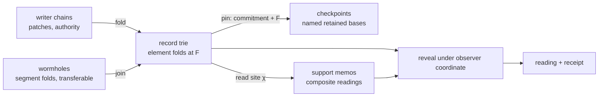

# Retained readings: the checkpoint system as a cache of folded causal cones

Status: proposed design record for goalpost #1044. Baseline: `feat/cone-bounded-runtime` at 906d24ea4 (goalpost #1039, draft PR #1040),
which already answers every public read and write from per-entity cone records. This record replaces the
whole-state checkpoint system; it does not reopen the decisions of #1039.

## Decision

git-warp has no whole-state checkpoint. Its checkpoint system is a store of **retained readings**: folds of
already-admitted history over bounded sites, each keyed by the question it answers, each derived from the
writer chains and discardable without loss. There are three kinds of retained reading, one data model
underneath them, and one retention authority (git-cas) above them:

| Kind | Site | Keyed by | Lives in |
| --- | --- | --- | --- |
| **Element fold** (a cone record) | one node, edge, adjacency page, dot page or admission tally | route key | the lane's record trie |
| **Support memo** | a composite reading: a neighbourhood page, a traversal window, an inventory page, a settlement footprint, an admission-inventory certificate | reading identity: optic slice, observer coordinate, law and reducer versions, dependency digests | a git-cas cache set per lane |
| **Wormhole** | a contiguous segment of one writer chain, folded onto its footprint | writer, segment bounds, fold law | a publication ref per segment, transferable |

A **checkpoint** is a named pin of a lane basis: the basis commitment and frontier retained under an
explicit name and lifetime. It copies nothing and materializes nothing.

The authoritative history is the writer chains. Everything in this record can be deleted and rebuilt from
them, and nothing in this record is ever transferred as truth. Compaction operates only on this derived
layer; patches, receipts, dots and tombstones are never retired by it.

## Why

### The mathematics

The AION papers and the Echo doctrine fix what a checkpoint may be and when it may be reused.

- **A reading is a slice.** Replaying only the patches in the backward cone `D(v)` of a value reproduces
  `v` with the full-replay values, given footprint completeness, no hidden writes and backward provenance
  completeness (Paper III, Theorem "Partial materialisation by slicing"). Every git-warp op names the one
  element it changes and every event id is unique, so the three hypotheses hold per element; the element fold
  is the slice payload of that element, reduced.
- **A checkpoint is a fold.** Admitted history may be re-expressed as a retained shell `θ' ≃_Λ θ` under an
  explicit retention contract `Λ`; folding changes the carrier, never the admitted situation, and preserves
  lawful readings exactly when `Λ` covers the observer plan and authority regime that will read it
  (Paper VII, "Commitment, Folding, Revelation"; Prop. "Folding preserves lawful readings"). A WARP hologram
  "preserve[s] the least sufficient boundary", never "an entire materialised world" (Paper VII,
  Def. "WARP hologram").
- **Reuse is cone containment, recomputation is the difference.** A cached cone serves any reading whose
  demanded value lies inside it; for partial overlap exactly the patches outside the cached cone are applied,
  in tick order (Paper III, §5.1 and Appendix B).
- **Validity across frontiers is interference-free transport.** A reading lowered at frontier `F` is reusable
  at `F' = F + S` only when no event in the suffix `S` touches the reading's policy-closed site: not just its
  writes, but what it read, what it found absent, and what it depended on remaining fixed (Observer Geometry
  II, Defs. "Interference", "Suffix Transport"; Echo `authored-operation-effects.md`, which compares slots
  rather than values so that a change followed by its restoration still invalidates). An unretained patch in
  the interval makes the written set unknown and forces recomputation.
- **A cached reading is scoped.** Its identity includes the causal coordinate, the optic or observer law, the
  aperture, the witness basis, the rights posture, the budget posture, the projection and reducer versions
  and the residual, plurality or obstruction posture; reuse for a question that differs in any of them is a
  defect, and reuse never bypasses an obstruction (Echo `sliced-readings-and-copy-on-write-strands.md`,
  Law 7; `there-is-no-graph.md`, "Graph-Shaped Readings").
- **Observers compose one way.** A cache built for observer `S₁` may serve `S₂` only when `S₂` is a structural
  coarsening of `S₁`; the reverse has a positive insufficiency floor (Observer Geometry I, Prop. "Aperture
  monotonicity"). Handing a budgeted or boundary observer a materialized bulk cone is a zero-cost translator
  it was not entitled to, which is the formal shape of a leak (Paper IV, Prop. "Boundary-to-bulk
  translation" and Remark).
- **Identity is causal, not structural.** Graph-identical states with different causal origins are distinct
  objects (Paper IV, §6.2 Remark); snapshot equality is an audit question, not a support guarantee (Observer
  Geometry III, Thm 5.4 Remark). A cache must be keyed by causal origin, never by state content alone, and
  equal state roots prove nothing.
- **Observation is revelation.** It projects history without mutating it (Paper VIII, Axiom "Observation
  Revelation"); a cache fill is never an admission and never writes to a writer chain.
- **Wormholes compress history, not state.** A wormhole is "a provenance-preserving compression of a
  multi-tick segment into a single edge labelled by a sub-payload" (Paper III, §6; Paper IV, §2.2). It may
  drop or move the patches inside the range but may not drop the receipts and witness the range stands for
  (Echo Law 10). The term is reserved for this and must not name portals or instance links (Echo TERMS).
- **Compaction is one-directional and declared.** Segments move Hot → Warm → Cold only forward and only
  after the pre-image verified (Paper VIII, Def. "Compaction Tiers", Thm "Verifiability Conservation"). Loss
  must be declared in the support ledger, never silent; undeclared loss served as full support is witness
  debt (Observer Geometry III, §4, §8). The Reintegration Core and Witness Core are never dropped; only the
  Receipt Shell may be redacted (Paper VIII, "The Witness Ladder").
- **A cache may change only wall-clock cost.** Cold and warm paths produce identical receipts, charges and
  read sets (Echo `authored-operation-effects.md`, "Scratch independence").

### Why the old system had to go

The whole-state checkpoint reduced every patch into one `WarpState`, serialized it as one `state.cbor`, and
on every refresh decoded the previous blob (capped at 5 MiB), replayed the suffix, and wrote a complete new
blob. Reads enumerated every node's property page before the first reading and rescanned the whole tail per
reading. None of this is a fold over a bounded site; all of it is the "hidden whole-state operation behind
names such as snapshot, replay basis, materialization" that #814 and #824 forbid. The evidence is in the
audit attached to #1039 and in #1034, #1035, #1036.

### What the cone branch left undone

#1039 made every public read and write cone-bounded, but its design record and the issue map record these
gaps, which this record closes:

1. Two retained representations coexist (the record trie and the materialization bundle) with no stated
   relation, against #739/#815 "pin, not copy".
2. The record store manages its own retention (a 64-entry ring of captured bases, an adapter-local
   `fast-import` writer, a WARP `doctor` check), against #734/#739/#741: git-cas owns cache policy, expiry,
   retention witnesses and sweep, and CI rejects WARP-owned cache lifecycle.
3. Receipts and `Coordinate` expose a Git tree OID (`coneRoot`) as basis identity, against #743/#817: basis
   identity is a domain commitment, not a storage byte identity.
4. Captured coordinates are not retained by name (#964, #966).
5. Nothing is cached above the element: every neighbourhood, traversal and inventory page is recomputed from
   records on every reading.
6. There is no compaction or GC story over records, and no wormhole.
7. A lane whose history removes a dot shared by two elements is permanently unreadable.
8. The first fold of a lane folds its whole history and a fresh receiver has no lawful shortcut, because
   derived refs are never transferred (#999).

## Vocabulary

The nouns below are the ones the design uses. Each is grounded in the sources cited above or in #392's
vocabulary ownership; new nouns are marked.

| Noun | Meaning here |
| --- | --- |
| Frontier `F` | Per writer chain, the last patch folded: `(sha, lamport)`. The coordinate of a lane basis. |
| Element | A node, an edge, an adjacency page, a dot page, an admission tally or admission record. The unit every op names. |
| Element fold (record) | The CRDT state of one element reduced from exactly the patches that name it, up to `F`. |
| Record trie | The address space of a lane's element folds at one frontier. It is an index of folds, not a materialized graph; it is never loaded whole. |
| Basis | `(commitment, F)`: a record trie root at a frontier. |
| Basis commitment *(new)* | The domain digest of a basis: BLAKE3 over the trie's canonical record digests, the frontier, the layout and the fold law version. Not a Git OID. |
| Checkpoint | A named, retained pin of a basis with an explicit lifetime. |
| Optic slice `χ` | The bounded site a reading judges: the elements it reads, including those it finds absent. |
| Reading identity *(new in code; from #392/#626)* | The question a reading answers: optic slice, observer coordinate, law and reducer versions, basis commitment. |
| Observer coordinate | `(basis, aperture, posture)`: what the reader is positioned over, what it may see, and `Scratch`, `AuthorOnly` or `Shared`. |
| Support memo *(new)* | A retained reading over a composite site, with the dependency digests that make its validity checkable. |
| Dependency set | The record keys a reading consulted, with the digest of each record as read. Absent records are members with the empty digest. |
| Wormhole | One writer's contiguous patch segment, folded onto its footprint, retained with its witness as a transferable shell. |
| Fold law version | The identity of the reducer semantics (op strategies, lifecycle rules, concurrency sets, layout). Part of every identity above. |
| Retention contract `Λ` | What a retained reading must still support: read, replay, audit, reveal. Encoded as the set of uses a memo kind serves. |
| Hot / Warm / Cold | Paper VIII's tiers. In git-warp, Warm (patches) is the native and authoritative tier; Hot is this derived layer; Cold is reserved. |

## Laws

Every rule the implementation enforces, with its source. The enforcement section says how each is tested.

1. **History primacy.** Writer chains are the only authority. Every retained reading is derived, rebuildable
   from them, and deletable without loss. No retained reading is transferred as truth. (Paper VIII Axiom 4.1;
   #731, #873, #999.)
2. **Fold law.** A retained reading is `θ' ≃_Λ θ`: it preserves the admitted situation over its site for the
   uses `Λ` names. Its identity is the reading identity, never a Git OID and never a state hash. Equal state
   roots are not equality. (Paper VII Def. "Shell equivalence"; Paper IV §6.2; OG-III Thm 5.4; #817, #743.)
3. **Slicing law.** An element fold is the reduction of exactly the patches that name the element. A reading
   over site `χ` reads only the folds of `χ`. Partial overlap with a retained reading recomputes exactly the
   patches outside it, in event order. (Paper III Thm "Partial materialisation by slicing".)
4. **Validity law.** A support memo at frontier `F` is valid at `F' ≥ F` iff no patch in `(F, F']` names an
   element of its dependency set. Equivalently: every dependency record's digest is unchanged between the
   two bases. A patch in the interval that is not retained makes validity unknown, and unknown means
   recompute. (OG-II "Interference"; Echo `authored-operation-effects.md`.)
5. **Revelation law.** Records and memos are commitment-level objects below the revelation boundary. Nothing
   public returns a record. A reading is revealed under an observer coordinate; a memo is keyed by that
   coordinate and serves only an identical coordinate, or a strict coarsening of it by post-composition. An
   `AuthorOnly` memo serves only its author. An obstruction is memoized as an obstruction and is never turned
   into a value by a cache. (Paper VII "Revelation"; OG-I Prop. "Aperture monotonicity"; Paper VIII App. B;
   Echo Law 7.)
6. **Evidence law.** A memo hit and a cold recomputation produce byte-identical receipts: the same basis
   commitment, frontier, dependency digests, posture and witness. Whether the cache was hit appears only in
   diagnostics. (Echo "Scratch independence"; #738 "warm reuse must be honest".)
7. **Observation law.** No read, fold, memo fill, wormhole creation or compaction writes to a writer chain
   or changes any admitted situation. (Paper VIII Axiom 4.6; Paper VII "revelation only".)
8. **Wormhole law.** A wormhole covers a contiguous segment of one writer chain; its delta is the fold of
   exactly that segment from the empty state; it names every patch sha it stands for; it is verified by
   deferred expansion (refold and compare) or accepted under an explicit reliance decision; it never replaces,
   rewrites or prunes the patches. Composition of consecutive wormholes is concatenation. (Paper III §6;
   Echo Law 10; TERMS "Wormhole reserved".)
9. **Compaction law.** Compaction acts on the Hot tier only: it releases retained readings and record versions
   under git-cas policy and declares what it released. It never retires a patch, receipt, dot, tombstone,
   braid member or import outcome. Cold (dropping patches behind a proof) is not permitted while membership
   retirement has no stability contract. (Paper VIII Def. 8.2, Thm 8.3; OG-III §4; #911, #885, #474.)
10. **Ownership law.** git-warp owns the meaning, schemas, keys, commitments and receipts of retained
    readings. git-cas owns their bytes, reachability, retention witnesses, capacity and TTL policy, sweep,
    doctor and repair. No WARP-owned LRU, page cache, shadow cache or write-on-read. (#734, #738, #739, #741.)
11. **Determinism law.** The bytes and identity of every retained reading depend only on the patch set and
    the fold law, never on fold order, memory addresses or arrival order. (Echo Law 9; #1039 "per-element
    joins commutative and idempotent".)
12. **Posture law.** Missing support is an obstruction or a rehydration requirement, never a silent fallback
    to a wider materialization. (Echo Law 6; #626 doctrine; #962.)

## Design

### The one representation

The record trie is the retained representation. A checkpoint pins it; a wormhole seeds it; a memo depends on
it. The materialization bundle, its index shards, `state.cbor` and the checkpoint-tail reader are deleted
(see "Deletion").

### Records and the trie

Records are the element folds of #1039 (node, edge, adjacency page, dot page, admission tally and record),
with these changes:

- **Canonical digest.** Every record encodes to canonical CBOR and carries no storage identity. Its digest is
  BLAKE3 of those bytes. Each trie directory page lists its children as `(name, kind, digest)`, so the root
  digest is a Merkle commitment over all records that is recomputed along the touched path only.
- **Canonical adjacency.** Adjacency pages hold sorted runs of edge keys with a fixed page capacity and are
  split and merged deterministically by key, so two clones folding the same patch set in different orders
  produce identical pages (Law 11). This replaces registration-order paging, whose page assignment depended
  on fold order and could not be joined across clones.
- **Joinable records.** Every record kind has a `join` that is the CRDT join of its parts: OR-Set entries and
  tombstones by union, LWW registers by event-id maximum, lifecycle events by their existing merge,
  concurrency sets by the fold rule, dot pages by union of claims, adjacency by set union, admission tallies
  by chain position. `join` is what makes wormholes and strand overlays composable: the fold of a
  concatenation equals the join of the folds.
- **Shared dots.** A dot removed for one element and later claimed by another is tombstoned in both. The dot
  page records the removal; a claim of a removed dot is folded as already dead. This is the reducer's global
  tombstone semantics made local and exact, and it replaces the permanent `ConeSharedDotObstruction`. The
  oracle compares it against a full reduction on generated histories with shared dots.
- **Storage.** Records are git-cas pages; directory pages are git-cas bundles whose members are child
  handles; a basis is one bundle `{ frontier, layout, commitment, records }`. A fold session writes the
  changed pages and the changed directories through `pages.putBatch` and `bundles.putOrderedBatch`, which
  use git-cas's bulk session. The adapter-local `fast-import` writer is removed. If measurement shows the
  nested-bundle write path costs more than one tree write per touched directory, the missing operation is a
  tree-edit write that git-cas owns, filed against git-cas, not an adapter-local process (#734).

### Basis, commitment and checkpoints

A **basis** is `(commitment, F)`. Its storage handle is the bundle handle; its identity is the commitment.

- The lane head `refs/warp/<lane>/cone/head` is published through `publications.commit` with
  compare-and-swap on the previous head. Strand bases and heads keep their `cone/strands/<id>/{base,head}`
  refs the same way. These are checkpoint heads in the sense of #975/#999: derived, clone-local, never
  transferred.
- `Coordinate` carries `(frontier, commitment)` and nothing else. `coneRoot` leaves the public surface.
  Receipts cite the commitment, the frontier and the digests of the records read. `Coordinate` portability
  across same-history clones is frontier-based: a receiver rebuilds or seeds its own basis to the same
  frontier and verifies the commitment matches, which is what #965 asks for without inventing a repository
  identity.
- A **checkpoint** is `retention.retain({ handle, root: { ref: refs/cas/rootsets/git-warp/<lane>/checkpoints,
  name }, policy })` of a basis bundle, with a name and a retention policy. `captureCoordinate()` creates a
  checkpoint with a generated name and `evictable` policy; `Runtime.checkpoint(name)` *(new)* creates a
  `pinned` one; `Runtime.releaseCheckpoint(name)` *(new)* removes it. The 64-entry ring is deleted. The
  `checkpointPolicy` option of #843 keeps its shape and acquires its honest meaning: `{ every: 64 }` pins an
  `evictable` checkpoint every 64 folded patches; `null` opts out. Capacity and expiry are git-cas policy on
  the RootSet and CacheSet, inspected by `doctor`.
- A saved coordinate reads at its checkpoint without a second capture (#966): the reading opens the retained
  bundle through a cache acquisition for the duration of the read.

### Support memos

A support memo retains a composite reading so that the next reading of the same site reuses it, and a
reading of an overlapping site reuses the part it shares.

- **Identity.** `ReadingIdentity = BLAKE3(kind, optic slice parameters, observer coordinate, fold law
  version, projection version)`. The observer coordinate is the aperture, the posture and, for `AuthorOnly`,
  the author. The basis is not in the key: validity is decided by the dependency set, so one memo serves
  every later frontier that left its dependencies untouched (Law 4).
- **Content.** The reading payload as revealed to that observer, the posture (`completed`, `obstructed`,
  `underdetermined`, with plurality), the receipt evidence (basis commitment and frontier at computation),
  and the dependency set `[(record key, digest)]` including absent records with the empty digest.
- **Kinds.** Neighbourhood pages (incident edge keys in canonical order, endpoint liveness, labels),
  traversal windows (the visited frontier of a bounded traversal), admission inventory pages and their
  certificates, settlement footprints, and the first page of every `Observation` that reads more than one
  record. Single-record readings are not memoized; the record is the memo.
- **Lookup.** `get(identity)`; then for every dependency, compare the stored digest with the record digest
  under the current basis (one trie lookup per dependency through the object session; absent means the empty
  digest). All equal: the memo is valid and its receipt is re-stamped with the current frontier and
  commitment, which by Law 4 is the receipt a cold computation would produce. Any difference: recompute, and
  reuse the unchanged part where the kind supports it (a neighbourhood page recomputes only the changed
  incident records; a traversal window recomputes from the first changed hop).
- **Fill.** After a cold computation, `put(identity, handle, { retention: 'evictable', expiresAt })` into the
  lane's cache set `git-warp/lanes/<lane>/readings`. Strand readings use `git-warp/strands/<id>/readings`.
  Fill is write-behind and never on the read path's critical section; a fill failure is a diagnostic, never a
  read failure.
- **Observer gating.** A memo is returned only to a reading whose observer coordinate equals the memo's.
  Coarsening (serving a redacted-aperture reader from a wider memo by applying its aperture) is a later,
  separately tested slice; until it lands, distinct coordinates have distinct memos. `AuthorOnly` memos live
  under the author's strand namespace. git-warp does not authenticate writers; the posture gate is enforced
  on the identity the Runtime was opened with, and the hosting application is responsible for binding that
  identity, which the documentation states plainly.
- **Policy.** Capacity, TTL and eviction belong to the git-cas cache set (`maxEntries`, `maxBytes`,
  `accessResolutionMs`). `Runtime.open` accepts a `readings` option that is passed to git-cas; git-warp
  keeps no in-process memo cache. Eviction is forgetting and costs a recomputation, never a wrong answer.

### Wormholes

A wormhole is the retained fold of one writer's contiguous segment, and the only retained reading that may
cross a clone boundary.

- **Shell.** `{ lane, writer, fromSha, toSha, patchCount, lamportRange, foldLawVersion, footprint (route
  keys), deltaCommitment, patchShas }` as a canonical page, plus the **delta**: the record trie produced by
  folding exactly that segment from the empty basis (Law 8). The shell's witness is the list of patch shas and
  the delta commitment; the Receipt Shell (host, timing, routing) is separate and redactable (Paper VIII,
  Witness Ladder).
- **Creation.** `git warp wormhole create --lane L --writer W --from A --to B` folds the segment in a bounded
  session and publishes the bundle under `refs/warp/<lane>/wormholes/<writer>/<toSha>` through
  `publications.commit`. A policy `wormholePolicy: { every: N }` *(new)* creates one per `N` patches of the
  local writer at fold time. Consecutive wormholes compose by joining their deltas and concatenating their
  witnesses (`wormhole compose`).
- **Use in ingest.** When `ConeIngest` advances a writer from position `p` to tip `t`, it first lists the
  writer's wormholes whose `fromSha` is the successor of `p`; it joins the largest covering delta into the
  records instead of decoding those patches, then continues with the remaining suffix. The result is identical
  to decoding every patch (oracle: `fold(P·Q) == join(fold(P), fold(Q))`).
- **Transfer.** The sync recipe gains an opt-in refspec for `refs/warp/<lane>/wormholes/<writer>/*`,
  fetched without force, never pruned. A received wormhole is a hologram, not truth: before `ingest` joins it,
  the receiver either verifies it by deferred expansion (refold the named patches, compare the delta
  commitment) or accepts it under a recorded reliance decision (`wormholeTrust: 'verify' | 'rely'`, default
  `verify`). Either way the receipt names which. This is the lawful fresh-clone shortcut: the patches arrive
  with the chains as today, and the receiver's first fold costs the wormholes' joins plus the uncovered tail
  rather than every patch.
- **Reserved.** The Cold tier (a commitment plus a transition proof replacing the patches) is not permitted by
  Law 9. The shell carries a `proof` slot that is `null`; `ZKWormholeService` and its types stay as the
  reserved vocabulary for that tier and are not reachable from any public path.

### Compaction and garbage collection

Compaction and GC act on the Hot tier. They are explicit operations, with receipts, under git-cas policy.

| Operation | What it releases | What it keeps | Receipt |
| --- | --- | --- | --- |
| Reading sweep | expired and over-capacity memos (`cache.sweep()`) | pinned memos | counts released and retained, bytes |
| Checkpoint release | named or expired `evictable` checkpoints (`rootSet.remove`, `sweep`) | `pinned` checkpoints, the current head | names released |
| Basis compaction | record versions reachable only from released bases (Git prune after `doctor` healthy) | every record reachable from a head or a checkpoint | object counts, via git-cas doctor |
| Wormhole compose | the component wormholes' refs once a composed one covers them and nothing names them | the composed wormhole and every patch | shas covered |
| Register sweep | dominated LWW registers below a node's retained clear (today's `executeGC` rule, per record) | membership entries, tombstones, lifecycle events, concurrency sets | registers pruned |
| Repository maintenance | pack count (#1041) | everything | Git's own |

Rules: no operation here reads or writes a writer chain; membership evidence is never retired (#911, #885);
every release is listed in a receipt that distinguishes released from retained (#474); a release that would
make a saved coordinate unreadable is refused unless the coordinate is released first. `doctor` reports basis
lag per writer (from #1039), memo hit rate and bytes, checkpoint count and policy satisfaction, and wormhole
coverage per writer, and recommends `wormhole create` when a writer's uncovered chain exceeds a threshold.

### Cold start and lazy folding

Two paths bound the first fold of a lane:

1. **Wormholes**, above, for the chains that have them.
2. **Lazy element folds** for a reading of a few entities out of a long uncovered chain. Each patch commit
   gains a `warp-footprint` trailer: the route-key prefixes of the elements its ops name, or a wildcard above
   a size cap. One `git log --format=%(trailers)` per writer screens a chain for the patches that name an
   element without decoding any patch; the fold then decodes only those. Records carry a per-writer
   `foldedThrough` position so a lazily folded record is correct for the frontier it names and is advanced on
   demand. The lane basis frontier remains the eager fold's frontier; a lazily folded record below it is
   finished before it is read.

Both keep the fold streaming: a writer range is listed and consumed as a stream, never collected into memory
(#824's external-memory workspace rule), which also removes the "holds each writer range in memory" limit.

### Settlement and strands

Strand overlays keep #1039's design: a strand basis path-copies its pinned base, and `join` makes the overlay
the join of base and strand folds. Two corrections follow from the issue map:

- `previewSettlement` and `settle` keep `settlement-common-basis-required` as their default when the target
  has moved; the footprint-records judgement becomes the explicit additive operation #970 asked for.
- The strand's pinned base is a `pinned` checkpoint in the lane's RootSet, released when the strand is
  dropped, so a strand never outlives its basis.

## Public surface

| Surface | Change |
| --- | --- |
| `Runtime.open` | options `checkpointPolicy` (kept, honest meaning), `readings` (git-cas cache policy), `wormholePolicy`, `wormholeTrust` |
| `Runtime.checkpoint(name)`, `releaseCheckpoint(name)`, `checkpoints()` | new: named retention of the current basis |
| `captureCoordinate()` | unchanged shape; now an `evictable` checkpoint |
| `Coordinate` | `(frontier, commitment)`; `coneRoot` removed |
| Receipts | cite commitment, frontier, dependency digests; identical cold or warm |
| `git warp checkpoint create|list|release`, `wormhole create|compose|verify|list`, `readings sweep|inspect`, `doctor` | new and extended CLI; `repair --action materialization` removed |
| Sync | opt-in wormhole refspec documented in `sync.md`; cone heads and checkpoints stay never-transferred |

Breaking: `Coordinate.coneRoot`, the 64-entry retention ring, `repair --action materialization`, layouts 1–4
(a head with an older layout is refused and rebuilt), and the shared-dot obstruction code (replaced by exact
folding).

## Deletion

The whole-state checkpoint system is 29,409 production lines in 202 files, plus about 2,500 lines of facade
and host plumbing, roughly a quarter of `src/`, with about 52,700 lines of tests, 1,900 lines of migration
scripts and one topic page. It is removed in this order; each step is safe once its boundary exists.

| Step | Delete | LOC | Boundary |
| --- | --- | ---: | --- |
| 1 | `repair --action materialization`, MCP `warp_repair` materialization, doctor `materialization-cache` and `coverage-complete` | ~480 | none: no public read needs them; `repair --action basis` already folds |
| 2 | Auto-checkpoint plumbing: `CheckpointPolicy` wiring in `RuntimeHostBoot`/`RuntimeHost`, `WarpGraph` option | ~150 | the honest `checkpointPolicy` of this record (slice 2) |
| 3 | Checkpoint-tail optics: `CheckpointTailOptic`, `CheckpointTailWitnessLocator`, scan, reducer, basis loader and verifier, the checkpoint-tail `ReadIdentity`, `CheckpointTailExactIdQueryReadModel`, `BoundedIntentGuardReader`, `OpticBasisPosture.checkpointTailBasisVerified` | ~5,300 | first move `CheckpointTailTraversalReader` and `parseNeighborhoodLimit` into the cone optics; `QueryController`'s exact-id path and `WarpWorldline.admitIntent` read records; `advanced.ts` narrows `Witness` to the cone identity |
| 4 | Index shards and bitmap index: `MaterializationIndexRoots`, the property, meta, life, fwd, rev, edge and label shard families and their readers | 6,430 | after 3, and after the facades stop calling `neighbors()`/`query()` through `BitmapNeighborProvider`; `NeighborProviderPort` stays |
| 5 | Whole-state checkpoint core: `CheckpointController`, `checkpointCreate`/`checkpointLoad`, `CheckpointSerializer`, `CborCheckpointStoreAdapter`, `CheckpointStorePort`, `WarpStateCborCodec`, `CborFullStateLifecycleDecoder`, `WarpStateCachePort`, `WarpStateSnapshotIndex`, `CheckpointCapability`, the checkpoint, coverage and state-cache ref builders (reserved name segments stay) | 2,860 | after 1–4; `StateSerializer` stays for the cone, BTR and comparison; `ForkController`'s checkpoint-head guards re-point at the cone frontier; `V18CheckpointSeed` writes nothing |
| 6 | Materialization controller and git-cas memo store, the trie `StateSession`, the seek cursor, `StrandMaterializer`, `RuntimeHost.materialize*`/`_cachedState`, the `WarpGraph`/`WarpCore`/`WarpApp` facades, `detachedOpen`, `ProjectionHandle`, the legacy query `Observer` and aperture paths | ~16,000 | the hardest boundary: `DotRepairService` reads collisions from dot pages; `ProvenanceController.materializeSlice`, `ComparisonSelector` and `BtrOperations` stream records in canonical order with a bounded merge join (#817); `SyncController`, `BisectService` and the internal `StrandCapability` move to the cone or are deleted with the facades; the performance scripts and the memory test adapter follow |
| 7 | GC over `_cachedState`: `GCPolicy`, `GCMetrics`, `executeGC`, `executeGCInSession`, the facade `runGC`/`maybeRunGC` | 400 | after 6; `deadPropertySweep` and `WarpState.compactDeadProperties` stay as the specification of the per-record register sweep |

Kept, as the boundary of the deletion: `JoinReducer.applyFast`/`reducePatches`, `WarpState`, `ORSet`, `LWW`,
`StateReader`, `StateSerializer`, the lifecycle rules, `KeyCodec`, `RouteKey`, `ProvenancePayload`,
`ProvenanceIndex` and BTR, `NeighborProviderPort`, `OpticBasisPosture.coneBasis`, and the patch and anchor
kinds of the commit-message codec. `WormholeService`'s in-memory `WormholeEdge` (#207) is replaced by the shell
above; `ZKWormholeService` stays as reserved vocabulary.

Migration and export become streaming operations over writer chains and records. Legacy checkpoint refs and
materialization caches are left in place, ignored, reported by `doctor` as removable, and deleted by an explicit
`repair --action retire-legacy`. `cas-first-memoized-materialization.md` is removed and
`v19-1-performance-architecture-witness.md` is marked historical.

## Enforcement

- **Traps.** The existing trap test gains traps on every deleted symbol's replacement boundary and on
  `scanPatchHistory`; every public read and write, with memos warm and cold, with and without wormholes, on
  worldlines and strands, records zero hits.
- **Oracles.** The equivalence oracle extends to: `fold(P·Q) == join(fold(P), fold(Q))` for random segment
  cuts (wormholes); shared-dot histories against full reduction; adjacency pages identical across fold
  interleavings; memo validity (a memo judged valid produces the same reading and receipt as a cold
  recomputation; a memo judged invalid differs from the cold result in at least one dependency); lazy element
  folds equal to eager ones.
- **Evidence.** A property test asserts byte-identical receipts for a reading served cold, warm from a memo,
  and after a wormhole seed.
- **Observer tests.** A memo filled under one aperture is not served to a different aperture; an `AuthorOnly`
  strand memo is not served to another writer identity; an obstruction stays an obstruction on a hit.
- **Retention tests.** Named checkpoints survive `git gc --prune=now`; released ones are collectible; a read at
  a released coordinate obstructs with a named posture; policy satisfaction is reported by `doctor`.
- **Cost witness.** The showcase witness gains a warm-memo column, a wormhole-seeded cold open, and a
  compaction run; per-read and per-save git processes stay flat across 200, 2,000 and 20,000 threads, and a
  fresh clone's first read with wormholes costs the uncovered tail, not the history.
- **CI.** The WARP-owned-cache check (#734) stays green: no ref under `refs/warp` is a cache, no WARP LRU
  exists, and every retention goes through git-cas.

## Slices

Each is one independently mergeable PR on `feat/cone-bounded-runtime`; the goalpost tracks them.

1. **Canonical records and commitment.** Record digests, Merkle directory pages, canonical adjacency,
   `join` per record kind, basis commitment; `Coordinate` and receipts cite the commitment. Oracle for join and
   determinism.
2. **git-cas-owned storage.** Records and bases through pages, bundles and `publications.commit`; named
   checkpoints through `retention.retain`; the ring and the adapter-local writer deleted; `checkpointPolicy`
   with its honest meaning.
3. **Support memos.** Reading identity, dependency sets, the lane and strand cache sets, memoized
   neighbourhood, traversal, inventory and settlement-footprint readings, observer gating, the evidence
   property test.
4. **Wormholes.** Shell and delta, create/compose/verify, ingest consumption, the opt-in refspec and the
   reliance option, the fresh-clone witness.
5. **Compaction and GC.** Sweep, release, basis compaction, register sweep, receipts, `doctor` reports.
6. **Shared dots and lazy folds.** Exact shared-dot folding replacing the obstruction; footprint trailers and
   lazy element folds; streaming writer ranges.
7. **Deletion.** The inventory above, migration and export over records, `retire-legacy`.
8. **Settlement default restored** (#970) and documentation: `cone-bounded-reads.md`, `sync.md`, `cli.md`,
   `troubleshooting.md`, the operations README, CHANGELOG.

Slices 1 and 2 are prerequisites of 3, 4 and 5; 6 and 8 are independent; 7 follows 2, 3 and 4 because the
deleted paths' last consumers move in those slices.

## Open questions

- Whether git-cas should gain a tree-edit write for path-copying a trie directory, or whether nested
  `bundles.putOrderedBatch` is already within budget; measured in slice 2.
- Memo coarsening across apertures: lawful by OG-I, but it needs the aperture to be a total function on the
  memo's payload; deferred until a consumer needs it.
- The wormhole `every: N` default, and whether wormholes should be created for other writers' chains locally
  (lawful, since they are derived) or only by each writer for its own chain (simpler trust).
- Whether `warp-footprint` trailers belong in the patch format version (write-time) or in a clone-local
  derived index (fold-time) for existing histories; slice 6 does the latter for history and the former for new
  patches.
