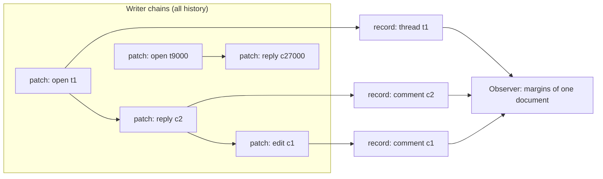

# Cone-bounded reads and writes

Use this page when you build an application on `Runtime` and want to know what
a write or a read costs, and why there is no materialize or repair step in the
intended usage.

> [!NOTE]
> This page describes the cone-bounded Runtime goalpost
> ([#1039](https://github.com/git-stunts/git-warp/issues/1039),
> [design record](../plans/cone-bounded-runtime.md)). Every client-facing path
> now runs on cone records: `lane.write`, every Observation and Reading,
> content Observations, `captureCoordinate`, `Runtime.fork`, strand Lanes,
> `previewSettlement`, `settle` and the entity admission inventory. None of
> them creates, verifies or loads a checkpoint, materializes the graph or walks
> writer history. Records also keep concurrent edits, so Readings report
> [plurality](#concurrent-edits). The [witness](#measure-it) records what the
> current build does.

## The usage in one line

Write intents, observe bounded readings, keep receipts.

- **Write intents.** A user action is one generated Intent array. One
  `lane.write` publishes it as one patch and returns one `WriteReceipt`.
- **Observe bounded readings.** A screen is a few generated Observers. Each
  names the entities it needs, such as a document, its threads, and their
  comments. It never asks about the whole graph.
- **Keep receipts.** Writes and Observations both return receipts that cite
  the causal basis they used. Keep them as your audit trail.

The [annotations example](../../examples/annotations/) does all three. It is a
margin-notes store shared by two clones through a Git hub. The application
code imports only `Runtime` from the package root, plus the generated SDK in
`examples/annotations/sdk/`. It has no `advanced` imports, no materialization
and no repair step.

## Causal cones

Every patch operation names the element it changes. `NodeAdd`, `NodeRemove`
and a node property set name one node. `EdgeAdd`, `EdgeRemove` and an edge
property set name one edge and its two endpoints. The CRDT join is computed
per element: the add and remove dots of one element, the last-writer-wins
register of one property, and the lifecycle of one node.

So an element's state depends only on the patches that name it. That set of
patches is the element's **causal cone**. A Reading about a comment's `body`
needs the cone of that comment. It does not need the 20,000 other threads.



git-warp keeps one small **record** per node and per edge, holding exactly that
element's join state, in a Git tree keyed by a hash of the element's id. The
record set and the per-writer position it has folded up to make up the clone's
**cone basis**, kept under `refs/warp/<lane>/cone/head`. The basis is derived
and local to the clone. It is never transferred; see
[ownership and transport](sync.md#ownership-and-transport).

## Why there is no repair or materialize step

A whole-state checkpoint answers every question at once, so it has to be
rebuilt whenever anything changes, and it grows with the graph. A cone basis
only has to cover what changed:

- **Opening** needs nothing prepared. A clone with no cone basis starts from
  the empty one and folds writer history forward the first time it is used.
- **After a write**, the clone folds its own new patch straight into the
  records that patch names.
- **After receiving** other writers' chains through the
  [sync refspecs](sync.md), the next read or write folds each received patch
  once into the records it names. Nothing has to be rebuilt by hand.

Nothing in this model needs a repair step to stay correct. Two optional
commands exist for operators:

- `git warp repair --lane <name> --action basis` folds the patches a clone has
  not folded yet, ahead of the next read, and reports how many it folded. It is
  bounded by those patches, never by the graph.
- `git warp doctor` reports `cone-basis-lag`: per writer, how many patches the
  basis trails. Lag is a cost forecast, not a fault; a writer chain that no
  longer extends what the basis folded is a fault.

When a patch cannot be folded per element (for example a dot shared by two
elements), reads and writes return an obstructed receipt with a repair hint.
They never fall back to a checkpoint or a materialization.

`git warp repair --action materialization` remains a maintenance tool for
global, whole-state work. An application read path should never need it.

## Concurrent edits

Each Lane patch records the writer heads it observed. A record keeps, beside
each property's last-writer-wins register, the writes to that register that no
other write to it observed, and the same for its lifecycle: removes against
adds and edits. That set is the register's maximal antichain under
happens-before, so two clones with the same patches keep the same set
whatever order they folded them in. A write that observed every member retires
them all.

- A **Reading** keeps its LWW value and reports the hidden siblings in
  `plurality` (see [querying](querying.md#see-concurrent-edits)). A delete that
  raced an edit is reported too.
- A **write** that only sets properties records the basis this clone held when
  it began. If the records then hold a value or remove it never observed, it is
  admitted `plural` with a `PluralityWitness` naming its own publication and
  the raced patches, and its receipt lists the values. Both values stay
  visible as siblings; nothing is silently replaced.
- **Bounds.** At most one member per writer chain is concurrent, and each set
  keeps at most 16 with their values. More are evicted to a per-chain clock and
  reported as `overflow`, never dropped silently. A member whose patch recorded
  no observed frontier (older or facade writes) makes the plurality
  `underdetermined`. A strand patch counts as having observed its strand's
  pinned base.

Retaining the sets costs a few more bytes per record written; the fold reads
no extra record for them.

## Forks, strands and settlement

A strand is a private line of work forked from a lane. It runs on cone bases
too:

- **`Runtime.fork`** captures one lane basis and pins it as the strand's base
  (`refs/warp/<lane>/cone/strands/<id>/base`). Pinning writes one ref and no
  records.
- **Strand reads and writes** use the strand's own basis
  (`cone/strands/<id>/head`): the pinned base plus the strand's own patches.
  Its record tree shares every untouched record with the base, so a strand
  costs only what it changes.
- **Settlement** is identified by frontiers: the base, the strand and the
  target lane. `previewSettlement` reads only the records of the nodes and
  edges the strand's patches name, under the base and the current target. If
  the target has not changed any of them since the fork, the preview is
  `derived`; otherwise it reports the conflict. `settle` replays the strand's
  patches through the target's cone basis.

A saved Coordinate keeps its basis reachable: `captureCoordinate()` records
it under the clone-local `refs/warp/<lane>/cone/retained`, which keeps the last
64 captured bases through `git gc`. Dropping a strand releases its cone refs.
All of these refs are clone-local and never transferred.

## Storage cost

Records live in an adaptive Git tree trie (16-way on the record's hash, with
buckets of up to 32 records). Record reads go through one long-lived
`git cat-file` session, so a read starts no Git process per record. Each
record write is one `git fast-import`, which writes every changed tree once.
Every basis head carries a layout marker; a head written by an older layout is
refused with `E_CONE_LAYOUT_UNSUPPORTED`, and deleting that ref lets the clone
fold it again.

Known limit: git-warp starts no repository maintenance. A large bulk import
leaves one pack per batched fold, and every Git process pays for each pack it
searches, so saves slow down by a few milliseconds per thousand packs until
`git gc` or `git repack` runs. This is tracked by
[#1041](https://github.com/git-stunts/git-warp/issues/1041).

## What costs scale with

| Operation | Cost grows with | Cost does not grow with |
| --- | --- | --- |
| `lane.write` of one action | The entities the action names, and patches new since this clone last looked | Total entities, total history |
| One Reading (property, node, neighbourhood page) | The records it reads; a neighbourhood page also reads its edges and their endpoints, up to the page limit | Total entities, total history |
| One document's margins | The document's threads and comments | Other documents |
| One entity admission inventory page | The page's admissions, plus one batch of index records per writer chain | Total history, non-admitting patches |
| `Runtime.open` | Nothing; the basis is not loaded up front | Graph size |
| First use after receiving | The received patches (folded once) | Earlier history |

Global questions remain global: label scans, whole-graph traversal and
export. They keep their own plans and support rules and are not answered from
a cone. The [entity admission inventory](entity-admission-inventory.md) is the
one inventory the cone answers: every fold appends a patch's `entity.add`
admissions to its writer chain's admission index, and an inventory pages that
index under a declared limit instead of scanning history.

Model your data so the common screens are bounded questions:

- Make membership an **edge** (`document → thread → comment`), not a list
  property. Two writers adding comments at the same time both survive, and a
  neighbourhood page reads only that thread's comments.
- Store **one property per field**. Editing a comment body writes one register.
- **Page** neighbourhoods with an explicit limit and follow the cursor. The
  example's `threadCommentPage` Observer does this.
- Delete with `edge.remove` and then `node.remove`, so the comment leaves its
  thread's neighbourhood.

## Measure it

The cone showcase witness builds annotation histories of 200, 2,000 and
20,000 threads across three writers. It then measures, through the public API
only:

- one-patch saves, at p50 and p95;
- reads of one document's margins, at p50 and p95;
- a cold open: a fresh process timed to its first margins read;
- Git processes per save and per read;
- RSS.

Every document has ten threads, so a document's margins are the same size at
every scale and only the rest of the graph grows. The claim under test is that
the cost of one save and one read stays flat from 2,000 to 20,000 threads.

The initial load is batched, 50 actions per patch, and labelled as such. Every
measured save is one action in one patch. Git processes are counted at the
`@git-stunts/plumbing` process boundary, the same boundary that
`scripts/performance/PerformanceRuntime.ts` counts.

Run it with one command. It builds a COPY-based image, runs the annotations
example, then runs one bounded container per scale (4 CPUs, 6 GiB, a 4 GiB
generated-data budget, and timeouts of 10, 20 and 30 minutes):

```bash
npm run witness:cone-showcase            # 200, 2000 and 20000 threads
npm run witness:cone-showcase -- 2000    # one scale
```

The results go to `.ratchet/cone-showcase/<label>-<pid>/`: one
`cone-showcase-<N>.json` per scale, `summary.md`, and the logs. Retained
results are in
[benchmarks/cone-showcase/results](../../benchmarks/cone-showcase/results/):
the baseline taken before public reads moved onto cone records
(`before-17084f178`), the slice 2 and 3 build before the storage work
(`after-e36380add`), and the integrated build.

To run only the example:

```bash
npm run example:annotations
```

## See also

- [Getting started](getting-started.md)
- [Sync](sync.md)
- [Generated domain SDKs](../migrations/v19/README.md#generated-domain-sdks)
- [Cone-bounded Runtime design record](../plans/cone-bounded-runtime.md)
