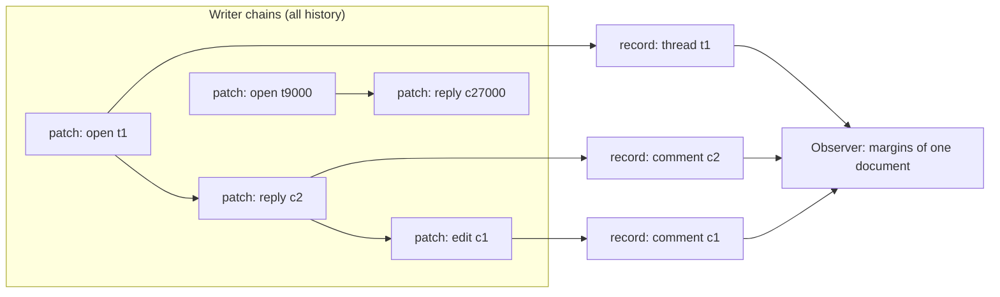

# Cone-bounded reads and writes

Use this page when you build an application on `Runtime` and want to know what
a write or a read costs, and why there is no materialize or repair step in the
intended usage.

> [!NOTE]
> This page describes the model of the cone-bounded Runtime goalpost
> ([#1039](https://github.com/git-stunts/git-warp/issues/1039),
> [design record](../plans/cone-bounded-runtime.md)). Slice 1, the cone
> records and their ingest, has landed. The public read and write paths are
> moving onto those records in slices 2 and 3. Until those slices land, a public
> read still needs a checkpoint basis and `edge.remove` still obstructs; the
> [witness](#measure-it) records exactly what the current build does.

## The usage in one line

Write intents, observe bounded readings, keep receipts.

- **Write intents.** A user action is one generated Intent array. One
  `lane.write` publishes it as one patch and returns one `WriteReceipt`.
- **Observe bounded readings.** A screen is a few generated Observers. Each
  names the entities it needs, such as a document, its threads, and their
  comments. It never asks about the whole graph.
- **Keep receipts.** Writes and Observations both return receipts that cite
  the causal basis they used. Keep them as your audit trail.

The [annotations example](../../examples/annotations/) does all three. It is a
margin-notes store shared by two clones through a Git hub. The application
code imports only `Runtime` from the package root, plus the generated SDK in
`examples/annotations/sdk/`. It has no `advanced` imports, no materialization
and no repair step.

## Causal cones

Every patch operation names the element it changes. `NodeAdd`, `NodeRemove`
and a node property set name one node. `EdgeAdd`, `EdgeRemove` and an edge
property set name one edge and its two endpoints. The CRDT join is computed
per element: the add and remove dots of one element, the last-writer-wins
register of one property, and the lifecycle of one node.

So an element's state depends only on the patches that name it. That set of
patches is the element's **causal cone**. A Reading about a comment's `body`
needs the cone of that comment. It does not need the 20,000 other threads.



git-warp keeps one small **record** per node and per edge, holding exactly that
element's join state, in a Git tree keyed by a hash of the element's id. The
record set and the per-writer position it has folded up to make up the clone's
**cone basis**, kept under `refs/warp/<lane>/cone/head`. The basis is derived
and local to the clone. It is never transferred; see
[ownership and transport](sync.md#ownership-and-transport).

## Why there is no repair or materialize step

A whole-state checkpoint answers every question at once, so it has to be
rebuilt whenever anything changes, and it grows with the graph. A cone basis
only has to cover what changed:

- **Opening** needs nothing prepared. A clone with no cone basis starts from
  the empty one and folds writer history forward the first time it is used.
- **After a write**, the clone folds its own new patch straight into the
  records that patch names.
- **After receiving** other writers' chains through the
  [sync refspecs](sync.md), the next read or write folds each received patch
  once into the records it names. Nothing has to be rebuilt by hand.

`git warp repair --action materialization` remains a maintenance tool for
global, whole-state work. An application read path should never need it.

## What costs scale with

| Operation | Cost grows with | Cost does not grow with |
| --- | --- | --- |
| `lane.write` of one action | The entities the action names, and patches new since this clone last looked | Total entities, total history |
| One Reading (property, node, neighbourhood page) | The records it reads; a neighbourhood page also reads its edges and their endpoints, up to the page limit | Total entities, total history |
| One document's margins | The document's threads and comments | Other documents |
| `Runtime.open` | Nothing; the basis is not loaded up front | Graph size |
| First use after receiving | The received patches (folded once) | Earlier history |

Global questions remain global: label scans, whole-graph traversal, inventories
and export. They keep their own plans and support rules and are not answered
from a cone.

Model your data so the common screens are bounded questions:

- Make membership an **edge** (`document → thread → comment`), not a list
  property. Two writers adding comments at the same time both survive, and a
  neighbourhood page reads only that thread's comments.
- Store **one property per field**. Editing a comment body writes one register.
- **Page** neighbourhoods with an explicit limit and follow the cursor. The
  example's `threadCommentPage` Observer does this.
- Delete with `edge.remove` and then `node.remove`, so the comment leaves its
  thread's neighbourhood.

## Measure it

The cone showcase witness builds annotation histories of 200, 2,000 and
20,000 threads across three writers. It then measures, through the public API
only:

- one-patch saves, at p50 and p95;
- reads of one document's margins, at p50 and p95;
- a cold open: a fresh process timed to its first margins read;
- Git processes per save and per read;
- RSS.

Every document has ten threads, so a document's margins are the same size at
every scale and only the rest of the graph grows. The claim under test is that
the cost of one save and one read stays flat from 2,000 to 20,000 threads.

The initial load is batched, 50 actions per patch, and labelled as such. Every
measured save is one action in one patch. Git processes are counted at the
`@git-stunts/plumbing` process boundary, the same boundary that
`scripts/performance/PerformanceRuntime.ts` counts.

Run it with one command. It builds a COPY-based image, runs the annotations
example, then runs one bounded container per scale (4 CPUs, 6 GiB, a 4 GiB
generated-data budget, and timeouts of 10, 20 and 30 minutes):

```bash
npm run witness:cone-showcase            # 200, 2000 and 20000 threads
npm run witness:cone-showcase -- 2000    # one scale
```

The results go to `.ratchet/cone-showcase/<label>-<pid>/`: one
`cone-showcase-<N>.json` per scale, `summary.md`, and the logs. Retained
results, starting with the baseline taken before slices 2 and 3, are in
[benchmarks/cone-showcase/results](../../benchmarks/cone-showcase/results/).

To run only the example:

```bash
npm run example:annotations
```

## See also

- [Getting started](getting-started.md)
- [Sync](sync.md)
- [Generated domain SDKs](../migrations/v19/README.md#generated-domain-sdks)
- [Cone-bounded Runtime design record](../plans/cone-bounded-runtime.md)
